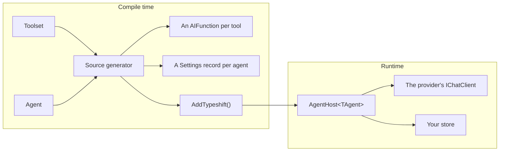

# Getting started

In four steps you build an agent that looks up the companies of a city. You write the tool as a C# method and the
agent as a class that offers it. Typeshift generates the rest: the schema the model reads, a typed `Configure` call
for the tool's settings, and the registration.

## 1. Install

Add the package to the project that will hold your agent:

```bash
dotnet add package Typeshift --prerelease
```

Typeshift needs .NET 11, and its types are in the `Typeshift` namespace, so add `using Typeshift;` to your files. A
solution of several projects needs the package in each project that declares toolsets or agents
([Project setup](./registration.md#project-setup)).

Next to your solution, create a `Directory.Build.props` that turns on XML docs, because the model reads each tool's
description from them. The same file sets the type of the ids you pass to runs. This tutorial uses `int`, which keeps
the ids in its examples short:

```xml
<Project>
  <PropertyGroup>
    <GenerateDocumentationFile>true</GenerateDocumentationFile>
    <!-- Ids are Guids unless you name another type. This sample uses int. -->
    <TypeshiftIdType>int</TypeshiftIdType>
  </PropertyGroup>
</Project>
```

## 2. Write a toolset

A toolset groups the tools of one domain. This one has a single tool, `FindCompanies`, whose XML docs tell the model
what it does. Put it in a file of its own:

<!-- snippet: quickstart-toolset -->
<a id='snippet-quickstart-toolset'></a>
```cs
internal partial class CompanyToolset : Toolset
{
    public CompanyToolset()
    {
        WithDisplayName("Companies");

        AddTool(FindCompanies)
            .WithSettings<FindCompaniesSettings>()
            .Configurable(s => s.Limit);
    }

    /// <summary>
    /// Finds the companies of a city.
    /// </summary>
    /// <param name="city">The city the companies are based in.</param>
    public static IReadOnlyList<Company> FindCompanies(string city, FindCompaniesSettings settings) =>
    [
        .. Companies
            .Where(company => company.City.Equals(city, StringComparison.OrdinalIgnoreCase))
            .Where(company => company.Active || settings.IncludeInactive)
            .Take(settings.Limit)
    ];

    private static readonly Company[] Companies =
    [
        new("Danube Robotics", "Vienna", Active: true),
        new("Prater Motion", "Vienna", Active: true),
        new("Graz Gearworks", "Graz", Active: false)
    ];
}

internal sealed record Company(string Name, string City, bool Active);
```
<sup><a href='https://github.com/weboost-at/Typeshift/blob/main/samples/Typeshift.Samples.Docs/Quickstart/CompanyToolset.cs#L3-L36' title='Snippet source file'>snippet source</a> | <a href='#snippet-quickstart-toolset' title='Start of snippet'>anchor</a></sup>
<!-- endSnippet -->

From the method and its docs, Typeshift builds the tool the model calls, `find_companies`, with a schema for `city`.
You write no schema and no `AIFunctionFactory` call. The class is `partial` because Typeshift adds members to it.

The model never sees the last parameter, `FindCompaniesSettings`. Typeshift fills it in when it calls the tool, from
this record's defaults and whatever your code and your stored settings change:

<!-- snippet: quickstart-settings-record -->
<a id='snippet-quickstart-settings-record'></a>
```cs
internal record FindCompaniesSettings
{
    public int Limit { get; init; } = 5;

    public bool IncludeInactive { get; init; }
}
```
<sup><a href='https://github.com/weboost-at/Typeshift/blob/main/samples/Typeshift.Samples.Docs/Quickstart/FindCompaniesSettings.cs#L3-L10' title='Snippet source file'>snippet source</a> | <a href='#snippet-quickstart-settings-record' title='Start of snippet'>anchor</a></sup>
<!-- endSnippet -->

`Configurable(s => s.Limit)` in the toolset lets stored settings and single runs change `Limit`. `IncludeInactive`
changes only in code.

## 3. Write an agent

An agent picks its model, its instructions and the toolsets it offers, all in its constructor:

<!-- snippet: quickstart-agent -->
<a id='snippet-quickstart-agent'></a>
```cs
internal partial class ResearchAgent : Agent
{
    public ResearchAgent()
    {
        WithDescription("Researches the companies of a city.");

        WithChatOptions()
            .WithModel("openai", "gpt-5-mini")
            .WithTemperature(0.2f)
            .Configurable(o => o.Instructions)
            .Configurable(o => o.Temperature);

        UseToolset<CompanyToolset>();

        ConfigureFindCompanies()
            .WithLimit(3);
    }

    protected override string GetInstructions() =>
        """
        Find companies with the find_companies tool and list them.
        """;
}
```
<sup><a href='https://github.com/weboost-at/Typeshift/blob/main/samples/Typeshift.Samples.Docs/Quickstart/ResearchAgent.cs#L3-L27' title='Snippet source file'>snippet source</a> | <a href='#snippet-quickstart-agent' title='Start of snippet'>anchor</a></sup>
<!-- endSnippet -->

- `WithModel("openai", "gpt-5-mini")` names a provider and the model as that provider calls it. Step 4 registers the
  client for `"openai"`.
- The two `Configurable` calls let stored settings change the instructions and the temperature. The model stays as
  the code sets it.
- `ConfigureFindCompanies()` exists because the agent offers `CompanyToolset`. Typeshift adds a `Configure` method
  for each tool with settings that the agent offers, and `WithLimit(3)` lowers this agent's limit from the record's 5.

Call one for a tool the agent doesn't offer, such as a ticket search, and the build fails:

```text
ResearchAgent.cs(18,9): error CS0103: The name 'ConfigureSearchTickets' does not exist in the current context
```

## 4. Register and run

`AddTypeshift()` registers every toolset and agent of your project. Chain a store to it, then register the chat
client of the agent's provider under the provider's name:

<!-- snippet: quickstart-clients -->
<a id='snippet-quickstart-clients'></a>
```cs
var services = new ServiceCollection();

services.AddTypeshift()
    .WithStore<InMemoryTypeshiftStore>();

services.AddKeyedChatClient("openai", new CannedChatClient());

await using var provider = services.BuildServiceProvider(validateScopes: true);
```
<sup><a href='https://github.com/weboost-at/Typeshift/blob/main/samples/Typeshift.Samples.Docs/Quickstart/Quickstart.cs#L11-L20' title='Snippet source file'>snippet source</a> | <a href='#snippet-quickstart-clients' title='Start of snippet'>anchor</a></sup>
<!-- endSnippet -->

`InMemoryTypeshiftStore` keeps settings and conversations in memory, which is enough until your app has a database.
A console app also needs the `Microsoft.Extensions.DependencyInjection` package for `BuildServiceProvider`.

`CannedChatClient` is a fake from the docs samples, so they run without a network. In your app, register your
provider's client instead. For OpenAI, with the `Microsoft.Extensions.AI.OpenAI` package, that is:

<!-- snippet: openai-client -->
<a id='snippet-openai-client'></a>
```cs
var openAi = new OpenAIClient(apiKey)
    .GetChatClient("gpt-5-mini")
    .AsIChatClient();

services.AddKeyedChatClient("openai", openAi);
```
<sup><a href='https://github.com/weboost-at/Typeshift/blob/main/samples/Typeshift.Samples.Docs/Scenarios/Models.cs#L31-L37' title='Snippet source file'>snippet source</a> | <a href='#snippet-openai-client' title='Start of snippet'>anchor</a></sup>
<!-- endSnippet -->

The key `"openai"` is a name you choose, and it has to match the provider the agent names in `WithModel`.
[Registering clients](./models.md#registering-clients) shows other providers, local servers and one client for
every agent.

You configure and run the agent through its host, `AgentHost<ResearchAgent>`. Resolve it from a scope, and store a
lower limit under settings id 42, for example one of your customers. In a web app, you take the host as a constructor
parameter instead ([Using an agent](./using-an-agent.md)):

<!-- snippet: quickstart-settings -->
<a id='snippet-quickstart-settings'></a>
```cs
await using var scope = provider.CreateAsyncScope();
var research = scope.ServiceProvider.GetRequiredService<AgentHost<ResearchAgent>>();
var settingsId = 42;

await research.ConfigureAsync(settingsId, settings => settings with
{
    Temperature = 0.4f,
    FindCompanies = settings.FindCompanies with { Limit = 2 }
});
```
<sup><a href='https://github.com/weboost-at/Typeshift/blob/main/samples/Typeshift.Samples.Docs/Quickstart/Quickstart.cs#L22-L32' title='Snippet source file'>snippet source</a> | <a href='#snippet-quickstart-settings' title='Start of snippet'>anchor</a></sup>
<!-- endSnippet -->

`ConfigureAsync` loads the agent's generated `ResearchAgent.Settings` record, which holds only what the code marked
`Configurable`, applies your change and saves it. Now run the agent with that settings id, in conversation 1:

<!-- snippet: quickstart-run -->
<a id='snippet-quickstart-run'></a>
```cs
var answer = await research.RunAsync("Vienna", settingsId, conversationId: 1);

Console.WriteLine($"{research.Agent.Name}: {answer.Text}");
```
<sup><a href='https://github.com/weboost-at/Typeshift/blob/main/samples/Typeshift.Samples.Docs/Quickstart/Quickstart.cs#L34-L38' title='Snippet source file'>snippet source</a> | <a href='#snippet-quickstart-run' title='Start of snippet'>anchor</a></sup>
<!-- endSnippet -->

```text
research_agent: Found Danube Robotics and Prater Motion.
```

The model called `find_companies` with `Vienna`, and the tool ran with the stored limit of 2 over the agent's 3 and
the record's 5. A later run with conversation id 1 continues this conversation
([Conversations](./conversations.md)). A run can also pass settings of its own, for that run only, over the stored
ones:

<!-- snippet: quickstart-run-settings -->
<a id='snippet-quickstart-run-settings'></a>
```cs
var run = new ResearchAgent.Settings
{
    FindCompanies = new CompanyToolset.FindCompaniesOverrides { Limit = 1 }
};

await foreach (var update in research.RunStreamingAsync("Vienna", settingsId, settings: run))
    Console.Write(update.Text);
```
<sup><a href='https://github.com/weboost-at/Typeshift/blob/main/samples/Typeshift.Samples.Docs/Quickstart/Quickstart.cs#L40-L48' title='Snippet source file'>snippet source</a> | <a href='#snippet-quickstart-run-settings' title='Start of snippet'>anchor</a></sup>
<!-- endSnippet -->

```text
Found Danube Robotics.
```

[Settings layering](./settings-and-stores.md#settings-layering) explains the layers in full.

## How the pieces fit



`AddTypeshift()` registers an `AgentHost<TAgent>` per agent. The host resolves the settings, calls the model, runs the
tools and stores the conversation.

| Piece | What it is | Read |
|---|---|---|
| Toolset | A `partial` class deriving from `Toolset` that declares the tools of one domain | [Toolsets](./toolsets.md) |
| Tool settings | A record of values a tool needs that the model must not choose | [Tool settings](./tool-settings.md) |
| Agent | A `partial` class deriving from `Agent`, with chat options, instructions and tools | [Agents](./defining-agents.md) |
| Agent host | `AgentHost<TAgent>`, which runs one agent in the scope it was resolved from | [Using an agent](./using-an-agent.md) |
| Store | Your `ITypeshiftStore`, or an `ISettingsStore` and an `IConversationStore`, which keep settings and conversations | [Settings and stores](./settings-and-stores.md) |

The [glossary](./glossary.md) defines every other term.

## What your app implements

Your app implements a few interfaces when it needs the feature that uses them:

| Interface | Needed for | Read |
|---|---|---|
| `IChatClientProvider` | A client that depends on more than its provider, such as a key per customer. | [Your own provider](./models.md#your-own-provider) |
| `ITypeshiftStore`, or `ISettingsStore` and `IConversationStore` | Settings ids and conversation ids. A singleton; `InMemoryTypeshiftStore` serves tests and samples. | [Implementing a store](./implementing-a-store.md) |
| `IContextProvider` | Memory, documents or other data added to every run of an agent. | [Context providers](./middleware.md#context-providers) |
| `IToolApprovalRule`, `IRunMiddleware`, `IToolMiddleware`, `IMcpToolProvider` | Approval rules, middleware and MCP servers. | [The chain](./registration.md#the-chain) |

## Docs for coding assistants

The guide is also published as Markdown for coding assistants such as GitHub Copilot, Claude Code or Cursor. Point
your assistant at one of these files, so it looks up the API these pages describe instead of guessing from what it
learned in training:

| File | Holds |
|---|---|
| [`https://weboost-at.github.io/Typeshift/llms.txt`](https://weboost-at.github.io/Typeshift/llms.txt) | The guide's pages, each with a link and its one-line description |
| [`https://weboost-at.github.io/Typeshift/llms-full.txt`](https://weboost-at.github.io/Typeshift/llms-full.txt) | Every page of the guide in one file |
| A guide page's address with `.md`, such as [`toolsets.md`](https://weboost-at.github.io/Typeshift/guide/toolsets.md) | That page alone |

`llms.txt` suits an assistant that fetches pages as it needs them, because it then reads only the pages of the task
at hand. Add `llms-full.txt` to the context of one that cannot fetch. `llms.txt` follows the
[llms.txt](https://llmstxt.org) format, and all three are rebuilt with the site, so they match the pages you read here.

## Related

- [Toolsets](./toolsets.md): tools, their names, parameters and results in depth.
- [Tool settings](./tool-settings.md): what a settings record may hold and what may change it.
- [Agents](./defining-agents.md): everything an agent's constructor can declare.
- [Using an agent](./using-an-agent.md): the host in a controller, an endpoint or a background job.
- [Running agents](./running-agents.md): real chat clients, structured output and streaming.
- [Conversations](./conversations.md): resuming, steering and watching runs.
- [Glossary](./glossary.md): the words these docs use.
