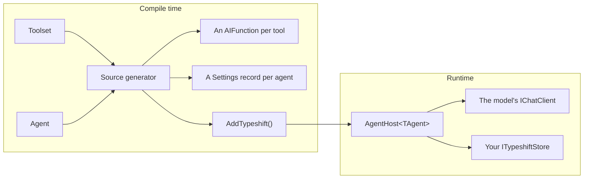

# Getting started

Typeshift lets you declare tools and agents in a few lines of C#. In four steps, this page builds an agent that finds
the companies of a city.

## 1. Install

Typeshift needs .NET 10. Add the package to every project that declares toolsets or agents
([TSH020](./diagnostics.md#tsh020)):

```bash
dotnet add package Typeshift --prerelease
```

Turn on XML docs in `Directory.Build.props`, since tools take their descriptions from them:

```xml
<PropertyGroup>
  <GenerateDocumentationFile>true</GenerateDocumentationFile>
  <!-- Ids are Guids unless you name another type. This sample uses int. -->
  <TypeshiftIdType>int</TypeshiftIdType>
</PropertyGroup>
```

## 2. Write a toolset

A toolset declares tools in its constructor. Each tool is a static method:

<!-- snippet: quickstart-toolset -->
<a id='snippet-quickstart-toolset'></a>
```cs
internal partial class CompanyToolset : Toolset
{
    public CompanyToolset()
    {
        WithDisplayName("Companies");

        AddTool(FindCompanies)
            .WithSettings<FindCompaniesSettings>()
            .Configurable(s => s.Limit);
    }

    /// <summary>
    /// Finds the companies of a city, best matches first.
    /// </summary>
    /// <param name="city">The city the companies are based in.</param>
    public static IReadOnlyList<Company> FindCompanies(string city, FindCompaniesSettings settings) =>
    [
        .. Companies
            .Where(company => company.City.Equals(city, StringComparison.OrdinalIgnoreCase))
            .Where(company => company.Active || settings.IncludeInactive)
            .Take(settings.Limit)
    ];
```
<sup><a href='https://github.com/weboost-at/Typeshift/blob/main/samples/Typeshift.Samples.Docs/Quickstart/CompanyToolset.cs#L3-L26' title='Snippet source file'>snippet source</a> | <a href='#snippet-quickstart-toolset' title='Start of snippet'>anchor</a></sup>
<!-- endSnippet -->

- The model calls the tool as `find_companies` and reads its XML docs.
- The model never sees `FindCompaniesSettings`, which Typeshift fills in. `Configurable` lets `Limit` change at
  runtime.

The settings record sets the defaults:

<!-- snippet: quickstart-settings-record -->
<a id='snippet-quickstart-settings-record'></a>
```cs
internal record FindCompaniesSettings
{
    public int Limit { get; init; } = 5;

    public bool IncludeInactive { get; init; }
}
```
<sup><a href='https://github.com/weboost-at/Typeshift/blob/main/samples/Typeshift.Samples.Docs/Quickstart/FindCompaniesSettings.cs#L3-L10' title='Snippet source file'>snippet source</a> | <a href='#snippet-quickstart-settings-record' title='Start of snippet'>anchor</a></sup>
<!-- endSnippet -->

## 3. Write an agent

An agent picks a model, its instructions and its tools:

<!-- snippet: quickstart-agent -->
<a id='snippet-quickstart-agent'></a>
```cs
internal partial class ResearchAgent : Agent
{
    public ResearchAgent()
    {
        WithDescription("Researches the companies of a city.");

        WithChatOptions()
            .WithModel("fast-model")
            .WithTemperature(0.2f)
            .Configurable(o => o.Instructions)
            .Configurable(o => o.Temperature);

        UseToolset<CompanyToolset>();

        ConfigureFindCompanies()
            .WithLimit(3);
    }

    protected override string GetInstructions() =>
        """
        Find companies with the find_companies tool and list them.
        """;
}
```
<sup><a href='https://github.com/weboost-at/Typeshift/blob/main/samples/Typeshift.Samples.Docs/Quickstart/ResearchAgent.cs#L3-L27' title='Snippet source file'>snippet source</a> | <a href='#snippet-quickstart-agent' title='Start of snippet'>anchor</a></sup>
<!-- endSnippet -->

- `Configurable` lets stored settings change the instructions and the temperature. The model stays as coded.
- `ConfigureFindCompanies()` exists because the agent uses `CompanyToolset`. Configuring a tool the agent does not
  offer fails the build.

## 4. Run it

`AddTypeshift()` registers every toolset and agent. You add a store and a chat client provider:

<!-- snippet: quickstart-registration -->
<a id='snippet-quickstart-registration'></a>
```cs
var services = new ServiceCollection();

services.AddTypeshift()
    .WithStore<InMemoryTypeshiftStore>()
    .WithChatClientProvider<KeyedChatClientProvider>();

services.AddKeyedSingleton<IChatClient>("fast-model", new CannedChatClient());

await using var provider = services.BuildServiceProvider(validateScopes: true);
```
<sup><a href='https://github.com/weboost-at/Typeshift/blob/main/samples/Typeshift.Samples.Docs/Quickstart/Quickstart.cs#L11-L21' title='Snippet source file'>snippet source</a> | <a href='#snippet-quickstart-registration' title='Start of snippet'>anchor</a></sup>
<!-- endSnippet -->

`CannedChatClient` stands in for a real model, and `InMemoryTypeshiftStore` for your database. The provider returns the
client for a model's name:

<!-- snippet: chat-client-provider -->
<a id='snippet-chat-client-provider'></a>
```cs
internal sealed class KeyedChatClientProvider(IServiceProvider services) : IChatClientProvider
{
    public ValueTask<IChatClient> GetChatClientAsync(string model, CancellationToken ct) =>
        ValueTask.FromResult(services.GetRequiredKeyedService<IChatClient>(model));
}
```
<sup><a href='https://github.com/weboost-at/Typeshift/blob/main/samples/Typeshift.Samples.Docs/Hosting/KeyedChatClientProvider.cs#L6-L12' title='Snippet source file'>snippet source</a> | <a href='#snippet-chat-client-provider' title='Start of snippet'>anchor</a></sup>
<!-- endSnippet -->

Store settings under a settings id, for example one per customer:

<!-- snippet: quickstart-settings -->
<a id='snippet-quickstart-settings'></a>
```cs
await using var scope = provider.CreateAsyncScope();
var research = scope.ServiceProvider.GetRequiredService<AgentHost<ResearchAgent>>();
var settingsId = 42;

await research.ConfigureAsync(settingsId, settings => settings with
{
    Temperature = 0.4f,
    FindCompanies = settings.FindCompanies with { Limit = 2 }
});
```
<sup><a href='https://github.com/weboost-at/Typeshift/blob/main/samples/Typeshift.Samples.Docs/Quickstart/Quickstart.cs#L23-L33' title='Snippet source file'>snippet source</a> | <a href='#snippet-quickstart-settings' title='Start of snippet'>anchor</a></sup>
<!-- endSnippet -->

Every run with settings id 42 now finds at most 2 companies:

<!-- snippet: quickstart-run -->
<a id='snippet-quickstart-run'></a>
```cs
var answer = await research.RunAsync("Vienna", settingsId, conversationId: 1);

Console.WriteLine($"{research.Agent.Name}: {answer.Text}");
```
<sup><a href='https://github.com/weboost-at/Typeshift/blob/main/samples/Typeshift.Samples.Docs/Quickstart/Quickstart.cs#L35-L39' title='Snippet source file'>snippet source</a> | <a href='#snippet-quickstart-run' title='Start of snippet'>anchor</a></sup>
<!-- endSnippet -->

The limit came from three layers: 5 in the record, 3 in the agent and 2 in the stored settings.
[Settings layering](./settings-layering.md) explains how they combine.

## How the pieces fit



`AddTypeshift()` registers an `AgentHost<TAgent>` per agent. The host resolves the settings, calls the model, runs the
tools and stores the conversation.

| Piece | What it is | Read |
|---|---|---|
| Toolset | A `partial` class deriving from `Toolset` that declares the tools of one domain | [Toolsets](./toolsets.md) |
| Tool settings | A record of values a tool needs that the model must not choose | [Tool settings](./tool-settings.md) |
| Agent | A `partial` class deriving from `Agent`, with chat options, instructions and tools | [Agents](./defining-agents.md) |
| Agent host | `AgentHost<TAgent>`, which runs one agent in the scope it was resolved from | [Running agents](./running-agents.md) |
| Store | Your `ITypeshiftStore`, which keeps settings and conversations | [Settings and stores](./settings-and-stores.md) |

The [glossary](./glossary.md) defines every other term.

## What your app implements

Your app implements a few interfaces. Every run needs a chat client provider, and the others come with the feature
that uses them:

| Interface | Needed for | Read |
|---|---|---|
| `IChatClientProvider` | Every run. It returns the `IChatClient` for a model's name. | [Chat clients](./running-agents.md#chat-clients) |
| `ITypeshiftStore` | Settings ids and conversation ids. `InMemoryTypeshiftStore` serves tests and samples. | [Settings and stores](./settings-and-stores.md) |
| `IFileSystemRoot`, `IWebSearch`, `IWebFetch` | The built-in file, shell and web tools. | [Built-in toolsets](./built-in-toolsets.md#what-each-needs) |
| `IContextProvider` | Memory, documents or other data added to every run of an agent. | [Context providers](./context-providers.md) |
| `IToolApprovalRule`, `IRunMiddleware`, `IToolMiddleware`, `IMcpToolProvider` | Approval rules, middleware and MCP servers. | [The chain](./registration.md#the-chain) |

## Related

- [Toolsets](./toolsets.md): tools, their names, parameters and results in depth.
- [Tool settings](./tool-settings.md): what a settings record may hold and what may change it.
- [Agents](./defining-agents.md): everything an agent's constructor can declare.
- [Running agents](./running-agents.md): real chat clients, structured output and streaming.
- [Conversations](./conversations.md): resuming, steering and watching runs.
- [Comparison](./comparison.md): Typeshift next to `AIFunctionFactory` and Microsoft Agent Framework.
- [Glossary](./glossary.md): the words these docs use.
