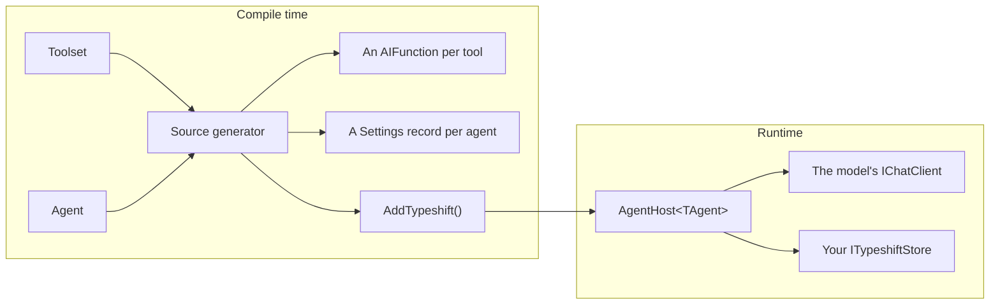

# Getting started

Typeshift is a .NET 10 library for agents and tools on
[Microsoft.Extensions.AI](https://learn.microsoft.com/dotnet/ai/microsoft-extensions-ai). You declare toolsets and
agents in C# constructors, and a source generator turns them into tool functions, a settings record per agent and one
registration call, without reflection. This page shows how the pieces fit, then builds an agent that finds the
companies of a city. Every snippet comes from a sample that CI runs, so the code compiles and works as shown.

::: tip The short version

- A **toolset** declares tools: static methods the model can call. An **agent** picks tools and sets a model and
  instructions. `AgentHost<TAgent>` runs the agent.
- Add the `Typeshift` package to every project that declares toolsets or agents, and turn on XML docs.
- Your app implements a chat client provider, and a store once it keeps settings or conversations.
- Settings the code marks **configurable** can change per settings id and per run. Everything else stays in code.
- `AddTypeshift()` registers everything. Mistakes are compile errors and [diagnostics](./diagnostics.md).

:::

## How the pieces fit



Your toolsets and agents go into the generator. Out come the functions the model calls, the `Settings` record that holds
what may change at runtime, and the code behind `services.AddTypeshift()`. That call registers an `AgentHost<TAgent>`
per agent, which runs it: it resolves the settings, calls the model, runs the tools and stores the conversation.

| Piece | What it is | Read |
|---|---|---|
| Toolset | A `partial` class deriving from `Toolset`, declaring the tools of one domain | [Toolsets](./toolsets.md) |
| Tool settings | A record of values a tool needs that the model must not choose | [Tool settings](./tool-settings.md) |
| Agent | A `partial` class deriving from `Agent`: chat options, instructions, tools | [Agents](./defining-agents.md) |
| Agent host | `AgentHost<TAgent>`, which runs one agent in the scope it was resolved from | [Running agents](./running-agents.md) |
| Store | Your `ITypeshiftStore`, which keeps settings and conversations | [Settings and stores](./settings-and-stores.md) |

The [glossary](./glossary.md) defines every term these docs use.

## What your app implements

Typeshift leaves a few things to your app: which model client to call, where to store data, and what the built-in
tools may reach. Each is an interface you implement. Only the chat client provider is needed for every run; the rest
come in with the feature that uses them.

| Interface | Needed for | Read |
|---|---|---|
| `IChatClientProvider` | Every run. It returns the `IChatClient` for a model's name. | [Chat clients](./running-agents.md#chat-clients) |
| `ITypeshiftStore` | Settings ids and conversation ids. `InMemoryTypeshiftStore` serves tests and samples. | [Settings and stores](./settings-and-stores.md) |
| `IFileSystemRoot`, `IWebSearch`, `IWebFetch` | The built-in file, shell and web tools. | [Built-in toolsets](./built-in-toolsets.md#what-each-needs) |
| `IContextProvider` | Memory, documents or other data added to every run of an agent. | [Context providers](./context-providers.md) |
| `IToolApprovalRule`, `IRunMiddleware`, `IToolMiddleware`, `IMcpToolProvider` | Approval rules, middleware and MCP servers. | [The chain](./registration.md#the-chain) |

## 1. Install the package

```bash
dotnet add package Typeshift --prerelease
```

Typeshift targets .NET 10 and C# 14. Add the package to every project that declares toolsets or agents, or calls
`AddTypeshift()`. The package carries the source generator, and NuGet does not pass a generator on to the projects that
reference yours ([TSH020](./diagnostics.md#tsh020)).

Turn on `GenerateDocumentationFile` too, since tools take their descriptions from XML docs
([TSH011](./diagnostics.md#tsh011)):

```xml
<PropertyGroup>
  <GenerateDocumentationFile>true</GenerateDocumentationFile>
</PropertyGroup>
```

## 2. Pick the id type

Ids are yours. A settings id names an agent's stored settings, and a conversation id names a conversation. Typeshift
never creates either. Ids are `Guid`s unless the build names another type, once, in `Directory.Build.props`. This
tutorial uses `int` ids:

<!-- snippet: id-type -->
<a id='snippet-id-type'></a>
```csproj
<PropertyGroup>
  <TypeshiftIdType>int</TypeshiftIdType>
</PropertyGroup>
```
<sup><a href='https://github.com/weboost-at/Typeshift/blob/main/samples/Typeshift.Samples.Docs/Typeshift.Samples.Docs.csproj#L5-L9' title='Snippet source file'>snippet source</a> | <a href='#snippet-id-type' title='Start of snippet'>anchor</a></sup>
<!-- endSnippet -->

That is why the settings id below is `42` and the conversation id is `1`. Leave the property out to keep `Guid`s. [The
id type](./registration.md#the-id-type) lists the types you can name.

## 3. Write a toolset

A toolset groups the tools of one domain. It is a `partial` class deriving from `Toolset`, and its constructor declares
each tool with `AddTool`. A tool is a static method. Its name is the method's name in snake_case: `FindCompanies`
becomes `find_companies`.

<!-- snippet: quickstart-toolset -->
<a id='snippet-quickstart-toolset'></a>
```cs
internal partial class CompanyToolset : Toolset
{
    public CompanyToolset()
    {
        WithDisplayName("Companies");

        AddTool(FindCompanies)
            .WithSettings<FindCompaniesSettings>()
            .Configurable(s => s.Limit);
    }

    /// <summary>
    /// Finds the companies of a city, best matches first.
    /// </summary>
    /// <param name="city">The city the companies are based in.</param>
    public static IReadOnlyList<Company> FindCompanies(string city, FindCompaniesSettings settings) =>
    [
        .. Companies
            .Where(company => company.City.Equals(city, StringComparison.OrdinalIgnoreCase))
            .Where(company => company.Active || settings.IncludeInactive)
            .Take(settings.Limit)
    ];
```
<sup><a href='https://github.com/weboost-at/Typeshift/blob/main/samples/Typeshift.Samples.Docs/Quickstart/CompanyToolset.cs#L3-L26' title='Snippet source file'>snippet source</a> | <a href='#snippet-quickstart-toolset' title='Start of snippet'>anchor</a></sup>
<!-- endSnippet -->

- The `<summary>` becomes the tool's description, and each `<param>` its parameter's.
- The `FindCompaniesSettings` parameter never reaches the model. The call fills it with the tool's resolved settings.
- `Configurable(s => s.Limit)` lets `Limit` change at runtime. `IncludeInactive` stays what the code says.

The settings are a record, and its code sets the defaults:

<!-- snippet: quickstart-settings-record -->
<a id='snippet-quickstart-settings-record'></a>
```cs
internal record FindCompaniesSettings
{
    public int Limit { get; init; } = 5;

    public bool IncludeInactive { get; init; }
}
```
<sup><a href='https://github.com/weboost-at/Typeshift/blob/main/samples/Typeshift.Samples.Docs/Quickstart/FindCompaniesSettings.cs#L3-L10' title='Snippet source file'>snippet source</a> | <a href='#snippet-quickstart-settings-record' title='Start of snippet'>anchor</a></sup>
<!-- endSnippet -->

## 4. Write an agent

An agent bundles what a model needs for one job. It is a `partial` class deriving from `Agent`. Its constructor sets the
chat options, picks the tools and sets their settings. `GetInstructions()` returns the instructions.

<!-- snippet: quickstart-agent -->
<a id='snippet-quickstart-agent'></a>
```cs
internal partial class ResearchAgent : Agent
{
    public ResearchAgent()
    {
        WithDescription("Researches the companies of a city.");

        WithChatOptions()
            .WithModel("fast-model")
            .WithTemperature(0.2f)
            .Configurable(o => o.Instructions)
            .Configurable(o => o.Temperature);

        UseToolset<CompanyToolset>();

        ConfigureFindCompanies()
            .WithLimit(3);
    }

    protected override string GetInstructions() =>
        """
        Find companies with the find_companies tool and list them.
        """;
}
```
<sup><a href='https://github.com/weboost-at/Typeshift/blob/main/samples/Typeshift.Samples.Docs/Quickstart/ResearchAgent.cs#L3-L27' title='Snippet source file'>snippet source</a> | <a href='#snippet-quickstart-agent' title='Start of snippet'>anchor</a></sup>
<!-- endSnippet -->

- `WithChatOptions()` sets the model and the temperature. The two `Configurable` calls let stored settings and runs
  change the instructions and the temperature. The model stays what the code says.
- `UseToolset<CompanyToolset>()` offers every tool of the toolset.
- `ConfigureFindCompanies()` sets the tool's settings for this agent, here a limit of 3. The generator writes it because
  the agent offers `find_companies`, with a `With...` per settable member of the settings record. Configuring a tool the
  agent does not offer does not compile.

## 5. Register Typeshift

`AddTypeshift()` registers every toolset and agent of the project and of the projects it references. `WithStore` adds
the store, which turns persistence on. `WithChatClientProvider` adds the provider that maps model names to
`IChatClient`s.

<!-- snippet: quickstart-registration -->
<a id='snippet-quickstart-registration'></a>
```cs
var services = new ServiceCollection();

services.AddTypeshift()
    .WithStore<InMemoryTypeshiftStore>()
    .WithChatClientProvider<KeyedChatClientProvider>();

services.AddKeyedSingleton<IChatClient>("fast-model", new CannedChatClient());

await using var provider = services.BuildServiceProvider(validateScopes: true);
```
<sup><a href='https://github.com/weboost-at/Typeshift/blob/main/samples/Typeshift.Samples.Docs/Quickstart/Quickstart.cs#L11-L21' title='Snippet source file'>snippet source</a> | <a href='#snippet-quickstart-registration' title='Start of snippet'>anchor</a></sup>
<!-- endSnippet -->

The provider is yours, and a few lines cover most apps. This one returns the client registered under the model's name:

<!-- snippet: chat-client-provider -->
<a id='snippet-chat-client-provider'></a>
```cs
internal sealed class KeyedChatClientProvider(IServiceProvider services) : IChatClientProvider
{
    public ValueTask<IChatClient> GetChatClientAsync(string model, CancellationToken ct) =>
        ValueTask.FromResult(services.GetRequiredKeyedService<IChatClient>(model));
}
```
<sup><a href='https://github.com/weboost-at/Typeshift/blob/main/samples/Typeshift.Samples.Docs/Hosting/KeyedChatClientProvider.cs#L6-L12' title='Snippet source file'>snippet source</a> | <a href='#snippet-chat-client-provider' title='Start of snippet'>anchor</a></sup>
<!-- endSnippet -->

`CannedChatClient` is the samples' stand-in for a real model, so this tutorial runs without a network. In your app,
register your provider's `IChatClient` under the model's name instead. `InMemoryTypeshiftStore` keeps everything in
memory, for tests and samples; in your app, you implement `ITypeshiftStore` over your database.
[Settings and stores](./settings-and-stores.md) and [Running agents](./running-agents.md#chat-clients) show how.

## 6. Store settings

The generator gives `ResearchAgent` a nested `Settings` record. It holds exactly what may change: the configurable chat
options and the configurable settings of its tools. `AgentHost<ResearchAgent>` stores it under a settings id. You decide
what a settings id stands for, for example one per customer, per team or per user.

<!-- snippet: quickstart-settings -->
<a id='snippet-quickstart-settings'></a>
```cs
await using var scope = provider.CreateAsyncScope();
var research = scope.ServiceProvider.GetRequiredService<AgentHost<ResearchAgent>>();
var settingsId = 42;

await research.ConfigureAsync(settingsId, settings => settings with
{
    Temperature = 0.4f,
    FindCompanies = settings.FindCompanies with { Limit = 2 }
});
```
<sup><a href='https://github.com/weboost-at/Typeshift/blob/main/samples/Typeshift.Samples.Docs/Quickstart/Quickstart.cs#L23-L33' title='Snippet source file'>snippet source</a> | <a href='#snippet-quickstart-settings' title='Start of snippet'>anchor</a></sup>
<!-- endSnippet -->

The host comes from a scope, because it runs with that scope's services. `ConfigureAsync` loads the settings stored
under 42, applies your change and saves them. Every run with settings id 42 now uses a temperature of 0.4 and finds at
most 2 companies.

## 7. Run the agent

`RunAsync` runs the agent. It layers the settings stored under the settings id over the agent's code and resumes
conversation 1. Then it runs the tool loop and stores the exchange:

<!-- snippet: quickstart-run -->
<a id='snippet-quickstart-run'></a>
```cs
var answer = await research.RunAsync("Vienna", settingsId, conversationId: 1);

Console.WriteLine($"{research.Agent.Name}: {answer.Text}");
```
<sup><a href='https://github.com/weboost-at/Typeshift/blob/main/samples/Typeshift.Samples.Docs/Quickstart/Quickstart.cs#L35-L39' title='Snippet source file'>snippet source</a> | <a href='#snippet-quickstart-run' title='Start of snippet'>anchor</a></sup>
<!-- endSnippet -->

A run can also pass settings for itself alone. This one finds at most one company and streams the answer:

<!-- snippet: quickstart-run-settings -->
<a id='snippet-quickstart-run-settings'></a>
```cs
var run = new ResearchAgent.Settings
{
    FindCompanies = new CompanyToolset.FindCompaniesOverrides { Limit = 1 }
};

await foreach (var update in research.RunStreamingAsync("Vienna", settingsId, settings: run))
    Console.Write(update.Text);
```
<sup><a href='https://github.com/weboost-at/Typeshift/blob/main/samples/Typeshift.Samples.Docs/Quickstart/Quickstart.cs#L41-L49' title='Snippet source file'>snippet source</a> | <a href='#snippet-quickstart-run-settings' title='Start of snippet'>anchor</a></sup>
<!-- endSnippet -->

The run leaves `Temperature` null, so the stored 0.4 still holds.

## What you built

- A toolset with one tool the model can call, and settings the model never sees.
- An agent that offers the tool, sets its limit and lets settings change its temperature and instructions.
- A registration with a store and a chat client provider.
- Settings stored under a settings id, and two runs that use them.

The `find_companies` limit now comes from four layers: 5 in the record, 3 in the agent, 2 in the stored settings and 1
for the streamed run. [Settings layering](./settings-layering.md) explains how they combine.

## Related

- [Toolsets](./toolsets.md): tools, their names, parameters and results in depth.
- [Tool settings](./tool-settings.md): what a settings record may hold and what may change it.
- [Agents](./defining-agents.md): everything an agent's constructor can declare.
- [Running agents](./running-agents.md): real chat clients, structured output and streaming.
- [Conversations](./conversations.md): resuming, steering and watching runs.
- [Comparison](./comparison.md): how Typeshift compares with `AIFunctionFactory` and Microsoft Agent Framework.
- [Glossary](./glossary.md): the words these docs use.
