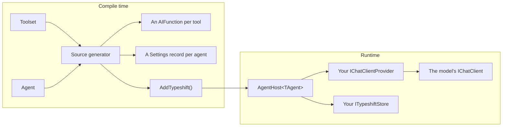

# Getting started

Typeshift lets you declare tools and agents in a few lines of C#. In four steps, this page builds an agent that finds
the companies of a city.

## 1. Install

Typeshift needs the .NET 10 SDK and C# 14, its default language version. Add the package to every project that
declares toolsets or agents or calls `AddTypeshift()`. The package carries the source generator, and NuGet does not
pass a generator on to the projects that reference yours, so each of them needs the package itself
([TSH020](./diagnostics.md#tsh020)):

```bash
dotnet add package Typeshift --prerelease
```

The types on this page are in the `Typeshift` namespace, which the package does not import for you, so add
`using Typeshift;` to your files. Step 4 also needs `using Microsoft.Extensions.AI;` and
`using Microsoft.Extensions.DependencyInjection;`, and in a console app the `Microsoft.Extensions.DependencyInjection`
package, which builds the service provider.

Turn on XML docs in a `Directory.Build.props` next to your solution, since tools take their descriptions from them; without them the build
warns with [TSH011](./diagnostics.md#tsh011). The same file sets `TypeshiftIdType`, the type of the settings ids and
conversation ids you pass to runs. Leave it out, and ids are `Guid`s, so step 4 does not compile with the ids 42 and
1:

```xml
<Project>
  <PropertyGroup>
    <GenerateDocumentationFile>true</GenerateDocumentationFile>
    <!-- Ids are Guids unless you name another type. This sample uses int. -->
    <TypeshiftIdType>int</TypeshiftIdType>
  </PropertyGroup>
</Project>
```

## 2. Write a toolset

Steps 2 and 3 each go in a file of their own, and step 4 goes in `Program.cs`. A toolset is a `partial` class, so the
generator can add members to it ([TSH001](./diagnostics.md#tsh001)). It declares its tools in its constructor, and
each tool is a static method:

<!-- snippet: quickstart-toolset -->
<a id='snippet-quickstart-toolset'></a>
```cs
internal partial class CompanyToolset : Toolset
{
    public CompanyToolset()
    {
        WithDisplayName("Companies");

        AddTool(FindCompanies)
            .WithSettings<FindCompaniesSettings>()
            .Configurable(s => s.Limit);
    }

    /// <summary>
    /// Finds the companies of a city.
    /// </summary>
    /// <param name="city">The city the companies are based in.</param>
    public static IReadOnlyList<Company> FindCompanies(string city, FindCompaniesSettings settings) =>
    [
        .. Companies
            .Where(company => company.City.Equals(city, StringComparison.OrdinalIgnoreCase))
            .Where(company => company.Active || settings.IncludeInactive)
            .Take(settings.Limit)
    ];

    private static readonly Company[] Companies =
    [
        new("Danube Robotics", "Vienna", Active: true),
        new("Prater Motion", "Vienna", Active: true),
        new("Graz Gearworks", "Graz", Active: false)
    ];
}

internal sealed record Company(string Name, string City, bool Active);
```
<sup><a href='https://github.com/weboost-at/Typeshift/blob/main/samples/Typeshift.Samples.Docs/Quickstart/CompanyToolset.cs#L3-L36' title='Snippet source file'>snippet source</a> | <a href='#snippet-quickstart-toolset' title='Start of snippet'>anchor</a></sup>
<!-- endSnippet -->

- The model calls the tool as `find_companies` and reads its XML docs.
- The model never sees the `FindCompaniesSettings` parameter. Typeshift fills it with the tool's settings when it
  calls the tool.
- `Configurable(s => s.Limit)` lets stored settings and runs change `Limit`, while `IncludeInactive` stays as your
  code sets it.

The settings record sets the defaults:

<!-- snippet: quickstart-settings-record -->
<a id='snippet-quickstart-settings-record'></a>
```cs
internal record FindCompaniesSettings
{
    public int Limit { get; init; } = 5;

    public bool IncludeInactive { get; init; }
}
```
<sup><a href='https://github.com/weboost-at/Typeshift/blob/main/samples/Typeshift.Samples.Docs/Quickstart/FindCompaniesSettings.cs#L3-L10' title='Snippet source file'>snippet source</a> | <a href='#snippet-quickstart-settings-record' title='Start of snippet'>anchor</a></sup>
<!-- endSnippet -->

## 3. Write an agent

An agent is a `partial` class too, for the same reason, and derives from `Agent`. It picks a model, its instructions
and its tools:

<!-- snippet: quickstart-agent -->
<a id='snippet-quickstart-agent'></a>
```cs
internal partial class ResearchAgent : Agent
{
    public ResearchAgent()
    {
        WithDescription("Researches the companies of a city.");

        WithChatOptions()
            .WithModel("openai", "gpt-5-mini")
            .WithTemperature(0.2f)
            .Configurable(o => o.Instructions)
            .Configurable(o => o.Temperature);

        UseToolset<CompanyToolset>();

        ConfigureFindCompanies()
            .WithLimit(3);
    }

    protected override string GetInstructions() =>
        """
        Find companies with the find_companies tool and list them.
        """;
}
```
<sup><a href='https://github.com/weboost-at/Typeshift/blob/main/samples/Typeshift.Samples.Docs/Quickstart/ResearchAgent.cs#L3-L27' title='Snippet source file'>snippet source</a> | <a href='#snippet-quickstart-agent' title='Start of snippet'>anchor</a></sup>
<!-- endSnippet -->

- `Configurable` lets stored settings and runs change the instructions and the temperature. The model stays as the
  code sets it.
- The generator writes `ConfigureFindCompanies()` because the agent uses `CompanyToolset`, and `WithLimit(3)` sets
  this agent's limit over the record's 5. Configuring a tool the agent does not offer fails the build.

## 4. Run it

`AddTypeshift()` registers every toolset and agent. Chain a store, which keeps settings and conversations, and a chat
client provider, which returns the `IChatClient` that serves each model:

<!-- snippet: quickstart-registration -->
<a id='snippet-quickstart-registration'></a>
```cs
var services = new ServiceCollection();

services.AddTypeshift()
    .WithStore<InMemoryTypeshiftStore>()
    .WithChatClientProvider<KeyedChatClientProvider>();

services.AddKeyedSingleton<IChatClient>("openai", new CannedChatClient());

await using var provider = services.BuildServiceProvider(validateScopes: true);
```
<sup><a href='https://github.com/weboost-at/Typeshift/blob/main/samples/Typeshift.Samples.Docs/Quickstart/Quickstart.cs#L11-L21' title='Snippet source file'>snippet source</a> | <a href='#snippet-quickstart-registration' title='Start of snippet'>anchor</a></sup>
<!-- endSnippet -->

`CannedChatClient` is a fake client from the docs samples, so they run without a network. In your app, register your
provider's client instead. With the `Microsoft.Extensions.AI.OpenAI` package and an OpenAI API key, that is:

<!-- snippet: openai-client -->
<a id='snippet-openai-client'></a>
```cs
var openAi = new OpenAIClient(apiKey)
    .GetChatClient("gpt-5-mini")
    .AsIChatClient();

services.AddKeyedSingleton("openai", openAi);
```
<sup><a href='https://github.com/weboost-at/Typeshift/blob/main/samples/Typeshift.Samples.Docs/Scenarios/Models.cs#L25-L31' title='Snippet source file'>snippet source</a> | <a href='#snippet-openai-client' title='Start of snippet'>anchor</a></sup>
<!-- endSnippet -->

`OpenAIClient` is in the `OpenAI` namespace, and `apiKey` comes from your app's configuration, for example an
environment variable. The key `"openai"` is a name you choose: it is the provider the agent names in
`WithModel("openai", "gpt-5-mini")`.
[A real client](./models.md#a-real-client) shows a local server and other providers. `InMemoryTypeshiftStore` comes
with Typeshift and stands in for your database.

`KeyedChatClientProvider` is your `IChatClientProvider`. For each run, Typeshift asks it for the client of the
provider and model the agent names, here `"openai"` and `"gpt-5-mini"`, and it returns the `IChatClient` registered
under the provider's key:

<!-- snippet: chat-client-provider -->
<a id='snippet-chat-client-provider'></a>
```cs
internal sealed class KeyedChatClientProvider(IServiceProvider services) : IChatClientProvider
{
    // One client per provider serves all its models: Typeshift puts the model into every request
    public ValueTask<IChatClient> GetChatClientAsync(string provider, string model, CancellationToken ct) =>
        ValueTask.FromResult(
            services.GetKeyedService<IChatClient>(provider)
                ?? throw new InvalidOperationException($"No IChatClient is registered for the provider '{provider}'."));
}
```
<sup><a href='https://github.com/weboost-at/Typeshift/blob/main/samples/Typeshift.Samples.Docs/Hosting/KeyedChatClientProvider.cs#L6-L15' title='Snippet source file'>snippet source</a> | <a href='#snippet-chat-client-provider' title='Start of snippet'>anchor</a></sup>
<!-- endSnippet -->

You configure and run the agent through its host, `AgentHost<ResearchAgent>`, which `AddTypeshift()` registered for
it. The next snippet starts by creating a scope and resolving the host from it. In a web app, you take the host as a
constructor parameter of your controller or service instead ([Using an agent](./using-an-agent.md)).

A settings id is an id you choose, for example one per customer. The store keeps the agent's settings under it, and
every run that passes the id uses them. `ConfigureAsync` loads the agent's generated `ResearchAgent.Settings` record,
which holds only what the code marked `Configurable`, applies your change and saves it:

<!-- snippet: quickstart-settings -->
<a id='snippet-quickstart-settings'></a>
```cs
await using var scope = provider.CreateAsyncScope();
var research = scope.ServiceProvider.GetRequiredService<AgentHost<ResearchAgent>>();
var settingsId = 42;

await research.ConfigureAsync(settingsId, settings => settings with
{
    Temperature = 0.4f,
    FindCompanies = settings.FindCompanies with { Limit = 2 }
});
```
<sup><a href='https://github.com/weboost-at/Typeshift/blob/main/samples/Typeshift.Samples.Docs/Quickstart/Quickstart.cs#L23-L33' title='Snippet source file'>snippet source</a> | <a href='#snippet-quickstart-settings' title='Start of snippet'>anchor</a></sup>
<!-- endSnippet -->

Every run with settings id 42 now finds at most 2 companies. Both ids are optional: a run without a settings id uses
the agent's code alone, and a run with neither id needs no store. With the conversation id, Typeshift stores the run
under conversation 1, and a later run with the same id continues the conversation:

<!-- snippet: quickstart-run -->
<a id='snippet-quickstart-run'></a>
```cs
var answer = await research.RunAsync("Vienna", settingsId, conversationId: 1);

Console.WriteLine($"{research.Agent.Name}: {answer.Text}");
```
<sup><a href='https://github.com/weboost-at/Typeshift/blob/main/samples/Typeshift.Samples.Docs/Quickstart/Quickstart.cs#L35-L39' title='Snippet source file'>snippet source</a> | <a href='#snippet-quickstart-run' title='Start of snippet'>anchor</a></sup>
<!-- endSnippet -->

The limit passes through three layers: 5 in the record, 3 in the agent and 2 in the stored settings. Each layer
overrides the one before, so the stored 2 applies. A run can pass settings of its own, a fourth layer over the stored
ones, as [Settings layering](./settings-and-stores.md#settings-layering) explains.

## How the pieces fit



`AddTypeshift()` registers an `AgentHost<TAgent>` per agent. The host resolves the settings, calls the model, runs the
tools and stores the conversation.

| Piece | What it is | Read |
|---|---|---|
| Toolset | A `partial` class deriving from `Toolset` that declares the tools of one domain | [Toolsets](./toolsets.md) |
| Tool settings | A record of values a tool needs that the model must not choose | [Tool settings](./tool-settings.md) |
| Agent | A `partial` class deriving from `Agent`, with chat options, instructions and tools | [Agents](./defining-agents.md) |
| Agent host | `AgentHost<TAgent>`, which runs one agent in the scope it was resolved from | [Using an agent](./using-an-agent.md) |
| Store | Your `ITypeshiftStore`, which keeps settings and conversations | [Settings and stores](./settings-and-stores.md) |

The [glossary](./glossary.md) defines every other term.

## What your app implements

Your app implements a few interfaces. Every run needs a chat client provider, and the others come with the feature
that uses them:

| Interface | Needed for | Read |
|---|---|---|
| `IChatClientProvider` | Every run. It returns the `IChatClient` for a provider and a model. | [Models and providers](./models.md) |
| `ITypeshiftStore` | Settings ids and conversation ids. A singleton; `InMemoryTypeshiftStore` serves tests and samples. | [Implementing a store](./implementing-a-store.md) |
| `IFileSystemRoot`, `IWebSearch`, `IWebFetch` | The built-in file, shell and web tools. | [Built-in toolsets](./built-in-toolsets.md#what-each-needs) |
| `IContextProvider` | Memory, documents or other data added to every run of an agent. | [Context providers](./middleware.md#context-providers) |
| `IToolApprovalRule`, `IRunMiddleware`, `IToolMiddleware`, `IMcpToolProvider` | Approval rules, middleware and MCP servers. | [The chain](./registration.md#the-chain) |

## Related

- [Toolsets](./toolsets.md): tools, their names, parameters and results in depth.
- [Tool settings](./tool-settings.md): what a settings record may hold and what may change it.
- [Agents](./defining-agents.md): everything an agent's constructor can declare.
- [Using an agent](./using-an-agent.md): the host in a controller, an endpoint or a background job.
- [Running agents](./running-agents.md): real chat clients, structured output and streaming.
- [Conversations](./conversations.md): resuming, steering and watching runs.
- [Glossary](./glossary.md): the words these docs use.
