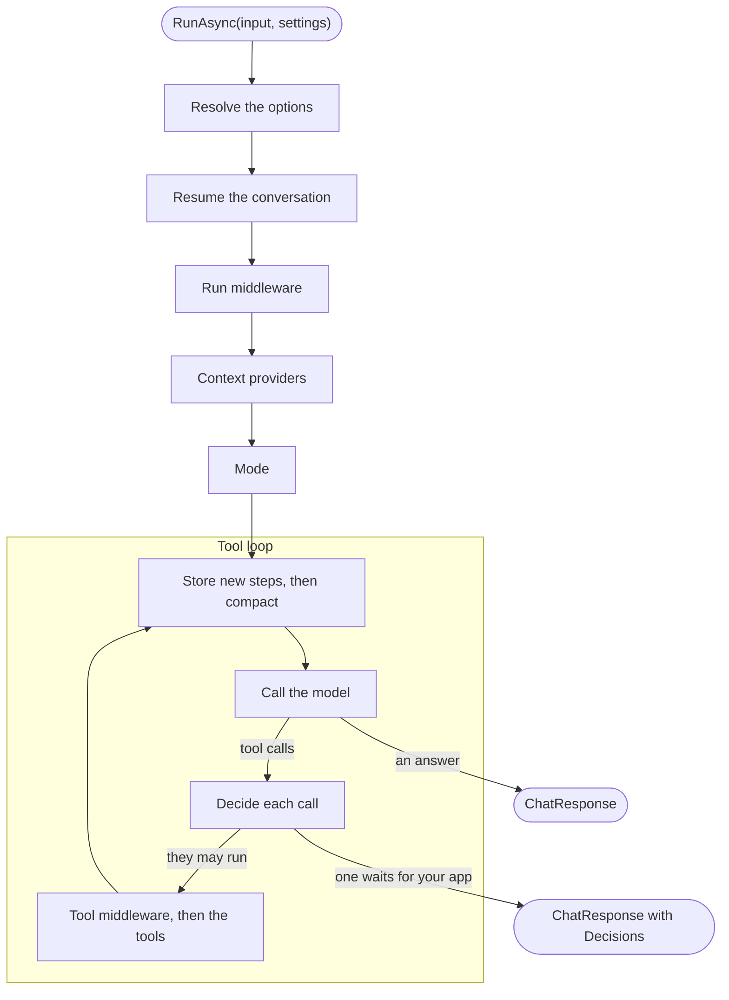

# How a run works

A run is one call that starts or resumes an agent through its host, or one call of a client from the
[raw path](./running-agents.md#the-raw-path); the [glossary](./glossary.md) names each member that starts one.
Streaming or not, every run passes through the same steps in the same order, and that order tells you what your
middleware sees, when context is added, which calls ask for approval and what is stored when.

Each step wraps the steps below it, so the answer passes back up through them in reverse order: run middleware sees
the response before the conversation stores how the run ended.

## The steps

1. **Resolve the options.** The host builds the run's `ChatOptions` from the agent's code, then the agent's own stored
   settings and those under the settings id, then the run's own settings. It creates the tools the agent offers, their
   settings resolved through the same layers, and adds the sub-agents and the tools of MCP servers after them. The
   layers resolve once, when the run starts ([settings layering](./settings-and-stores.md#settings-layering)).
2. **Resume the conversation.** With a conversation id, the run puts the stored entries ahead of the new input, so the
   model sees the whole conversation, and stores the input. It also settles the decisions the conversation waits
   for: new input expires the ones still open, so the model reads that their calls did not run, as it does for
   the ones your app withdrew, and the answers your app gave are carried out as the run's first step
   ([When a decision closes](./tool-approval.md#when-a-decision-closes)). The run keeps the conversation's mode unless
   the run's settings name one. If an earlier run [handed the conversation off](./multi-agent.md#handoff) to another
   agent, the agent that answered last answers this run too. Without a conversation id, the run starts fresh and
   stores nothing, unless [`PersistAllConversations`](./conversations.md#keeping-every-conversation) starts a
   conversation for it. Within one process, a conversation has one run at a time, and starting a second while the
   first goes on throws ([Conversations](./conversations.md)).
3. **Run middleware.** Each `IRunMiddleware` wraps the rest of the run ([Middleware](./middleware.md)).
4. **Context providers.** Each context provider the agent uses can add instructions, messages and tools to this run.
   The conversation stores none of it, so every run calls the providers again
   ([Context providers](./middleware.md#context-providers)).
5. **Mode.** In plan mode, the run offers the model only the read-only tools and `exit_plan_mode`
   ([The three modes](./tool-approval.md#the-three-modes)). In every mode, an agent that declares `UseQuestions()`
   also offers `ask_user`, in a run with a conversation ([Asking the user](./tool-approval.md#asking-the-user)).
   The run's tools are complete now, and the run fails if two of them share a name
   ([How the agent offers the tools](./mcp.md#how-the-agent-offers-the-tools)).
6. **The tool loop.** Microsoft.Extensions.AI's `FunctionInvokingChatClient` calls the model, runs the tools it asks
   for, each through the tool middleware, and calls the model again until it answers. The
   [run options](./defining-agents.md#run-options) set its limits, such as the most rounds of tool calls. Every
   model response passes a gate before the loop runs its calls. There, approval rules, standing approvals and auto
   mode decide each call of a tool that requires approval, and a rejected call gets the reason as its result. If a
   call remains that only your app can decide, such as a question to the user, the run stores a decision for it,
   runs none of the response's calls and ends ([Approval and modes](./tool-approval.md)). A tool that throws does
   not end the run. The model reads that the call failed, and why when the tool threw a `ToolException`
   ([When a tool fails](./toolsets.md#when-a-tool-fails)).

## Inside the tool loop

Before every model call inside the loop, the run appends the new steps to the conversation: tool results, input your
app [steered](./conversations.md#steering) into the run, and the answers of sub-agents running
[in the background](./multi-agent.md#in-the-background). Each model response is stored as it arrives, so a crash
loses at most the calls in flight.

When compaction is on and the estimate of a call reaches the maximum of input tokens, the run compacts what the model
sees, while the stored conversation keeps everything ([compaction](./conversations.md#compaction)). Typeshift traces
every call to the provider's client ([Observability](./observability.md)).

## What each step can change

| Step | Sees | Can |
|---|---|---|
| Run middleware | The agent, the messages, the options and the mode | Change the messages and options of this run, or answer in place of the model |
| Context provider | The run | Add instructions, messages and tools to this run |
| Approval rule | Each call that requires approval, with the arguments the model sent | Approve it, reject it with a reason for the model, or abstain |
| Tool middleware | Each tool call: the function, its arguments, the messages so far | Answer in place of the tool, or end the tool loop |

## Related

- [Running an agent](./running-agents.md): the calls that start a run, and the raw path.
- [Middleware and context](./middleware.md): wrapping every run and every tool call, and adding context.
- [Approval and modes](./tool-approval.md): what happens when a call needs approval.
- [Conversations](./conversations.md): storing, resuming and steering runs.
- [How Typeshift reads your code](./how-typeshift-reads-your-code.md): what the build writes before any run.
- [Architecture](../contributing/architecture.md#a-run): the same pipeline from the code's side.
