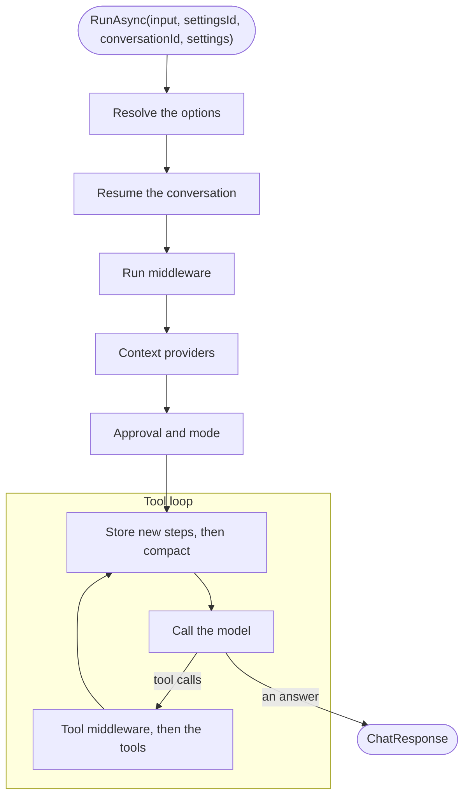

# How a run works

A run is one call of `RunAsync`, `RunStreamingAsync` or `ResumeAsync` on an agent's host. Every run passes through the
same steps in the same order. Knowing that order tells you what your middleware sees, when context is added, which calls
ask for approval and what is stored when.

::: tip The short version

- The settings resolve first, once per run: the code, then the stored settings, then the run's.
- Then the run passes, outermost first: the conversation, run middleware, context providers, approval, and the tool
  loop.
- Inside the tool loop, every step is stored before the next model call, and compaction shrinks what that call sees.
- Streaming runs take the same steps.

:::

## The steps

The run starts at the top. Each step wraps the ones below it, so the answer passes back up through them: the
conversation stores how the run ended, and middleware sees the response. The sections below follow the diagram.

## 1. Resolve the options

The host builds the run's `ChatOptions` from the agent's code and the settings layers: the agent's chat options and
instructions, then the settings stored under the settings id, then the run's own settings. It then creates the tools the
agent offers, each with its settings resolved through the same layers. Sub-agents and the tools of MCP servers come
after the agent's own tools.

The layers resolve once, when the run starts. Settings saved during a run apply from the next run on. See [Settings
layering](./settings-layering.md).

## 2. Resume the conversation

With a conversation id, the run loads the conversation's entries and puts them ahead of the new input, so the model sees
the whole conversation. It stores the input. Unless the run's settings name a mode, it continues in the mode the
conversation's last run ended in. A conversation that was handed off goes to the agent that answered last. Without a
conversation id, the run starts fresh and stores nothing.

Typeshift runs one run per conversation at a time in a process. See [Conversations](./conversations.md).

## 3. Run middleware

Each `IRunMiddleware` wraps the rest of the run. It sees the agent, the messages, the options and the mode, and may
change the messages and options for this run, or answer in place of the model. See [Middleware](./middleware.md).

## 4. Context providers

Each context provider the agent uses adds instructions, messages or tools to this run. What it adds is never stored with
the conversation, so every run asks again. See [Context providers](./context-providers.md).

## 5. Approval and mode

Before the tool loop, the run matches the host's answers to the approval requests the conversation stored. In plan mode
it offers only the read-only tools and `exit_plan_mode`. After each pass of the tool loop, rules, standing approvals and
auto mode decide the calls they can. When calls are left that only the host can decide, the run stores the requests and
ends. See [Tool approval](./tool-approval.md) and [Plan and auto modes](./modes.md).

## 6. The tool loop

Microsoft.Extensions.AI's `FunctionInvokingChatClient` calls the model, runs the tools it asks for, and calls the model
again until it answers. The [run options](./defining-agents.md#run-options) set its limits, such as the most rounds of
tool calls. Each tool call goes through the tool middleware, then the tool.

Before every model call, two things happen:

1. **The steps are stored.** Tool results, steering input and the answers of background sub-agents are appended to the
   conversation. Each model response is stored as it arrives. A crash loses at most the call in flight.
2. **The history is compacted**, when the agent turns compaction on and the call would exceed its token limit. The
   stored conversation keeps everything. See [Long-running agents](./long-running-agents.md#compaction).

The model's own `IChatClient` comes from your chat client provider. Typeshift traces every call to it and never disposes
it. See [Observability](./observability.md).

## What each step can change

| Step | Sees | Can |
|---|---|---|
| Run middleware | The agent, the messages, the options and the mode | Change the messages and options of this run, or answer in place of the model |
| Context provider | The run | Add instructions, messages and tools to this run |
| Approval rule | Each call that requires approval, with the arguments the model sent | Approve it, reject it with a reason for the model, or abstain |
| Tool middleware | Each tool call: the function, its arguments, the messages so far | Answer in place of the tool, or end the tool loop |

## Related

- [Running agents](./running-agents.md): the calls that start a run.
- [Settings layering](./settings-layering.md): how step 1 resolves each value.
- [Architecture](../contributing/architecture.md#a-run): the same pipeline from the code's side.
