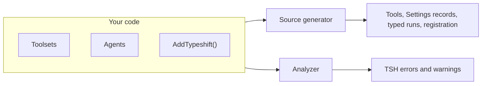

# How Typeshift reads your code

Typeshift reads your toolsets and agents when you build, and writes the code that runs them. A mistake such as
configuring a tool the agent doesn't offer then fails the build, and your app can publish with Native AOT. The price
is a few rules for how you write a declaration, and agents that exist only in code.



Your toolsets, your agents and your `AddTypeshift()` call go to two parts of the package. The source generator writes
the code your app compiles, and the analyzer reports mistakes as errors and warnings at the line you wrote. Both read
a declaration with the same code, so a shape the generator cannot read is one the analyzer reports.

They do not read the same project, though. The generator runs before any source generator has written its code, and
the analyzer after all of them. The analyzer therefore compares what it read with what the generator wrote, and warns
when the two differ ([TSH032](./diagnostics.md#tsh032)).

## What the generator reads

| You write | The generator reads | It writes |
|---|---|---|
| A toolset, a `partial` class that derives from `Toolset` | Each `AddTool` chain in the constructor, and the XML docs of each tool's method | An `AIFunction` per tool, which binds the model's arguments to your method, and a `{Tool}Overrides` record for a tool with configurable settings |
| An agent, a `partial` class that derives from `Agent` | The chains in its constructor: the toolsets and tools it offers, its own tools, its chat options and which of them are configurable | The agent's `Settings` record, a `Configure{Tool}()` for each offered tool with settings, and the typed runs of its host |
| `services.AddTypeshift()` or `TypeshiftRuntime.Create(...)` | The call | A replacement for the call, which registers the toolsets and agents of your project and of the projects it references |

The generator finds toolsets and agents by their base class, so they carry no attribute. It looks for the name
`Toolset` or `Agent` in the class's base list, with or without its namespace, and does not follow a using alias
([TSH017](./diagnostics.md#tsh017)). [Generated members](./generated-members.md) lists every member it writes and what
triggers each one.

## Declarations are read from source

The generator reads your constructors as source and never runs them. Take this pick from an agent's constructor:

<!-- snippet: exclude-tools -->
<a id='snippet-exclude-tools'></a>
```cs
UseToolset<TicketToolset>()
    .Exclude(t => t.CloseTicket);
```
<sup><a href='https://github.com/weboost-at/Typeshift/blob/main/samples/Typeshift.Samples.Docs/Agents/TriageAgent.cs#L13-L16' title='Snippet source file'>snippet source</a> | <a href='#snippet-exclude-tools' title='Start of snippet'>anchor</a></sup>
<!-- endSnippet -->

The generator reads `t => t.CloseTicket` and writes an agent that offers every tool of `TicketToolset` except
`close_ticket`. When your app creates the agent, the constructor runs, but its chains declare nothing. They only
record values, such as a toolset's display name, the chat options and what `Configure{Tool}()` sets. Which tools
exist, which ones an agent offers and what may change at runtime is decided by the generated code alone, so the agent
your app runs is the agent the build checked.

The rules for declarations follow from this. The generator follows a chain only where it sits directly in the
constructor, as one statement, with picks that name a member, such as `t => t.CloseTicket` or `s => s.Limit`. It
cannot follow a chain split over variables, and an `AddTool` inside an `if` would look optional while the generated
code always includes it, so the analyzer reports both ([TSH014](./diagnostics.md#tsh014),
[TSH015](./diagnostics.md#tsh015)). Names and descriptions are constants, because the generator needs their values
when you build. [Rules for every chain](./builders.md#rules-for-every-chain) lists each rule with its diagnostic.

## Code that other generators write

The generator cannot see code that a source generator writes, whether another package's or Typeshift's own. That is
how the compiler runs generators: each one reads the project as you wrote it. A declaration that names such code
compiles, but the generator cannot read it:

- A tool whose method another generator writes, as in `AddTool(Generated.Find)`, is not generated.
- A name, a description or a storage kind from a constant another generator writes is not read, so the agent keeps
  the default.
- A toolset or an agent that another generator writes as a whole class gets no generated code at all.

The analyzer warns where it can compare ([TSH032](./diagnostics.md#tsh032)): on the toolset or the agent whose
declaration the generator read differently, and on an agent that uses a toolset another generator wrote, since it
lacks that toolset's tools. An agent that another generator writes as a whole class is the one case nothing reports
when you build. It gets no host, so your app fails when it asks for one. Write toolsets and agents in your own source
files, and declare them with your own methods and constants.

A file that a script or a template writes into your project is different: it is a source file like any other, also
when it starts with `// <auto-generated/>`. The generator reads it, and the analyzer reports its mistakes in it.

## Generated code sits in files of its own

The generator writes its code into files of its own, which the compiler reads next to yours. Whatever that code
names, it names from another file than the one you wrote it in. That is why a toolset and an agent are `partial`
([TSH001](./diagnostics.md#tsh001)), so the generated file can add members to them, and why they cannot be nested as
`private` ([TSH016](./diagnostics.md#tsh016)).

It is also why C#'s `file` types do not work here, since only their own file can name them. A toolset or an agent
cannot be a `file` class ([TSH016](./diagnostics.md#tsh016)), a tool's method cannot belong to one
([TSH003](./diagnostics.md#tsh003)), and a settings record cannot be one
([TSH006](./diagnostics.md#tsh006)). Use `internal` for what should stay inside your project.

## Mistakes the build catches

The generated code knows every tool each agent offers, so some mistakes don't compile:

- Configuring a tool the agent doesn't offer. The agent has no `Configure{Tool}()` for it, as
  [Getting started](./getting-started.md#_3-write-an-agent) shows.
- Picking a tool of another toolset. The list that `Include` and `Exclude` pick from holds only that toolset's tools.
- Setting a value the code keeps. The agent's `Settings` record has members only for what the code marks
  configurable, so your code cannot store or pass a value for anything else.

The analyzer reports, while you type, what the compiler cannot see, such as two tools with one name or a tool without
a description. Its diagnostics behave like those of any other analyzer, so `#pragma` and `.editorconfig` reach them
([Severities and suppression](./diagnostics.md#severities-and-suppression)).

## Generated code that never reflects

On Microsoft.Extensions.AI alone, a tool is usually an `AIFunctionFactory.Create` call, which reads the method through
reflection when your app runs. Typeshift writes each tool's function when you build instead. The function binds the
model's arguments to your method's parameters through JSON metadata, and the `Settings` and overrides records read and
write themselves member by member. Generated code never reflects over your types, so your app can publish with
[Native AOT](./native-aot.md).

Outside Native AOT, System.Text.Json still reads the types your tools take and return through reflection. Under
Native AOT they need JSON metadata of their own
([Tool parameter and result types](./native-aot.md#tool-parameter-and-result-types)).

## Agents are defined when you build

Because the generator reads every agent from source, your app runs the agents it was built with. You cannot create an
agent at runtime, for example from a prompt one of your users writes, and stored settings change only what the code
marks configurable. [Why agents in code](./what-is-typeshift.md#why-agents-in-code) explains the trade, and what to
use instead.

The same holds for the tools of your toolsets. A run can still offer tools the generator never saw: those of an
[MCP server](./mcp.md), and those a [context provider](./middleware.md#context-providers) adds.

## How AddTypeshift() finds your agents

`AddTypeshift()` and `TypeshiftRuntime.Create(...)` look like ordinary library methods, but the library's own versions
throw. The generator replaces each call in your project with one that registers the toolsets and agents of that
project and of every project it references. Only the generator knows them all, so one call registers everything, and
you keep no list of toolsets or agents in step with your code.

The replacement is a C# [interceptor](https://learn.microsoft.com/dotnet/csharp/whats-new/csharp-12#interceptors),
which takes the place of the exact call the generator saw, so how you write the call matters.
[Registration](./registration.md#what-addtypeshift-registers) says how to call it and what to check when it throws.

## Related

- [Builders](./builders.md): every call the generator reads, and the rules for each chain.
- [AgentHost and generated members](./generated-members.md): what the generator writes, and what triggers each member.
- [Diagnostics](./diagnostics.md): every mistake the analyzer reports, and how to fix it.
- [How a run works](./how-a-run-works.md): the steps your agent passes through once your app runs it.
