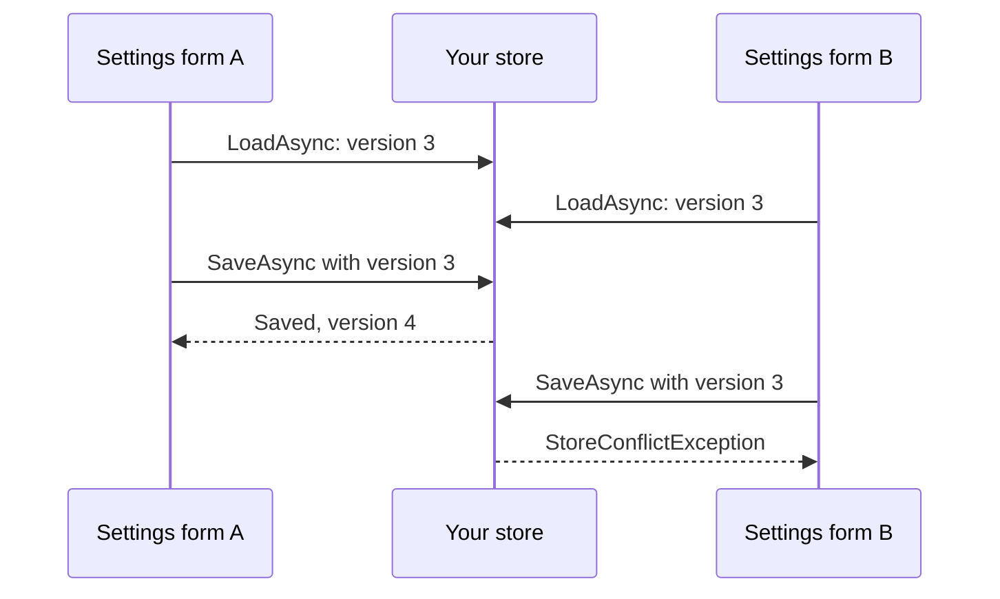

# Implementing a store

Typeshift keeps your agents' settings through an `ISettingsStore<TId>`, your conversations through an
`IConversationStore<TId>` and their decisions through an `IDecisionStore<TId>`, which you implement over your own
database for the type `TId` of your ids. This page walks through a store in the order you build it: you register it,
implement its interfaces, load and save settings, append conversations, keep decisions, migrate older settings and
check it. Until you register a store, Typeshift keeps everything in memory and loses it when the app stops, so a
production app writes its own.

## Register your store

Register your store in the `AddTypeshift()` chain with `WithStore<T>()`. This page builds a store on Entity Framework
Core, `EfTypeshiftStore`, so its context factory is registered next to it:

<!-- snippet: ef-core-registration -->
<a id='snippet-ef-core-registration'></a>
```cs
services.AddTypeshift()
    .WithStore<EfTypeshiftStore>();

services.AddDbContextFactory<TypeshiftDb>(options => options.UseSqlite("Data Source=typeshift.db"));
```
<sup><a href='https://github.com/weboost-at/Typeshift/blob/main/samples/Typeshift.Samples.Docs/Scenarios/Registration.cs#L42-L47' title='Snippet source file'>snippet source</a> | <a href='#snippet-ef-core-registration' title='Start of snippet'>anchor</a></sup>
<!-- endSnippet -->

`WithStore<T>()` registers your class as each store interface it implements, of any id type. An
`ITypeshiftStore<TId>` takes one call, and a store of settings and one of conversations and their decisions take a
call each.

### Which store serves a call

Without any store, Typeshift keeps settings, conversations and decisions in memory, under ids of every type, so
everything works from the first run on. The first save, or the first run that stores a conversation,
[logs a warning](./observability.md#logs) that names `WithStore<T>()`, and `WithFileStore()` for agents' own
settings. The memory is gone when the app stops, so register a store before your app keeps anything it must not
lose.

Once you register a store, with the chain or in the container yourself, Typeshift uses only the stores you
registered:

- For each store interface, the store registered last wins. Each `InMemoryTypeshiftStore<TId>` keeps agents' own
  settings too, so of several, the last one registered keeps them.
- A run applies agents' own settings only when a registered store implements `IAgentSettingsStore`, as
  `InMemoryTypeshiftStore<TId>` and the file store of `WithFileStore()` do.
- A call that needs an interface none of your stores implements throws an `InvalidOperationException` that names
  `WithStore<T>()` and the interface. A run with a conversation id and a store of settings alone throws, and so does
  an id of a type none of your stores keeps, such as a settings id of `long` beside an `ISettingsStore<int>`.
- Decisions are the one exception to that rule, so that a conversation that never has one costs nothing. Without an
  `IDecisionStore<TId>` of the conversation id's type, loading a conversation's decisions finds none and calls no
  store. The first thing Typeshift has to keep there, a decision, an approval for the conversation or the
  conversation's mode, throws the exception above, naming `IDecisionStore<TId>`. Typeshift
  never keeps decisions in memory beside a store you registered, because they would vanish with the process while
  the conversation they belong to stays ([Keep decisions](#keep-decisions)). The analyzer warns about a chain that
  registers a store of conversations and none of their decisions, when an agent of your project can ask
  ([TSH036](./diagnostics.md#tsh036)).
- A store you register in the container yourself is a singleton too ([Plan for one instance](#plan-for-one-instance)).
  One registered with `AddScoped` or `AddTransient` fails the first run with an `InvalidOperationException` that
  names it, because Typeshift takes its stores from the root container, not from a request's scope.

### Plan for one instance

`WithStore<T>()` registers your store as a singleton. One instance handles every run of every request, and several
runs often call it at the same time, so plan for that before you write its first method:

- **It cannot take scoped services**, such as a `DbContext` or the current customer. Take a factory instead, such as
  `IDbContextFactory<T>` or `IServiceScopeFactory`, and create what a call needs inside the call. Singleton services,
  such as options or a logger, are fine.
- **Any method can run while others are running**, even on the same document or conversation. Keep no state between
  calls, or guard what you keep.
- **It knows nothing of the caller.** Your app decides who may use a settings id or a conversation id before it
  gives one to a host ([Conversation ids](./conversations.md#conversation-ids)), and the store keeps whatever it
  is given.

::: warning A scoped DbContext breaks the store
A singleton that takes a `DbContext` keeps the first one it got for the life of the app and shares it between
requests, which `DbContext` does not allow. Register `IDbContextFactory<T>` with `AddDbContextFactory`, as the
registration above does, and create a context in each method.
:::

## Implement the interfaces

A store has seven methods in three interfaces. `ISettingsStore<TId>` keeps settings under a settings id with the
first two, `IConversationStore<TId>` keeps conversations with the next three, and `IDecisionStore<TId>` keeps each
conversation's decisions with the last two. The store on this page implements `ITypeshiftStore<int>`, which is all
three, for `int` ids. When settings and conversations live in different databases, implement the interfaces in
classes of their own and [register each](#register-your-store). Keep a conversation's decisions where its entries
live.

An app that keeps [each agent's own settings](./settings-and-stores.md#agent-settings) implements `IAgentSettingsStore`
too, or alone when it has no settings ids. Its `LoadAsync(kind)` and `SaveAsync(kind, json, loadedVersion)` work as
the settings methods below, keyed by the kind alone. Every run of every agent calls `LoadAsync(kind)`, so keep it
cheap, for example with a cache.

::: warning Keep an agent's own documents apart from an id's
In a table that holds both, an agent's own document has no id. A load that forgets to ask for that returns a
customer's document as every customer's defaults. `VerifyAsync` checks for this.
:::

You implement all seven. Every id has your store's id type, the type argument of its interfaces, and the samples on
this page use `int`: a host's ids of that type reach your store, as
[Ids of your own types](./settings-and-stores.md#ids-of-your-own-types) shows. Each method takes a `CancellationToken`
last.

| Method | Does |
|---|---|
| `LoadAsync(id, kind)` | Returns the document of a kind under an id as a `StoredDocument`, with its JSON and version, or null when none is stored. |
| `SaveAsync(id, kind, json, loadedVersion)` | Saves a document's JSON if its stored version still equals `loadedVersion` (0 when nothing is stored yet), and returns the new version. Throws a `StoreConflictException` when another save came first. |
| `LoadConversationAsync(conversation)` | Returns every entry of a conversation, summaries included, oldest first. |
| `LoadConversationSinceCompactionAsync(conversation)` | Returns what a run reads: the last summary and the entries after it ([Start from the last summary](#start-from-the-last-summary)). |
| `AppendConversationAsync(conversation, entry)` | Appends one entry to a conversation. The first entry creates the conversation. |
| `LoadDecisionsAsync(conversation)` | Returns the conversation's decisions document as a `StoredDocument`, or null when none is stored ([Keep decisions](#keep-decisions)). |
| `SaveDecisionsAsync(conversation, json, loadedVersion)` | Saves the conversation's decisions document if its stored version still equals `loadedVersion`, as `SaveAsync` does, and returns the new version. |

The database on this page has a table for settings, keyed by id and kind together
([Key settings by id and kind](#key-settings-by-id-and-kind)), one for conversations, keyed by a number the database
assigns, and one for decisions, keyed by the conversation:

<!-- snippet: ef-core-db -->
<a id='snippet-ef-core-db'></a>
```cs
internal sealed class TypeshiftDb(DbContextOptions<TypeshiftDb> options) : DbContext(options)
{
    public DbSet<DocumentRow> Documents => Set<DocumentRow>();

    public DbSet<EntryRow> Entries => Set<EntryRow>();

    public DbSet<DecisionsRow> Decisions => Set<DecisionsRow>();

    protected override void OnModelCreating(ModelBuilder model)
    {
        model.Entity<DocumentRow>()
            .HasKey(document => new { document.Id, document.Kind });

        model.Entity<EntryRow>()
            .HasKey(entry => entry.Sequence);

        model.Entity<EntryRow>()
            .HasIndex(entry => entry.Conversation);

        model.Entity<DecisionsRow>()
            .HasKey(decisions => decisions.Conversation);

        // The application sets the key, the conversation's id, so the database must not generate it
        model.Entity<DecisionsRow>()
            .Property(decisions => decisions.Conversation)
            .ValueGeneratedNever();
    }
}

internal sealed class DocumentRow
{
    public required int Id { get; init; }

    public required string Kind { get; init; }

    public required long Version { get; init; }

    public required string Json { get; init; }
}

internal sealed class EntryRow
{
    public long Sequence { get; init; }

    public required int Conversation { get; init; }

    public required bool IsSummary { get; init; }

    public required string Json { get; init; }
}

internal sealed class DecisionsRow
{
    public required int Conversation { get; init; }

    public required long Version { get; init; }

    public required string Json { get; init; }
}
```
<sup><a href='https://github.com/weboost-at/Typeshift/blob/main/samples/Typeshift.Samples.Docs/Stores/EfCore/TypeshiftDb.cs#L5-L65' title='Snippet source file'>snippet source</a> | <a href='#snippet-ef-core-db' title='Start of snippet'>anchor</a></sup>
<!-- endSnippet -->

Typeshift creates no tables. The docs sample creates them with `EnsureCreatedAsync` at startup, and your app creates
them as it does its other tables, such as with EF Core migrations.

## Key settings by id and kind

A document is an agent's `Settings` record, the one `ConfigureAsync` and `SaveSettingsAsync` save. Typeshift writes
the record as JSON before it calls `SaveAsync` and reads it back after `LoadAsync`, so your store handles strings and
numbers only. Keep each document in a row keyed by the id and the kind, with the JSON and the
[version](#save-with-a-version):

- **The id** is the settings id your app gave the host, such as a customer's.
- **The kind** is the agent's class name, or what its `WithStorageKind("...")` sets. One settings id holds a document
  per agent of a run, sub-agents and handoffs included
  ([Sub-agents and handoffs](./settings-and-stores.md#sub-agents-and-handoffs)), so the id and the kind together are
  the key.
- **The JSON** is the record as Typeshift wrote it ([The stored JSON](./settings-and-stores.md#the-stored-json)).
  Keep it as text and return it unchanged.

Loading reads the row by its id and kind and returns its JSON and version as a `StoredDocument`:

<!-- snippet: ef-core-load -->
<a id='snippet-ef-core-load'></a>
```cs
internal sealed class EfTypeshiftStore(IDbContextFactory<TypeshiftDb> contexts) : ITypeshiftStore<int>
{
    public async Task<StoredDocument?> LoadAsync(int id, string kind, CancellationToken ct)
    {
        await using var db = await contexts.CreateDbContextAsync(ct);

        return await db.Documents.FindAsync([id, kind], ct) is { } row
            ? new StoredDocument(row.Json, row.Version)
            : null;
    }
```
<sup><a href='https://github.com/weboost-at/Typeshift/blob/main/samples/Typeshift.Samples.Docs/Stores/EfCore/EfTypeshiftStore.cs#L5-L16' title='Snippet source file'>snippet source</a> | <a href='#snippet-ef-core-load' title='Start of snippet'>anchor</a></sup>
<!-- endSnippet -->

## Save with a version

A version is the number of the stored document's current state, kept for optimistic concurrency. It lets a save
find out that the document changed since the caller loaded it, so one save never silently overwrites another.
Typeshift does not interpret the number: it hands `SaveAsync` back the version `LoadAsync` returned, as
`loadedVersion`, and your store compares the two. `loadedVersion` is always the old version. Your store writes the new
one itself and returns it, and the caller passes that to its next save:

| Call | Stored before | Your store | Returns |
|---|---|---|---|
| `LoadAsync` | nothing | finds no row | `null` |
| `SaveAsync(json, loadedVersion: 0)` | nothing | inserts the row at version 1 | `1` |
| `SaveAsync(json, loadedVersion: 1)` | version 1 | updates the row, which still holds 1, to version 2 | `2` |
| `SaveAsync(json, loadedVersion: 1)` | version 2 | changes nothing: the row no longer holds 1 | throws `StoreConflictException` |
| `SaveAsync(json, loadedVersion: 0)` | version 2 | changes nothing: a row exists | throws `StoreConflictException` |



The diagram shows two forms editing the same customer's settings. Both load version 3, and the first to save
wins and moves the document to version 4. The second still names version 3, so its save fails instead of erasing
the first form's change, and that form loads the settings again.

Runs only load settings; they never save them. Saves come from your app, through `ConfigureAsync`, which loads again
and reapplies its change after a lost save, and `SaveSettingsAsync`, which leaves the conflict to your code
([Agent settings](./settings-and-stores.md#agent-settings)).

### Write the save in one statement

Run one `INSERT` or `UPDATE` that checks the version as it writes, and throw a `StoreConflictException` when it
changed no row. The `loadedVersion` the caller passes tells you which state of the document it loaded:

- **Version 0 means the caller found no document**, so insert it. A row that is there already was created by another
  save in between.
- **Any other version is the one the caller loaded**, so update the row only while it still holds that version. A
  row that holds another version was saved by someone else since, and a missing row was deleted after the caller
  loaded it. Both are conflicts.

Check and write in one statement. If you read the row, compare its version and then write, two saves that both
loaded version 3 can both pass the check before either writes, and the second silently overwrites the first. Each of
these statements reports how many rows it changed, and none means another save won:

```sql
INSERT INTO documents (id, kind, version, json) VALUES (@id, @kind, 1, @json)
ON CONFLICT (id, kind) DO NOTHING;

UPDATE documents SET json = @json, version = @loaded + 1
WHERE id = @id AND kind = @kind AND version = @loaded;
```

SQL Server has no `ON CONFLICT`. There, run a plain `INSERT` and treat the duplicate-key error, number 2627, as the
conflict, passing it to the `StoreConflictException` as its inner exception.

Return the new version. Any number works as long as it is not 0 and was never this document's version before, and
counting up by one is the simple choice. Throw `StoreConflictException` only for a lost race, with a message that
names the document. Any other failure, such as a lost connection, goes to the caller as it is.

The EF Core store runs one of the two statements per save. `ExecuteSqlAsync` inserts with `ON CONFLICT DO NOTHING`,
which SQLite and PostgreSQL support, and turns each interpolated value into a SQL parameter. Its SQL quotes the table
and column names as EF Core names them by default, so match it to your own mapping. `ExecuteUpdateAsync` updates with
the version in its `WHERE`. Both return the number of rows they changed:

<!-- snippet: ef-core-save -->
<a id='snippet-ef-core-save'></a>
```cs
public async Task<long> SaveAsync(int id, string kind, string json, long loadedVersion, CancellationToken ct)
{
    await using var db = await contexts.CreateDbContextAsync(ct);

    var rows = loadedVersion == 0
        ? await InsertAsync(db, id, kind, json, ct)
        : await UpdateAsync(db, id, kind, json, loadedVersion, ct);

    // Each statement checks and writes in one step, so a save that changed no row lost to another save
    return rows == 1
        ? loadedVersion + 1
        : throw new StoreConflictException($"{kind} {id} was saved after version {loadedVersion}.");
}

private static Task<int> InsertAsync(TypeshiftDb db, int id, string kind, string json, CancellationToken ct) =>
    db.Database.ExecuteSqlAsync(
        $"""
        INSERT INTO "Documents" ("Id", "Kind", "Version", "Json")
        VALUES ({id}, {kind}, 1, {json})
        ON CONFLICT ("Id", "Kind") DO NOTHING
        """,
        ct);

private static Task<int> UpdateAsync(
    TypeshiftDb db,
    int id,
    string kind,
    string json,
    long loadedVersion,
    CancellationToken ct) =>
    db.Documents
        .Where(row => row.Id == id && row.Kind == kind && row.Version == loadedVersion)
        .ExecuteUpdateAsync(
            set => set
                .SetProperty(row => row.Json, json)
                .SetProperty(row => row.Version, loadedVersion + 1),
            ct);
```
<sup><a href='https://github.com/weboost-at/Typeshift/blob/main/samples/Typeshift.Samples.Docs/Stores/EfCore/EfTypeshiftStore.cs#L18-L56' title='Snippet source file'>snippet source</a> | <a href='#snippet-ef-core-save' title='Start of snippet'>anchor</a></sup>
<!-- endSnippet -->

## Append to a conversation

A conversation only grows. Runs append each step as it happens: the input, every model response, the tool results
of each round of calls, steering input and the entry that ends a run
([What is stored](./conversations.md#what-is-stored)). Your store never changes or removes an entry:

- **Keep the append order.** `LoadConversationAsync` returns the entries in the order they were appended, oldest
  first. Let the database number the rows, as an identity column does; a timestamp can tie.
- **Store each entry as its JSON**, `entry.Serialize()`, and read it back with `ConversationEntry.Deserialize(json)`.
  A database client that serializes with `System.Text.Json` or Newtonsoft.Json may take the entry as it is
  ([What is stored](./conversations.md#what-is-stored)). Keep that JSON whole: later runs read members from it that
  your store never looks at, such as `EstimatedInputTokens`, which
  [compaction](./conversations.md#compaction) keeps on a model response.
- **Keep the append cheap.** Runs append while they work, so `AppendConversationAsync` is the hot path, and a row per
  entry suits it.

The messages in that JSON follow the content contract of Microsoft.Extensions.AI, which knows the content types of
that library. A run stores a step without a content of any other type, such as one a provider's client adds, and logs
a warning that names the type. When your app's version of Microsoft.Extensions.AI cannot read a stored content, for
example after a package downgrade, `ConversationEntry.Deserialize` leaves that content out and reads the rest of the
entry, and the next run of the conversation logs how many contents it went without.

### Start from the last summary

When clearing old tool results does not shrink the history enough, [compaction](./conversations.md#compaction)
summarizes a run's oldest turns. It appends one entry of its own that holds the summary and the messages it kept after
the summary, with `IsSummary` set to true. Every later run starts from the latest such entry, because it carries what
the runs need from before it. The conversation's mode and its standing approvals are not among the entries: they
are [kept with its decisions](#keep-decisions).

`LoadConversationSinceCompactionAsync` returns that entry and everything after it, oldest first, or every entry when
the conversation has no summary. Every run calls it first, and an agent that compacts makes conversations long, so start
at the last summary instead of reading the conversation whole: copy `entry.IsSummary` into a column of its own when you
append, and start the query at the last row that has it:

<!-- snippet: ef-core-conversations -->
<a id='snippet-ef-core-conversations'></a>
```cs
public async Task<IReadOnlyList<ConversationEntry>> LoadConversationAsync(int conversation, CancellationToken ct)
{
    await using var db = await contexts.CreateDbContextAsync(ct);

    var rows = await db.Entries
        .Where(entry => entry.Conversation == conversation)
        .OrderBy(entry => entry.Sequence)
        .ToListAsync(ct);

    return [.. rows.Select(row => ConversationEntry.Deserialize(row.Json))];
}

// A run starts from the last summary, so the rows before it stay in the database
public async Task<IReadOnlyList<ConversationEntry>> LoadConversationSinceCompactionAsync(
    int conversation,
    CancellationToken ct)
{
    await using var db = await contexts.CreateDbContextAsync(ct);
    var entries = db.Entries.Where(entry => entry.Conversation == conversation);

    var start = await entries
        .Where(entry => entry.IsSummary)
        .MaxAsync(entry => (long?)entry.Sequence, ct) ?? 0;

    var rows = await entries
        .Where(entry => entry.Sequence >= start)
        .OrderBy(entry => entry.Sequence)
        .ToListAsync(ct);

    return [.. rows.Select(row => ConversationEntry.Deserialize(row.Json))];
}

public async Task AppendConversationAsync(int conversation, ConversationEntry entry, CancellationToken ct)
{
    await using var db = await contexts.CreateDbContextAsync(ct);

    db.Entries.Add(new EntryRow
    {
        Conversation = conversation,
        IsSummary = entry.IsSummary,
        Json = entry.Serialize()
    });

    await db.SaveChangesAsync(ct);
}
```
<sup><a href='https://github.com/weboost-at/Typeshift/blob/main/samples/Typeshift.Samples.Docs/Stores/EfCore/EfTypeshiftStore.cs#L58-L104' title='Snippet source file'>snippet source</a> | <a href='#snippet-ef-core-conversations' title='Start of snippet'>anchor</a></sup>
<!-- endSnippet -->

`LoadConversationAsync` still returns every entry, summaries included, for your app's own use, such as showing the whole
history. Runs never call it: they load from the last summary on.

Columns for `entry.EndsRun` and `entry.At` pay off in the same way. An app that looks for interrupted runs after a
restart ([Resuming](./conversations.md#resuming)) then finds them with one query over each conversation's last row,
instead of loading every conversation whole.

## Keep decisions

A decision is something a run asks your app before it goes on, such as whether a tool call may run. Typeshift keeps
what a conversation waits for, the tools your app approved for it and its mode in one JSON document per
conversation. Your
store keeps that document as it keeps a settings document: as text, with a
[version](#save-with-a-version), under the conversation's id alone.

Unlike a conversation's entries, the document is small and changes in place. It holds the calls of one model response
at most, the standing approvals, the mode and a handful of ids, whatever the conversation's length. Typeshift reads
it when a run starts and when your app asks what waits. It saves it when a run asks, when your app answers, when the
run carries the answers out, and when a run's settings or your app name the conversation's mode.

`SaveDecisionsAsync` follows the rules of [Save with a version](#save-with-a-version), and they matter more here.
Two requests may answer the same question at once, and two instances of your app may continue the same conversation
at once. Each of them saves with the version it loaded, exactly one save wins, and the loser learns that it lost. That
is how an approved call starts only once, so check the version and write in
[one statement](#write-the-save-in-one-statement):

<!-- snippet: ef-core-decisions -->
<a id='snippet-ef-core-decisions'></a>
```cs
public async Task<StoredDocument?> LoadDecisionsAsync(int conversation, CancellationToken ct)
{
    await using var db = await contexts.CreateDbContextAsync(ct);

    return await db.Decisions.FindAsync([conversation], ct) is { } row
        ? new StoredDocument(row.Json, row.Version)
        : null;
}

public async Task<long> SaveDecisionsAsync(int conversation, string json, long loadedVersion, CancellationToken ct)
{
    await using var db = await contexts.CreateDbContextAsync(ct);

    var rows = loadedVersion == 0
        ? await db.Database.ExecuteSqlAsync(
            $"""
            INSERT INTO "Decisions" ("Conversation", "Version", "Json")
            VALUES ({conversation}, 1, {json})
            ON CONFLICT ("Conversation") DO NOTHING
            """,
            ct)
        : await db.Decisions
            .Where(row => row.Conversation == conversation && row.Version == loadedVersion)
            .ExecuteUpdateAsync(
                set => set
                    .SetProperty(row => row.Json, json)
                    .SetProperty(row => row.Version, loadedVersion + 1),
                ct);

    // One statement checks the version and writes, which is what lets an approved call start only once
    return rows == 1
        ? loadedVersion + 1
        : throw new StoreConflictException(
            $"The decisions of conversation {conversation} were saved after version {loadedVersion}.");
}
}
```
<sup><a href='https://github.com/weboost-at/Typeshift/blob/main/samples/Typeshift.Samples.Docs/Stores/EfCore/EfTypeshiftStore.cs#L106-L143' title='Snippet source file'>snippet source</a> | <a href='#snippet-ef-core-decisions' title='Start of snippet'>anchor</a></sup>
<!-- endSnippet -->

Keep decisions in a table of their own, as the sample does, or under a key no settings id can take. Settings ids and
conversation ids are separate, so a table keyed by a settings id and a kind would put conversation 7's decisions among
customer 7's settings, where a delete or a filter meant for settings reaches them.

## Migrate older settings

A settings document's JSON names the agent's schema version, the one `WithSchemaVersion(n)` sets, in
`"$schemaVersion"` ([The stored JSON](./settings-and-stores.md#the-stored-json)), and JSON without it is at schema
version 1. Typeshift refuses a schema version newer than the code's, so an app rolled back to older code fails loudly
instead of reading settings it does not understand.

An agent raises its schema version when a configurable member is renamed or removed, and migrating the stored JSON of
older schema versions is then up to you. You can do it in `LoadAsync`, where the kind tells you which agent's settings
a row holds: read `"$schemaVersion"`, rewrite the JSON of an older schema version and return it with the version the
row holds, or migrate the rows with a script over your database. Each save writes the current schema version, so a
migrated document reaches it in your database with its next save. Typeshift reads a schema version you leave as it
is, so a renamed or removed member reads as missing ([The stored JSON](./settings-and-stores.md#the-stored-json)).

## Check your store

`VerifyAsync` runs this page's rules for keys, versions, conversation entries and decisions against your store. Call
it on your store from a test of your own in any test framework, with the store over a test database:

<!-- snippet: store-check -->
<a id='snippet-store-check'></a>
```cs
var store = new EfTypeshiftStore(contexts);

await store.VerifyAsync(9001, 9002);
```
<sup><a href='https://github.com/weboost-at/Typeshift/blob/main/samples/Typeshift.Samples.Docs/Scenarios/StoreVerification.cs#L13-L17' title='Snippet source file'>snippet source</a> | <a href='#snippet-store-check' title='Start of snippet'>anchor</a></sup>
<!-- endSnippet -->

- It runs the rules of every interface your store implements for the id type you pass: the settings rules for an
  `ISettingsStore`, the conversation rules for an `IConversationStore`, the decision rules for an `IDecisionStore`,
  and all of them for a store that is all three for that id type, even when you call it through one of the
  interfaces. A store whose settings ids and conversation ids have different types takes two ids of each type in one
  call, as `store.VerifyAsync("tenant-a", "tenant-b", chat, otherChat)`, or one call per id type. Decisions are
  checked under the conversation ids.
- A store that is also an `IAgentSettingsStore` gets the settings rules for agents' own settings, under kinds named
  after the first id, which start with `typeshift_check_`. These documents stay in the database, so run the check
  against a database for tests. For a store of agents' own settings alone, call `VerifyAgentSettingsAsync(kind)`
  with a kind nothing is stored under.
- A broken rule throws an `InvalidOperationException` whose message names the rule and what to change, such as
  keying documents by id and kind together. An exception your store throws itself passes through as it is, except
  where a `StoreConflictException` belongs: there the message names the type your store threw instead.
- For settings, it saves a document, then one of another kind under the same id, and loads both back. It then saves
  the first document at version 0, and with its old version after a save with the current one. Those two saves must
  throw a `StoreConflictException` and leave the document as it was. Every save that succeeds must return a new
  version other than 0.
- For conversations, it appends a run's input and its end, then two summaries with `IsSummary` set, each followed
  by a run's end. After the first run and again at the end, it loads the
  conversation whole and from the last summary on, which is every entry while there is no summary. Each entry must
  come back unchanged, in the order it was appended.
- For decisions, it saves a conversation's document and loads it back, then runs the saves that must conflict: at
  version 0, with an old version, and at another version than 0 before anything is stored.
- It takes two ids. Before anything else, it saves a document and appends an entry under the second one, and at the
  end both must be as they were. A conversation's decisions under the second id are checked the same way. A store that forgets the id in a query, and so hands one customer's settings or
  conversation to another, fails there.
- A save of a document that is not stored, at a version other than 0, must throw a `StoreConflictException` and
  write nothing, as a save does whose document was deleted after it was loaded.
- The entries it appends carry times that tie and run backwards, as the times of real entries can, so a store that
  orders a conversation by time fails.
- It writes under the id you pass, as a settings id and as a conversation id, so calling it twice with one id fails
  with a message that asks for a new id. Give each call an id nothing else uses, such as a new `Guid`, or start from
  an empty database, as the docs sample does.
- It makes one call at a time, so it cannot catch two saves that race. A store that reads the version and then
  writes passes it and still loses saves under load
  ([Write the save in one statement](#write-the-save-in-one-statement)).

## Related

- [Settings and stores](./settings-and-stores.md): how stored settings layer over the agent's code, and the JSON a
  store keeps.
- [Conversations](./conversations.md): what a run stores, resuming, and compaction.
- [Approval and modes](./tool-approval.md): the tool calls a run asks your app about.
- [Registration](./registration.md#the-chain): `WithStore<T>()` among the other chain calls.
- [Generated members](./generated-members.md#settings): the `Settings` record a store keeps, with its `Kind` and
  `SchemaVersion`.
