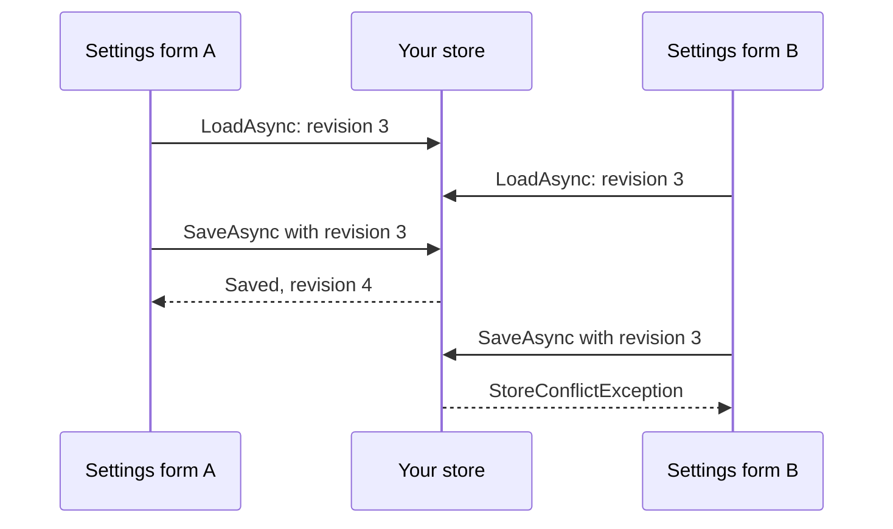

# Implementing a store

Typeshift keeps every agent's settings and every conversation through one store, an `ITypeshiftStore` you implement
over your own database. This page walks through what a store must do, in the order you meet it: its lifetime, the
settings it saves with their revisions, and the conversations it appends to. `InMemoryTypeshiftStore` serves tests
and samples, so a production app writes its own.

## The store is a singleton

`WithStore<T>()` registers your store as a singleton. One instance serves every run of every request, often several
at the same time, so plan the store around that before you write a method of it:

- **It cannot take scoped services**, such as a `DbContext` or the current customer. Take a factory instead, and
  create what a call needs inside the call.
- **Every method may run while others run**, on the same document or conversation too. Keep no state between calls,
  or guard what you keep.
- **It knows nothing of the caller.** Your app decides who may use a settings id or a conversation id before it
  passes one to a run ([Conversations](./conversations.md#tracking-a-conversation)), and the store keeps whatever it
  is given.

::: warning A scoped DbContext breaks the store
A singleton that takes a `DbContext` keeps the first one it got for the life of the app and shares it between
requests, which `DbContext` does not allow. Register `IDbContextFactory<T>` with `AddDbContextFactory` and create a
context in each method.
:::

This page builds a store on Entity Framework Core, registered next to its context factory:

<!-- snippet: ef-core-registration -->
<a id='snippet-ef-core-registration'></a>
```cs
services.AddDbContextFactory<TypeshiftDb>(options => options.UseSqlite("Data Source=typeshift.db"));
```
<sup><a href='https://github.com/weboost-at/Typeshift/blob/main/samples/Typeshift.Samples.Docs/Scenarios/Registration.cs#L43-L45' title='Snippet source file'>snippet source</a> | <a href='#snippet-ef-core-registration' title='Start of snippet'>anchor</a></sup>
<!-- endSnippet -->

## The five methods

`ITypeshiftStore` has four methods, plus a fifth that a store may override. The ids they take have the build's
[id type](./registration.md#the-id-type), `Guid` unless `TypeshiftIdType` names another, and each method takes a
`CancellationToken` last.

| Method | Does |
|---|---|
| `LoadAsync<TData>(id)` | Returns the document of kind `TData.Kind` under an id, with its revision, or null when none is stored. |
| `SaveAsync<TData>(id, data, revision)` | Saves the document if its stored revision is still `revision`, 0 for none, and returns the new revision. Throws a `StoreConflictException` when another save came first. |
| `LoadConversationAsync(conversation)` | Returns a conversation's entries, oldest first. |
| `LoadConversationSinceCompactionAsync(conversation)` | Returns the conversation's last summary and the entries after it. By default it loads the whole conversation and drops what came before the summary. |
| `AppendConversationAsync(conversation, entry)` | Appends one entry to a conversation, and creates the conversation with its first. |

The first two keep settings, the other three conversations. The database of this page has a table for each:

<!-- snippet: ef-core-db -->
<a id='snippet-ef-core-db'></a>
```cs
internal sealed class TypeshiftDb(DbContextOptions<TypeshiftDb> options) : DbContext(options)
{
    public DbSet<DocumentRow> Documents => Set<DocumentRow>();

    public DbSet<EntryRow> Entries => Set<EntryRow>();

    protected override void OnModelCreating(ModelBuilder model)
    {
        model.Entity<DocumentRow>()
            .HasKey(document => new { document.Kind, document.Id });

        model.Entity<DocumentRow>()
            .Property(document => document.Revision)
            .IsConcurrencyToken();

        model.Entity<EntryRow>()
            .HasKey(entry => entry.Sequence);

        model.Entity<EntryRow>()
            .HasIndex(entry => entry.Conversation);
    }
}

internal sealed class DocumentRow
{
    public required string Kind { get; init; }

    public required int Id { get; init; }

    public required int Version { get; set; }

    public required long Revision { get; set; }

    public required string Json { get; set; }
}

internal sealed class EntryRow
{
    public long Sequence { get; init; }

    public required int Conversation { get; init; }

    public required int Version { get; init; }

    public required bool IsSummary { get; init; }

    public required string Json { get; init; }
}
```
<sup><a href='https://github.com/weboost-at/Typeshift/blob/main/samples/Typeshift.Samples.Docs/Stores/EfCore/TypeshiftDb.cs#L5-L54' title='Snippet source file'>snippet source</a> | <a href='#snippet-ef-core-db' title='Start of snippet'>anchor</a></sup>
<!-- endSnippet -->

## Settings documents

A document is an agent's `Settings` record, the one `ConfigureAsync` and `SaveSettingsAsync` save. Store it under
two keys and with two values next to its JSON:

- **The kind**, `TData.Kind`, is the agent's class name or what its `WithStorageKind("...")` sets. Under one settings
  id, each agent has a document of its own, so the kind and the id together are the key.
- **The id** is the settings id your app passed, such as a customer's.
- **The JSON** is what `data.Serialize()` writes. Keep it as text and hand it back unchanged.
- **The version**, `TData.Version`, is the schema version the agent's `WithSettingsVersion(n)` sets, 1 unless raised.
  Store it with the JSON and pass it back to `TData.Deserialize(json, version)` when you load.

`Deserialize` refuses a version newer than the code's, so an app rolled back to older code fails loudly instead of
reading settings it does not understand. When an agent raises its version, because a configurable member was renamed
or removed, migrating the stored JSON of older versions is your store's job, for example in `LoadAsync` before it
calls `Deserialize`.

Loading reads the row by its kind and id and returns the document with the revision the row holds:

<!-- snippet: ef-core-load -->
<a id='snippet-ef-core-load'></a>
```cs
internal sealed class EfTypeshiftStore(IDbContextFactory<TypeshiftDb> contexts) : ITypeshiftStore
{
    public async Task<Stored<TData>?> LoadAsync<TData>(int id, CancellationToken ct)
        where TData : class, IStorable<TData>
    {
        await using var db = await contexts.CreateDbContextAsync(ct);

        return await db.Documents.FindAsync([TData.Kind, id], ct) is { } row
            ? new Stored<TData>(TData.Deserialize(row.Json, row.Version), row.Revision)
            : null;
    }
```
<sup><a href='https://github.com/weboost-at/Typeshift/blob/main/samples/Typeshift.Samples.Docs/Stores/EfCore/EfTypeshiftStore.cs#L5-L17' title='Snippet source file'>snippet source</a> | <a href='#snippet-ef-core-load' title='Start of snippet'>anchor</a></sup>
<!-- endSnippet -->

## Revisions

A revision is the number of the stored document's current state, kept for optimistic concurrency. It lets a save
find out that the document changed since the caller loaded it, so one save never silently overwrites another.
Typeshift never reads anything into the number. It hands `SaveAsync` back the revision `LoadAsync` returned, and
your store compares the two.



The diagram shows two forms editing the same customer's settings. Both load revision 3, and the first to save
wins and moves the document to revision 4. The second still names revision 3, so its save fails instead of erasing
the first form's change, and that form loads the settings again.

### What a save must do

1. **Revision 0 means the caller found nothing.** Insert the document, and throw a `StoreConflictException` when one
   exists already, because another save created it in between.
2. **Any other revision is the one the caller loaded.** Update the document only while its stored revision still
   equals it, and throw a `StoreConflictException` otherwise.
3. **Check and write in one step**, such as an `UPDATE ... WHERE revision = @revision`, a concurrency token or a
   transaction. A read followed by a separate write lets two saves of the same revision both win.
4. **Return the new revision.** Any number works as long as it is not 0 and differs from the document's earlier
   revisions; counting up by one is the simple choice.
5. **Throw `StoreConflictException` only for a lost race.** Any other failure, such as a lost connection, goes to the
   caller as it is.

The EF Core store maps these rules onto a concurrency token. The update matches the row only while it still holds the
loaded revision, and an insert that finds the row taken is a conflict too:

<!-- snippet: ef-core-save -->
<a id='snippet-ef-core-save'></a>
```cs
public async Task<long> SaveAsync<TData>(int id, TData data, long revision, CancellationToken ct)
    where TData : class, IStorable<TData>
{
    await using var db = await contexts.CreateDbContextAsync(ct);

    var row = new DocumentRow
    {
        Kind = TData.Kind,
        Id = id,
        Version = TData.Version,
        Revision = revision + 1,
        Json = data.Serialize()
    };

    var entry = db.Entry(row);
    entry.State = revision == 0 ? EntityState.Added : EntityState.Modified;

    // The update only matches the row while it still has the revision the caller loaded
    if (revision > 0)
        entry.Property(document => document.Revision).OriginalValue = revision;

    // A conflict is another save that won; any other failure is the database's and surfaces as it is
    try
    {
        await db.SaveChangesAsync(ct);
        return row.Revision;
    }
    catch (DbUpdateConcurrencyException exception)
    {
        throw new StoreConflictException($"{TData.Kind} {id} changed after revision {revision}.", exception);
    }
    catch (DbUpdateException exception) when (revision == 0)
    {
        if (!await ExistsAsync(TData.Kind, id, ct)) throw;

        throw new StoreConflictException($"{TData.Kind} {id} was saved first by another.", exception);
    }
}

private async Task<bool> ExistsAsync(string kind, int id, CancellationToken ct)
{
    await using var db = await contexts.CreateDbContextAsync(ct);
    return await db.Documents.AnyAsync(row => row.Kind == kind && row.Id == id, ct);
}
```
<sup><a href='https://github.com/weboost-at/Typeshift/blob/main/samples/Typeshift.Samples.Docs/Stores/EfCore/EfTypeshiftStore.cs#L19-L64' title='Snippet source file'>snippet source</a> | <a href='#snippet-ef-core-save' title='Start of snippet'>anchor</a></sup>
<!-- endSnippet -->

### Who saves

Runs only load settings; they never save them. Saves come from your app:

- `ConfigureAsync` loads the settings, applies your change and saves them with the loaded revision. On a conflict it
  loads and applies the change again, up to ten times, then throws the last `StoreConflictException`. A store that
  conflicts on every save therefore fails after ten tries instead of looping.
- `SaveSettingsAsync` saves with the revision you pass, usually the one `LoadSettingsAsync` returned to a settings
  form. On a conflict, load the settings again and show the user the current values
  ([Agent settings](./settings-and-stores.md#agent-settings)).

## Conversations

A conversation only grows. Runs append each step as it happens: the input, every model response, the tool results
of each round of calls, steering input and the entry that ends a run ([What is stored](./conversations.md#what-is-stored)).
Your store keeps them in the order it received them and never changes or removes one:

- **Keep the append order.** `LoadConversationAsync` returns the entries in that order, oldest first, so store a
  sequence number or a timestamp that sorts the same way.
- **Store each entry as its JSON**, `entry.Serialize()`, with `ConversationEntry.Version` next to it, and read it back
  with `ConversationEntry.Deserialize(json, version)`.
- **Keep the append cheap.** Runs append while they work, so `AppendConversationAsync` is the hot path, and a row per
  entry suits it.

### Recognizing a summary

When [compaction](./conversations.md#compaction) has to summarize a run's oldest turns, because clearing old tool
results did not shrink the history enough, it appends an entry of its own: the summary and the messages it kept after
it. That entry has `IsSummary` set to true, and every later run starts from the latest one, because it carries what
the runs need from before it, the conversation's mode and its standing approvals included.

`LoadConversationSinceCompactionAsync` returns that entry and everything after it, oldest first, or every entry when
the conversation has no summary. Its default calls `LoadConversationAsync` and drops what came before the summary, so
a long conversation is read whole on every run. To read only what a run needs, copy `entry.IsSummary` into a column of
its own when you append, and override the method to start at the last row that has it:

<!-- snippet: ef-core-conversations -->
<a id='snippet-ef-core-conversations'></a>
```cs
public async Task<IReadOnlyList<ConversationEntry>> LoadConversationAsync(int conversation, CancellationToken ct)
{
    await using var db = await contexts.CreateDbContextAsync(ct);

    var rows = await db.Entries
        .Where(entry => entry.Conversation == conversation)
        .OrderBy(entry => entry.Sequence)
        .ToListAsync(ct);

    return [.. rows.Select(row => ConversationEntry.Deserialize(row.Json, row.Version))];
}

// A run starts from the last summary, so the rows before it stay in the database
public async Task<IReadOnlyList<ConversationEntry>> LoadConversationSinceCompactionAsync(
    int conversation,
    CancellationToken ct)
{
    await using var db = await contexts.CreateDbContextAsync(ct);
    var entries = db.Entries.Where(entry => entry.Conversation == conversation);

    var start = await entries
        .Where(entry => entry.IsSummary)
        .MaxAsync(entry => (long?)entry.Sequence, ct) ?? 0;

    var rows = await entries
        .Where(entry => entry.Sequence >= start)
        .OrderBy(entry => entry.Sequence)
        .ToListAsync(ct);

    return [.. rows.Select(row => ConversationEntry.Deserialize(row.Json, row.Version))];
}

public async Task AppendConversationAsync(int conversation, ConversationEntry entry, CancellationToken ct)
{
    await using var db = await contexts.CreateDbContextAsync(ct);

    db.Entries.Add(new EntryRow
    {
        Conversation = conversation,
        Version = ConversationEntry.Version,
        IsSummary = entry.IsSummary,
        Json = entry.Serialize()
    });

    await db.SaveChangesAsync(ct);
}
}
```
<sup><a href='https://github.com/weboost-at/Typeshift/blob/main/samples/Typeshift.Samples.Docs/Stores/EfCore/EfTypeshiftStore.cs#L66-L114' title='Snippet source file'>snippet source</a> | <a href='#snippet-ef-core-conversations' title='Start of snippet'>anchor</a></sup>
<!-- endSnippet -->

`LoadConversationAsync` still returns every entry, summaries included, for your app's own use, such as showing the
whole history.

## Related

- [Settings and stores](./settings-and-stores.md): how stored settings layer over the agent's code, and the JSON a
  store keeps.
- [Conversations](./conversations.md): what a run stores, resuming, and compaction.
- [Registration](./registration.md#the-chain): `WithStore<T>()` among the other chain calls.
- [Generated members](./generated-members.md#settings): the `Settings` record and its `Kind`, `Version` and
  `Serialize()`.
