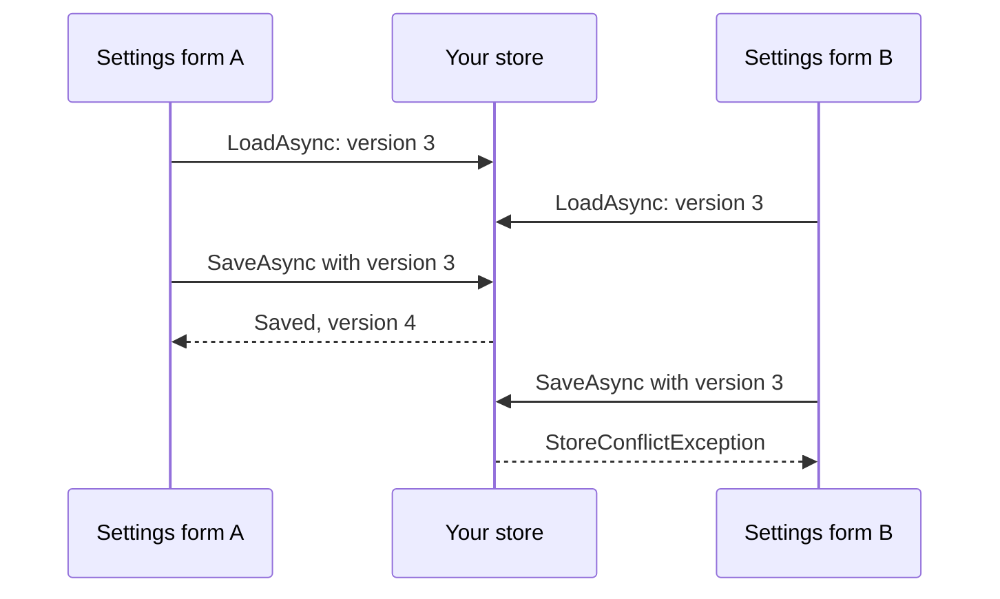

# Implementing a store

Typeshift keeps your agents' settings through an `ISettingsStore` and your conversations through an
`IConversationStore`, which you implement over your own database. This page walks through what a store must do, in the
order you meet it: its lifetime, the settings it saves with their versions, and the conversations it appends to.
`InMemoryTypeshiftStore` is for tests and samples, so a production app writes its own.

## The store is a singleton

`WithStore<T>()` registers your store as a singleton. One instance handles every run of every request, and several
runs often call it at the same time, so plan for that before you write its first method:

- **It cannot take scoped services**, such as a `DbContext` or the current customer. Take a factory instead, such as
  `IDbContextFactory<T>` or `IServiceScopeFactory`, and create what a call needs inside the call. Singleton services,
  such as options or a logger, are fine.
- **Any method can run while others are running**, even on the same document or conversation. Keep no state between
  calls, or guard what you keep.
- **It knows nothing of the caller.** Your app decides who may use a settings id or a conversation id before it
  passes one to a run ([Conversations](./conversations.md#tracking-a-conversation)), and the store keeps whatever it
  is given.

::: warning A scoped DbContext breaks the store
A singleton that takes a `DbContext` keeps the first one it got for the life of the app and shares it between
requests, which `DbContext` does not allow. Register `IDbContextFactory<T>` with `AddDbContextFactory` and create a
context in each method.
:::

This page builds a store on Entity Framework Core. Register its context factory next to your `WithStore<T>()` call:

<!-- snippet: ef-core-registration -->
<a id='snippet-ef-core-registration'></a>
```cs
services.AddDbContextFactory<TypeshiftDb>(options => options.UseSqlite("Data Source=typeshift.db"));
```
<sup><a href='https://github.com/weboost-at/Typeshift/blob/main/samples/Typeshift.Samples.Docs/Scenarios/Registration.cs#L43-L45' title='Snippet source file'>snippet source</a> | <a href='#snippet-ef-core-registration' title='Start of snippet'>anchor</a></sup>
<!-- endSnippet -->

## The five methods

A store has five methods in two interfaces. `ISettingsStore` keeps settings with the first two, and `IConversationStore`
keeps conversations with the other three. The store on this page implements `ITypeshiftStore`, which is both. When
settings and conversations live in different databases, implement each interface in a class of its own and
[register each](./settings-and-stores.md#registering-a-store).

You implement four of the methods, and `LoadConversationSinceCompactionAsync` has a default you may replace by declaring
the method in your store. Every id has your build's [id type](./registration.md#the-id-type), which is `Guid` unless
`TypeshiftIdType` names another; the samples on this page set it to `int`. Each method takes a `CancellationToken` last.

| Method | Does |
|---|---|
| `LoadAsync(id, kind)` | Returns the document of a kind under an id as a `StoredDocument`, with its JSON and version, or null when none is stored. |
| `SaveAsync(id, kind, json, expectedVersion)` | Saves a document's JSON if its stored version still equals `expectedVersion` (0 when nothing is stored yet), and returns the new version. Throws a `StoreConflictException` when another save came first. |
| `LoadConversationAsync(conversation)` | Returns a conversation's entries, oldest first. |
| `LoadConversationSinceCompactionAsync(conversation)` | Returns the conversation's last summary and the entries after it ([Recognizing a summary](#recognizing-a-summary)). |
| `AppendConversationAsync(conversation, entry)` | Appends one entry to a conversation. The first entry creates the conversation. |

The database on this page has a table for settings and one for conversations:

<!-- snippet: ef-core-db -->
<a id='snippet-ef-core-db'></a>
```cs
internal sealed class TypeshiftDb(DbContextOptions<TypeshiftDb> options) : DbContext(options)
{
    public DbSet<DocumentRow> Documents => Set<DocumentRow>();

    public DbSet<EntryRow> Entries => Set<EntryRow>();

    protected override void OnModelCreating(ModelBuilder model)
    {
        model.Entity<DocumentRow>()
            .HasKey(document => new { document.Id, document.Kind });

        model.Entity<EntryRow>()
            .HasKey(entry => entry.Sequence);

        model.Entity<EntryRow>()
            .HasIndex(entry => entry.Conversation);
    }
}

internal sealed class DocumentRow
{
    public required int Id { get; init; }

    public required string Kind { get; init; }

    public required long Version { get; init; }

    public required string Json { get; init; }
}

internal sealed class EntryRow
{
    public long Sequence { get; init; }

    public required int Conversation { get; init; }

    public required bool IsSummary { get; init; }

    public required string Json { get; init; }
}
```
<sup><a href='https://github.com/weboost-at/Typeshift/blob/main/samples/Typeshift.Samples.Docs/Stores/EfCore/TypeshiftDb.cs#L5-L46' title='Snippet source file'>snippet source</a> | <a href='#snippet-ef-core-db' title='Start of snippet'>anchor</a></sup>
<!-- endSnippet -->

## Settings documents

A document is an agent's `Settings` record, the one `ConfigureAsync` and `SaveSettingsAsync` save. Typeshift writes
the record as JSON before it calls `SaveAsync` and reads it back after `LoadAsync`, so your store handles strings and
numbers only. Keep each document in a row keyed by the id and the kind, with the JSON and the
[version](#versions):

- **The id** is the settings id your app passed, such as a customer's.
- **The kind** is the agent's class name, or what its `WithStorageKind("...")` sets. Under one settings id, each agent
  has a document of its own, so the id and the kind together are the key.
- **The JSON** is the record as Typeshift wrote it ([The stored JSON](./settings-and-stores.md#the-stored-json)).
  Keep it as text and return it unchanged.

The JSON names the agent's schema version, the one `WithSchemaVersion(n)` sets, in `"$schemaVersion"`
([The stored JSON](./settings-and-stores.md#the-stored-json)), and JSON without it is at schema version 1. Typeshift
refuses a schema version newer than the code's, so an app rolled back to older code fails loudly instead of reading
settings it does not understand.

An agent raises its schema version when a configurable member is renamed or removed, and migrating the stored JSON of
older schema versions is then up to you. You can do it in `LoadAsync`, where the kind tells you which agent's settings a
row holds: read `"$schemaVersion"`, rewrite the JSON of an older schema version and return it with the version the row
holds, or migrate the rows with a script over your database. Each save writes the current schema version, so a migrated
document reaches it in your database with its next save.

Loading reads the row by its id and kind and returns its JSON and version as a `StoredDocument`:

<!-- snippet: ef-core-load -->
<a id='snippet-ef-core-load'></a>
```cs
internal sealed class EfTypeshiftStore(IDbContextFactory<TypeshiftDb> contexts) : ITypeshiftStore
{
    public async Task<StoredDocument?> LoadAsync(int id, string kind, CancellationToken ct)
    {
        await using var db = await contexts.CreateDbContextAsync(ct);

        return await db.Documents.FindAsync([id, kind], ct) is { } row
            ? new StoredDocument(row.Json, row.Version)
            : null;
    }
```
<sup><a href='https://github.com/weboost-at/Typeshift/blob/main/samples/Typeshift.Samples.Docs/Stores/EfCore/EfTypeshiftStore.cs#L5-L16' title='Snippet source file'>snippet source</a> | <a href='#snippet-ef-core-load' title='Start of snippet'>anchor</a></sup>
<!-- endSnippet -->

## Versions

A version is the number of the stored document's current state, kept for optimistic concurrency. It lets a save
find out that the document changed since the caller loaded it, so one save never silently overwrites another.
Typeshift does not interpret the number: it hands `SaveAsync` back the version `LoadAsync` returned, and your store
compares the two.



The diagram shows two forms editing the same customer's settings. Both load version 3, and the first to save
wins and moves the document to version 4. The second still names version 3, so its save fails instead of erasing
the first form's change, and that form loads the settings again.

### What a save must do

Run one `INSERT` or `UPDATE` that checks the version as it writes, and throw a `StoreConflictException` when it
changed no row. The version the caller passes tells you which state of the document it loaded:

- **Version 0 means the caller found no document**, so insert it. A row that is there already was created by another
  save in between.
- **Any other version is the one the caller loaded**, so update the row only while it still holds that version. A
  row that holds another version was saved by someone else since, and a missing row was deleted since. Both are
  conflicts.

Check and write in one statement. If you read the row, compare its version and then write, two saves that both
loaded version 3 can both pass the check before either writes, and the second silently overwrites the first. Each of
these statements reports how many rows it changed, and none means another save won:

```sql
INSERT INTO documents (id, kind, version, json) VALUES (@id, @kind, 1, @json)
ON CONFLICT (id, kind) DO NOTHING;

UPDATE documents SET json = @json, version = @expectedVersion + 1
WHERE id = @id AND kind = @kind AND version = @expectedVersion;
```

SQL Server has no `ON CONFLICT`. There, run a plain `INSERT` and treat the duplicate-key error, number 2627, as the
conflict, passing it to the `StoreConflictException` as its inner exception.

Return the new version. Any number works as long as it is not 0 and was never this document's version before, and
counting up by one is the simple choice. Throw `StoreConflictException` only for a lost race, with a message that
names the document. Any other failure, such as a lost connection, goes to the caller as it is.

The EF Core store runs one of the two statements per save. `ExecuteSqlAsync` inserts with `ON CONFLICT DO NOTHING`,
which SQLite and PostgreSQL support, and turns each interpolated value into a SQL parameter. `ExecuteUpdateAsync`
updates with the version in its `WHERE`. Both return the number of rows they changed:

<!-- snippet: ef-core-save -->
<a id='snippet-ef-core-save'></a>
```cs
public async Task<long> SaveAsync(int id, string kind, string json, long expectedVersion, CancellationToken ct)
{
    await using var db = await contexts.CreateDbContextAsync(ct);

    var rows = expectedVersion == 0
        ? await InsertAsync(db, id, kind, json, ct)
        : await UpdateAsync(db, id, kind, json, expectedVersion, ct);

    // Each statement checks and writes in one step, so a save that changed no row lost to another save
    return rows == 1
        ? expectedVersion + 1
        : throw new StoreConflictException($"{kind} {id} was saved after version {expectedVersion}.");
}

private static Task<int> InsertAsync(TypeshiftDb db, int id, string kind, string json, CancellationToken ct) =>
    db.Database.ExecuteSqlAsync(
        $"""
        INSERT INTO "Documents" ("Id", "Kind", "Version", "Json")
        VALUES ({id}, {kind}, 1, {json})
        ON CONFLICT ("Id", "Kind") DO NOTHING
        """,
        ct);

private static Task<int> UpdateAsync(
    TypeshiftDb db,
    int id,
    string kind,
    string json,
    long expectedVersion,
    CancellationToken ct) =>
    db.Documents
        .Where(row => row.Id == id && row.Kind == kind && row.Version == expectedVersion)
        .ExecuteUpdateAsync(
            set => set
                .SetProperty(row => row.Json, json)
                .SetProperty(row => row.Version, expectedVersion + 1),
            ct);
```
<sup><a href='https://github.com/weboost-at/Typeshift/blob/main/samples/Typeshift.Samples.Docs/Stores/EfCore/EfTypeshiftStore.cs#L18-L56' title='Snippet source file'>snippet source</a> | <a href='#snippet-ef-core-save' title='Start of snippet'>anchor</a></sup>
<!-- endSnippet -->

### Who saves

Runs only load settings; they never save them. Saves come from your app, through `ConfigureAsync`, which loads again
and reapplies its change after a lost save, and `SaveSettingsAsync`, which leaves the conflict to your code
([Agent settings](./settings-and-stores.md#agent-settings)).

## Conversations

A conversation only grows. Runs append each step as it happens: the input, every model response, the tool results
of each round of calls, steering input and the entry that ends a run
([What is stored](./conversations.md#what-is-stored)). Your store never changes or removes an entry:

- **Keep the append order.** `LoadConversationAsync` returns the entries in the order they were appended, oldest
  first. Let the database number the rows, as an identity column does; a timestamp can tie.
- **Store each entry as its JSON**, `entry.Serialize()`, and read it back with `ConversationEntry.Deserialize(json)`.
  A database client that serializes with `System.Text.Json` or Newtonsoft.Json may take the entry as it is
  ([What is stored](./conversations.md#what-is-stored)).
- **Keep the append cheap.** Runs append while they work, so `AppendConversationAsync` is the hot path, and a row per
  entry suits it.

### Recognizing a summary

When clearing old tool results does not shrink the history enough, [compaction](./conversations.md#compaction)
summarizes a run's oldest turns. It appends one entry of its own that holds the summary and the messages it kept after
the summary, with `IsSummary` set to true. Every later run starts from the latest such entry, because it carries what
the runs need from before it, including the conversation's mode and its standing approvals.

`LoadConversationSinceCompactionAsync` returns that entry and everything after it, oldest first, or every entry when
the conversation has no summary. Its default calls `LoadConversationAsync` and drops what came before the summary, so
a long conversation is read whole on every run. To read only what a run needs, copy `entry.IsSummary` into a column of
its own when you append, and declare the method in your store to start at the last row that has it:

<!-- snippet: ef-core-conversations -->
<a id='snippet-ef-core-conversations'></a>
```cs
public async Task<IReadOnlyList<ConversationEntry>> LoadConversationAsync(int conversation, CancellationToken ct)
{
    await using var db = await contexts.CreateDbContextAsync(ct);

    var rows = await db.Entries
        .Where(entry => entry.Conversation == conversation)
        .OrderBy(entry => entry.Sequence)
        .ToListAsync(ct);

    return [.. rows.Select(row => ConversationEntry.Deserialize(row.Json))];
}

// A run starts from the last summary, so the rows before it stay in the database
public async Task<IReadOnlyList<ConversationEntry>> LoadConversationSinceCompactionAsync(
    int conversation,
    CancellationToken ct)
{
    await using var db = await contexts.CreateDbContextAsync(ct);
    var entries = db.Entries.Where(entry => entry.Conversation == conversation);

    var start = await entries
        .Where(entry => entry.IsSummary)
        .MaxAsync(entry => (long?)entry.Sequence, ct) ?? 0;

    var rows = await entries
        .Where(entry => entry.Sequence >= start)
        .OrderBy(entry => entry.Sequence)
        .ToListAsync(ct);

    return [.. rows.Select(row => ConversationEntry.Deserialize(row.Json))];
}

public async Task AppendConversationAsync(int conversation, ConversationEntry entry, CancellationToken ct)
{
    await using var db = await contexts.CreateDbContextAsync(ct);

    db.Entries.Add(new EntryRow
    {
        Conversation = conversation,
        IsSummary = entry.IsSummary,
        Json = entry.Serialize()
    });

    await db.SaveChangesAsync(ct);
}
}
```
<sup><a href='https://github.com/weboost-at/Typeshift/blob/main/samples/Typeshift.Samples.Docs/Stores/EfCore/EfTypeshiftStore.cs#L58-L105' title='Snippet source file'>snippet source</a> | <a href='#snippet-ef-core-conversations' title='Start of snippet'>anchor</a></sup>
<!-- endSnippet -->

`LoadConversationAsync` still returns every entry, summaries included, for your app's own use, such as showing the
whole history. Runs call it too in one case: when the last summary has no `StandingApprovals`, as one stored by a
Typeshift version before 0.1.0-alpha.3, they read the whole conversation. Compaction always fills them in, even as
an empty list, so test your store with a summary compaction wrote, for example by giving an agent a small
`WithMaxInputTokens`, rather than with an entry you built yourself.

## Related

- [Settings and stores](./settings-and-stores.md): how stored settings layer over the agent's code, and the JSON a
  store keeps.
- [Conversations](./conversations.md): what a run stores, resuming, and compaction.
- [Registration](./registration.md#the-chain): `WithStore<T>()` among the other chain calls.
- [Generated members](./generated-members.md#settings): the `Settings` record a store keeps, with its `Kind` and
  `SchemaVersion`.
