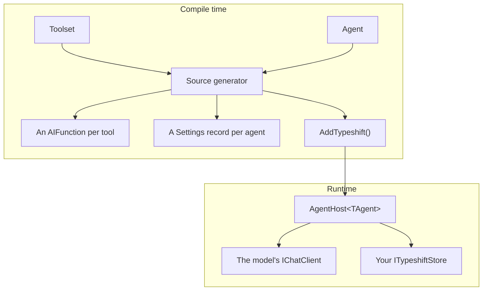

# Overview

Typeshift is a .NET 10 library for agents and tools on
[Microsoft.Extensions.AI](https://learn.microsoft.com/dotnet/ai/microsoft-extensions-ai). You declare toolsets and
agents in C# constructors. A source generator reads them at compile time and writes what would otherwise take
reflection: a function per tool, a settings record per agent and one registration call. At runtime, a host runs each
agent against any `IChatClient`.

::: tip The short version

- A **toolset** declares tools: static methods the model can call. An **agent** picks tools and sets a model and
  instructions. A **host** runs the agent.
- The generator turns mistakes into compile errors and [diagnostics](./diagnostics.md), never into errors inside
  generated code.
- Settings the code marks **configurable** can change per customer and per run. Everything else stays in code.
- Ids and storage are yours: you implement one store, with the id type you already use.

:::

## How the pieces fit

Your toolsets and agents go into the generator. Out come the functions the model calls, the `Settings` record that holds
what may change at runtime, and the code behind `services.AddTypeshift()`. That call registers an `AgentHost<TAgent>`
per agent, which runs it: it resolves the settings, calls the model, runs the tools and stores the conversation.

| Piece | What it is | Read |
|---|---|---|
| Toolset | A `partial` class deriving from `Toolset`, declaring the tools of one domain | [Toolsets](./toolsets.md) |
| Tool settings | A record of values a tool needs that the model must not choose | [Tool settings](./tool-settings.md) |
| Agent | A `partial` class deriving from `Agent`: chat options, instructions, tools | [Agents](./defining-agents.md) |
| Agent host | `AgentHost<TAgent>`, which runs one agent in the scope it was resolved from | [Running agents](./running-agents.md) |
| Store | Your `ITypeshiftStore`, which keeps settings and conversations | [Settings and stores](./settings-and-stores.md) |

The [glossary](./glossary.md) defines every term these docs use.

## Reading order

The guide goes from the big picture to the details. Read it in this order when you are new:

| Section | Answers | Kind of page |
|---|---|---|
| [Getting started](./getting-started.md) | What does a working agent look like? | Tutorial |
| [Why code-defined](./why-code-defined.md) | Why declare agents in code, and what does that cost? | Concept |
| [How a run works](./how-a-run-works.md), [Settings layering](./settings-layering.md) | What happens when an agent runs? Where does each value come from? | Concept |
| Building agents: [Toolsets](./toolsets.md) to [Multiple agents](./multi-agent.md) | How do I declare tools and agents? | Guide |
| Running agents: [Running agents](./running-agents.md) to [Long-running agents](./long-running-agents.md) | How do I run them, store their settings and keep conversations? | Guide |
| Controlling runs: [Tool approval](./tool-approval.md) to [Context providers](./context-providers.md) | How do I decide what a run may do, and add to every run? | Guide |
| In production: [Observability](./observability.md), [Native AOT](./native-aot.md) | How do I watch it and publish it? | Guide |
| Reference: [Registration](./registration.md) to [Glossary](./glossary.md) | What exactly does each call take and do? | Reference |

Working on Typeshift itself? Start with [Contributing](../contributing/index.md).

## Related

- [Getting started](./getting-started.md): build a working agent.
- [Why code-defined](./why-code-defined.md): the idea and its trade-offs.
- [Glossary](./glossary.md): the words these docs use.
