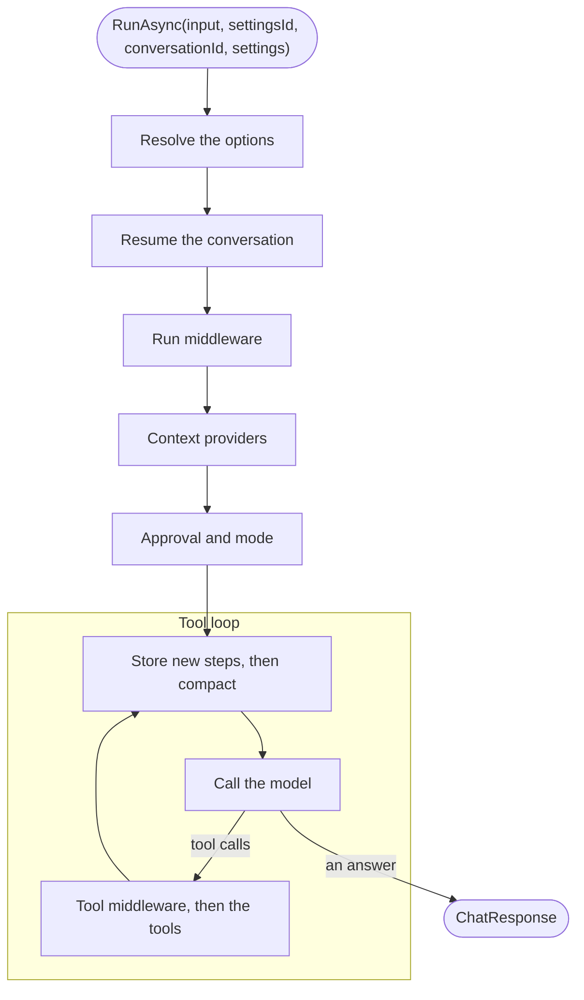

# Running agents

You run an agent through its host, `AgentHost<TAgent>`, which `AddTypeshift()` registers for every agent. Resolve the
host from a request's scope, so the tools see that request's services.

## Registration

<!-- snippet: registration -->
<a id='snippet-registration'></a>
```cs
services.AddTypeshift()
    .WithStore<EfTypeshiftStore>()
    .WithChatClientProvider<KeyedChatClientProvider>()
    .WithRealtimeTracking()
    .WithRunMiddleware<BlockedTopics>()
    .WithToolMiddleware<AuditToolCalls>();

services.AddKeyedSingleton("fast-model", fast);
services.AddKeyedSingleton("reasoning-model", reasoning);
```
<sup><a href='https://github.com/weboost-at/Typeshift/blob/main/samples/Typeshift.Samples.Docs/Scenarios/Registration.cs#L18-L28' title='Snippet source file'>snippet source</a> | <a href='#snippet-registration' title='Start of snippet'>anchor</a></sup>
<!-- endSnippet -->

`AddTypeshift()` registers the toolsets and agents of this project and the projects it references, plus a host per
agent. This page needs two calls of the chain: `WithChatClientProvider<T>()` maps model names to clients, and
`WithStore<T>()` keeps settings and conversations. [Registration](./registration.md#the-chain) covers the rest.

## Chat clients

Your `IChatClientProvider` returns the `IChatClient` for a model's name. Provider packages register their clients with
DI, so a provider over keyed registrations covers most hosts:

<!-- snippet: chat-client-provider -->
<a id='snippet-chat-client-provider'></a>
```cs
internal sealed class KeyedChatClientProvider(IServiceProvider services) : IChatClientProvider
{
    public ValueTask<IChatClient> GetChatClientAsync(string model, CancellationToken ct) =>
        ValueTask.FromResult(services.GetRequiredKeyedService<IChatClient>(model));
}
```
<sup><a href='https://github.com/weboost-at/Typeshift/blob/main/samples/Typeshift.Samples.Docs/Hosting/KeyedChatClientProvider.cs#L6-L12' title='Snippet source file'>snippet source</a> | <a href='#snippet-chat-client-provider' title='Start of snippet'>anchor</a></sup>
<!-- endSnippet -->

Typeshift resolves the provider from the run's services, so it can pick a customer's own credentials. It never
disposes the client the provider returns.

## The run's services

`AgentHost<TAgent>` is transient and runs with the services of the scope you resolved it from. Tools and the chat
client provider resolve there too, so a request's scoped services, such as the current customer, reach them:

<!-- snippet: run -->
<a id='snippet-run'></a>
```cs
await using var scope = provider.CreateAsyncScope();
var support = scope.ServiceProvider.GetRequiredService<AgentHost<SupportAgent>>();

var answer = await support.RunAsync("Where is my refund?");

Console.WriteLine($"{answer.Messages[^1].AuthorName}: {answer.Text}");
```
<sup><a href='https://github.com/weboost-at/Typeshift/blob/main/samples/Typeshift.Samples.Docs/Scenarios/RunningAgents.cs#L13-L20' title='Snippet source file'>snippet source</a> | <a href='#snippet-run' title='Start of snippet'>anchor</a></sup>
<!-- endSnippet -->

A run returns Microsoft.Extensions.AI's `ChatResponse`: the model's messages, with the tool calls and results between
them. Each message names the agent that wrote it in `AuthorName`.

## Stored settings

Pass a settings id, and the run layers the [settings stored](./settings-and-stores.md) under it over the agent's code:

<!-- snippet: run-with-settings-id -->
<a id='snippet-run-with-settings-id'></a>
```cs
var settingsId = 42;

var stored = await support.RunAsync("Where is my refund?", settingsId);
```
<sup><a href='https://github.com/weboost-at/Typeshift/blob/main/samples/Typeshift.Samples.Docs/Scenarios/RunningAgents.cs#L22-L26' title='Snippet source file'>snippet source</a> | <a href='#snippet-run-with-settings-id' title='Start of snippet'>anchor</a></sup>
<!-- endSnippet -->

## Run settings

A run can also pass the agent's `Settings` for itself. They override the stored settings, for that run only:

<!-- snippet: run-settings -->
<a id='snippet-run-settings'></a>
```cs
var run = new SupportAgent.Settings
{
    Model = "reasoning-model",
    Temperature = 0,
    SearchTickets = new TicketToolset.SearchTicketsOverrides { IncludeClosed = true },
    SearchArticles = new KnowledgeToolset.SearchArticlesOverrides { Language = "de" }
};

var thorough = await support.RunAsync("Where is my refund?", settingsId, settings: run);
```
<sup><a href='https://github.com/weboost-at/Typeshift/blob/main/samples/Typeshift.Samples.Docs/Scenarios/RunningAgents.cs#L30-L40' title='Snippet source file'>snippet source</a> | <a href='#snippet-run-settings' title='Start of snippet'>anchor</a></sup>
<!-- endSnippet -->

Values the run leaves null keep what the stored settings or the agent's code set, as
[settings layering](./settings-and-stores.md#settings-layering) explains.

## Conversations

With a conversation id, the run resumes the conversation and stores itself in it, step by step. `ResumeAsync`
continues a run that a crash cut off. [Conversations](./conversations.md) covers both.

## Structured output

`RunAsync<T>` asks the model for JSON in `T`'s schema and returns it typed, in `Result`:

<!-- snippet: structured-output -->
<a id='snippet-structured-output'></a>
```cs
var report = await support.RunAsync<RefundStatus>("Summarize the refund.", settingsId);

Console.WriteLine($"{report.Result.Invoice}: {report.Result.State}");
```
<sup><a href='https://github.com/weboost-at/Typeshift/blob/main/samples/Typeshift.Samples.Docs/Scenarios/RunningAgents.cs#L44-L48' title='Snippet source file'>snippet source</a> | <a href='#snippet-structured-output' title='Start of snippet'>anchor</a></sup>
<!-- endSnippet -->

<!-- snippet: structured-output-type -->
<a id='snippet-structured-output-type'></a>
```cs
internal sealed record RefundStatus(string Invoice, RefundState State, DateOnly? Expected);

internal enum RefundState
{
    Requested,
    Approved,
    Paid
}
```
<sup><a href='https://github.com/weboost-at/Typeshift/blob/main/samples/Typeshift.Samples.Docs/Scenarios/RunningAgents.cs#L76-L85' title='Snippet source file'>snippet source</a> | <a href='#snippet-structured-output-type' title='Start of snippet'>anchor</a></sup>
<!-- endSnippet -->

Under [Native AOT](./production.md#native-aot), `T` needs JSON metadata.

## Streaming

`RunStreamingAsync` streams the updates, and tool calls run between them:

<!-- snippet: streaming -->
<a id='snippet-streaming'></a>
```cs
await foreach (var update in support.RunStreamingAsync("Where is my refund?", settingsId))
    Console.Write(update.Text);
```
<sup><a href='https://github.com/weboost-at/Typeshift/blob/main/samples/Typeshift.Samples.Docs/Scenarios/RunningAgents.cs#L52-L55' title='Snippet source file'>snippet source</a> | <a href='#snippet-streaming' title='Start of snippet'>anchor</a></sup>
<!-- endSnippet -->

With `WithRealtimeTracking()`, anyone [watching the conversation](./conversations.md#live-updates) sees the updates
too.

## The raw path

A host that needs the `IChatClient` itself splits a run into three steps: resolve the options, create the client, and
call it with those options:

<!-- snippet: raw-path -->
<a id='snippet-raw-path'></a>
```cs
var options = await support.ResolveOptionsAsync(settingsId, run);

using var client = await support.CreateChatClientAsync(options);
var response = await client.GetResponseAsync([new ChatMessage(ChatRole.User, "Where is my refund?")], options);
```
<sup><a href='https://github.com/weboost-at/Typeshift/blob/main/samples/Typeshift.Samples.Docs/Scenarios/RunningAgents.cs#L59-L64' title='Snippet source file'>snippet source</a> | <a href='#snippet-raw-path' title='Start of snippet'>anchor</a></sup>
<!-- endSnippet -->

The client is the run's whole pipeline, the tool loop and the agent's run options included. Disposing it leaves the
provider's client alone. `ChatOptions.ConversationId` names the conversation to run in, as a string of the build's id
type, and never reaches the provider.

## How a run works

A run is one call of `RunAsync`, `RunStreamingAsync` or `ResumeAsync`. Streaming or not, every run passes through the
same steps in the same order, and that order tells you what your middleware sees, when context is added, which calls
ask for approval and what is stored when.



The run starts at the top. Each step wraps the ones below it, so the answer passes back up through them: the
conversation stores how the run ended, and middleware sees the response.

1. **Resolve the options.** The host builds the run's `ChatOptions` from the agent's code, then the settings stored
   under the settings id, then the run's own settings. It creates the tools the agent offers, their settings resolved
   through the same layers, and adds the sub-agents and the tools of MCP servers after them. The layers resolve once,
   when the run starts ([settings layering](./settings-and-stores.md#settings-layering)).
2. **Resume the conversation.** With a conversation id, the run puts the stored entries ahead of the new input, so the
   model sees the whole conversation, and stores the input. It keeps the conversation's mode unless the run's settings
   name one, and a conversation that was handed off goes to the agent that answered last. Without a conversation id,
   the run starts fresh and stores nothing. Within one process, a conversation has one run at a time
   ([Conversations](./conversations.md)).
3. **Run middleware.** Each `IRunMiddleware` wraps the rest of the run ([Middleware](./middleware.md)).
4. **Context providers.** Each provider the agent uses adds to this run. Nothing it adds is stored with the
   conversation, so every run asks again ([Context providers](./middleware.md#context-providers)).
5. **Approval and mode.** The run matches the host's answers to the approval requests the conversation stored, and in
   plan mode offers only the read-only tools and `exit_plan_mode`. After each pass of the tool loop, rules, standing
   approvals and auto mode decide the calls they can. When calls are left that only the host can decide, the run
   stores the requests and ends ([Approval and modes](./tool-approval.md)).
6. **The tool loop.** Microsoft.Extensions.AI's `FunctionInvokingChatClient` calls the model, runs the tools it asks
   for, each through the tool middleware, and calls the model again until it answers. The
   [run options](./defining-agents.md#run-options) set its limits, such as the most rounds of tool calls.

Before every model call inside the loop, the run appends the new steps to the conversation: tool results, steering
input and the answers of background sub-agents. Each model response is stored as it arrives, so a crash loses at most
the call in flight.

When compaction is on and a call would exceed the token limit, the run compacts what the model sees, while the stored
conversation keeps everything ([compaction](./conversations.md#compaction)). Typeshift traces every call to the
provider's client ([Observability](./production.md#observability)).

### What each step can change

| Step | Sees | Can |
|---|---|---|
| Run middleware | The agent, the messages, the options and the mode | Change the messages and options of this run, or answer in place of the model |
| Context provider | The run | Add instructions, messages and tools to this run |
| Approval rule | Each call that requires approval, with the arguments the model sent | Approve it, reject it with a reason for the model, or abstain |
| Tool middleware | Each tool call: the function, its arguments, the messages so far | Answer in place of the tool, or end the tool loop |

## Related

- [Agent host](./agent-host.md): every member of the host and its signature.
- [Registration](./registration.md#the-chain): the chain calls and their lifetimes.
- [Conversations](./conversations.md): storing, resuming and steering runs.
- [Settings and stores](./settings-and-stores.md#settings-layering): where each of a run's values comes from.
- [Architecture](../contributing/architecture.md#a-run): the same pipeline from the code's side.
