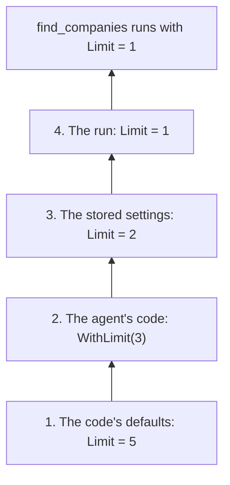

# Settings and stores

Typeshift stores each agent's `Settings`, as the agent's own or under a settings id, and conversations under a
conversation id. An agent's own settings go through an `IAgentSettingsStore`, settings under an id through an
`ISettingsStore<TId>`, and conversations through an `IConversationStore<TId>`, where `TId` is the type of your ids.
Typeshift keeps them in memory until you register stores of your own, which you
[implement](./implementing-a-store.md) over your database, in one class or in several.

## Settings layering

A run's settings come from four layers, and each sets values over the one below. Tool settings, chat options and run
options all resolve this way, once, when the run starts.

### One value, four layers

Follow the `find_companies` limit of the [getting started](./getting-started.md) agent up through the layers:



**1. The code's defaults.** `FindCompaniesSettings` initializes `Limit` to 5, so a record made with its parameterless
constructor holds 5. This layer sets every member, so a tool always receives a whole record.

**2. The agent's code.** `ResearchAgent` calls `ConfigureFindCompanies().WithLimit(3)`, so every run of the agent
searches with 3 unless a layer above sets another limit. Its chat and run options, such as `WithTemperature(0.2f)`,
live here too. Because this layer is reviewed, compiled code, it may set any settable member, configurable or not.

**3. The stored settings.** `WithSettingsId(42).ConfigureAsync(...)` stores `Limit = 2` and `Temperature = 0.4f`, so
every run with settings id 42 searches with 2, at a temperature of 0.4. `IncludeInactive` cannot be stored, because
`ResearchAgent.Settings` has only the configurable members. Below the settings of the id lie the agent's own stored
settings, which every run applies, with a settings id or without one ([Agent settings](#agent-settings)).

**4. The run.** A run that passes `FindCompanies = new() { Limit = 1 }` in its settings searches with 1, for that run
only. It leaves `Temperature` null, so the stored 0.4 holds.

### Precedence

The highest layer that sets a value wins:

| Layer | Set by | May set | Holds for |
|---|---|---|---|
| 4. The run | The `settings` argument of `RunAsync` and the other runs | Configurable members | That run |
| 3. Stored | The agent's own `Settings`, then those under the host's settings id: `ConfigureAsync`, `SaveSettingsAsync` | Configurable members | Every run, or every run with that settings id |
| 2. The agent's code | `Configure{Tool}()`, `WithChatOptions()`, `WithRunOptions()`, `WithInstructions()` or `GetInstructions()` | Every settable member | Every run of the agent |
| 1. The code's defaults | The settings record's parameterless constructor; the run options' defaults | Every member | Every run |

Because the layers resolve when a run starts, settings saved during a run apply from the next run on.

### Null values and nested records

A layer either replaces a value below it or leaves it alone. It never merges, so a configurable member that is itself
a record or a class is replaced as a whole.

::: warning No layer clears a value
Null keeps the layer below, so neither stored settings nor a run can take away a temperature the agent's code set.
:::

### The model and the instructions

The model resolves through the layers like any other value. It stays as the code sets it unless
`Configurable(o => o.ModelId)` lets the layers above choose it, so stored settings can change the model only when the
agent's code allows that. Its provider is a value of its own, so a layer that sets only `Model` keeps the provider of
the layer below.

Stored or run `Instructions` replace the agent's own, from `WithInstructions` or `GetInstructions()`. Context providers and plan mode then
append to whatever instructions the layers resolved.

### The mode of a conversation

A conversation whose mode was named is in that mode (`Default`, `Plan` or `Auto`) for every later run. It overrides
the agent's code and the stored settings, but not the run's own settings. A run whose own settings name a mode
switches the conversation to it, and so do an approved plan and `SetModeAsync`
([Setting the mode](./tool-approval.md#setting-the-mode)).

### Sub-agents and handoffs

Sub-agents and handoffs keep the settings id, but not the run's settings. A sub-agent runs with the stored settings
of its own kind, those of the agent and those under the caller's settings id, in the caller's mode. An agent handed
off to answers with the stored settings of its kind under the same id. Run settings apply only to the agent the run
started on, except a mode they name, which [belongs to the conversation](#the-mode-of-a-conversation)
([Multiple agents](./multi-agent.md)).

## Ids of your own types

Each store has the id type of its interface, and one app may have several: an `ISettingsStore<int>` keeps settings
under `int` ids while an `IConversationStore<string>` keeps conversations under `string` ids. You give a host its ids
in code, and each id's type picks the store of that type:

- `support.WithSettingsId(42)` applies the settings stored under 42 in the `ISettingsStore<int>`, over the agent's
  own. Its settings members, such as `ConfigureAsync(...)`, load and save those settings.
- `support.WithConversationId(chat)` resumes the conversation in the `IConversationStore` of `chat`'s type, and stores
  what the run adds to it.

Each call returns a copy of the host with the id, in the host's scope, so
`support.WithSettingsId(42).WithConversationId(chat).RunAsync(input)` runs with both, and `support` itself keeps none.
A call whose copy goes nowhere, `support.WithSettingsId(42);` as a statement of its own, is
[TSH041](./diagnostics.md#tsh041). A copy is a small object, so make one wherever your code has the ids, such as in
each request. Disposing it disposes
what disposing `support` would, which for a host from the runtime is its scope
([The runtime](./registration.md#the-runtime)). Ids of the same value and different types are different ids: a
conversation under 5 as an `int` is not the one under 5 as a `long`.

So pick one type for each kind of id and keep it across your app, and give ids value equality: a number, a string, a
`Guid`, an enum, a record or a struct, so that an id read twice names the same settings and the same conversation. A
nullable id, such as the `Guid?` a request often holds, names what its value names, and one without a value throws
an `ArgumentNullException`.
[Which store serves a call](./implementing-a-store.md#which-store-serves-a-call) says what happens to an id whose type
none of your stores keeps.

A few things follow the host's ids:

- `ResumeAsync()` resumes the host's conversation, and `ResolveOptionsAsync()` hands it on to the
  [raw path](./running-agents.md#the-raw-path).
- `ConversationTracker<TId>` lists, watches and steers the conversations under ids of `TId`, so a chat under `Guid`
  ids takes `ConversationTracker<Guid>`. The container has the tracker of every id type
  ([Live runs](./conversations.md#live-runs)). Once your app registers stores, the tracker of an id type that none of
  them keeps conversations under throws at its first call, as a run under such an id does, where it would otherwise
  watch nothing.

## Agent settings

### An agent's own settings

An app whose agents need one set of settings each stores them as the agent's own, under no id. Every run of the agent
applies them:

<!-- snippet: own-settings -->
<a id='snippet-own-settings'></a>
```cs
await research.ConfigureAsync(settings => settings with { Temperature = 0.3f });

var everyRun = await research.RunAsync("Graz");
```
<sup><a href='https://github.com/weboost-at/Typeshift/blob/main/samples/Typeshift.Samples.Docs/Quickstart/Quickstart.cs#L58-L62' title='Snippet source file'>snippet source</a> | <a href='#snippet-own-settings' title='Start of snippet'>anchor</a></sup>
<!-- endSnippet -->

`LoadSettingsAsync()` and `SaveSettingsAsync(settings, loadedVersion)` load and save them, and
`ConfigureAsync(configure)` retries on a conflict, as the sections below show. On a host from
`WithSettingsId(id)`, the same three members load and save the settings under the id instead.

::: warning Settings without an id are every run's defaults
On a host without a settings id, these members change the agent's own settings, which the runs of every customer
apply. That is what a page for the app's defaults needs, and nothing in Typeshift refuses it, so an endpoint that
saves posted settings decides who may change the defaults, for example by the user's role, and saves a customer's
own under the customer's id.
:::

### Keep them in a file

Kept in memory, an agent's own settings are gone when the app stops. To keep them without a database, for example in
a local tool or a single-agent service, register the file store with `WithFileStore`:

<!-- snippet: file-agent-settings -->
<a id='snippet-file-agent-settings'></a>
```cs
var services = new ServiceCollection();

services.AddTypeshift()
    .WithFileStore(store => store.Folder = folder);
```
<sup><a href='https://github.com/weboost-at/Typeshift/blob/main/samples/Typeshift.Samples.Docs/Quickstart/FileSettings.cs#L29-L34' title='Snippet source file'>snippet source</a> | <a href='#snippet-file-agent-settings' title='Start of snippet'>anchor</a></sup>
<!-- endSnippet -->

The file store keeps agents' settings in its `settings` folder, a file named after each agent's kind:
`settings/ResearchAgent.json` here. You can read, back up and edit the file by hand. Several processes may share the
folder, since a save takes a lock file of its kind first.

- Without a `Folder`, the store lies in a `typeshift` folder under `AppContext.BaseDirectory`, beside your app's
  assemblies, so a service finds it whatever its current directory is. Set one when your app may not write there, as
  is usual for an install folder under Program Files.
- The first save logs the folder, at `Information` ([Logs](./observability.md#logs)).
- A relative `Folder` resolves against the current directory when you register the store, which for a service may be
  the system's folder.
- Characters other than ASCII letters, digits, `_` and `-` are escaped in the file name, so any kind has a file of its
  own.
- On a file system that ignores case, as on Windows and macOS, two kinds that differ only in case share a file. The
  file names its kind, so a load of the other kind throws; give one of the agents a `WithStorageKind` of its own.
- A save waits up to 30 seconds for the lock file, `settings/ResearchAgent.json.lock` here, and then throws a
  `TimeoutException` that names it, so a program that hangs while it holds the lock cannot hang your saves. The lock
  file stays in the folder between saves.
- A file that is no JSON, or whose JSON has another shape than the store writes, fails the load with an
  `InvalidDataException` that names the file and the shape.
- `WithFileStore` is a call of the chain like the others, so it needs no `using` of its own, inside
  `TypeshiftRuntime.Create(client, typeshift => typeshift.WithFileStore())` either.
- Registering the file store, as registering any store does, ends the memory: settings under ids and conversations
  then need a store of their own ([Which store serves a call](./implementing-a-store.md#which-store-serves-a-call)).
  `InMemoryTypeshiftStore<TId>` beside the file store keeps those in memory and leaves the agents' own settings to
  the files, whichever of the two you register first.

::: warning The default folder does not outlive a deployment
`AppContext.BaseDirectory` is the output of your build or your publish. A build in another configuration, a cleaned
`bin` folder, a publish to a new folder and a new container image each start with an empty `typeshift` folder, so
your agents run on the settings in their code again, and nothing fails. An app you deploy sets `Folder` to a place
outside its output that the deployment keeps, such as a mounted volume or a data directory.
:::

### Settings under an id, such as per customer

A settings id stands for whatever you decide: a customer, a team, a user, or a settings profile of your own. Under one
settings id, each agent has its own document, because each agent's `Settings` is its own kind, so a store keys
documents by id and kind together.

`ConfigureAsync` loads an agent's settings, applies your change and saves them. When another save came in between, it
loads them again and reapplies your change, ten tries in all. If the tenth save loses too, it throws the store's
`StoreConflictException`:

<!-- snippet: configure-settings -->
<a id='snippet-configure-settings'></a>
```cs
await support.WithSettingsId(42).ConfigureAsync(settings => settings with
{
    Provider = "anthropic",
    Model = "claude-sonnet-5-5",
    Instructions = "Answer in German.",
    SearchTickets = settings.SearchTickets with { Limit = 20 }
});
```
<sup><a href='https://github.com/weboost-at/Typeshift/blob/main/samples/Typeshift.Samples.Docs/Scenarios/AgentSettings.cs#L13-L21' title='Snippet source file'>snippet source</a> | <a href='#snippet-configure-settings' title='Start of snippet'>anchor</a></sup>
<!-- endSnippet -->

### A settings form: load, save and conflicts

A settings form changes settings in two steps: it loads them with their version and saves them back with it. The
version tells the store which state the form loaded, so the save throws a `StoreConflictException` when someone saved
in between ([Save with a version](./implementing-a-store.md#save-with-a-version) explains the number):

<!-- snippet: load-and-save-settings -->
<a id='snippet-load-and-save-settings'></a>
```cs
var host = support.WithSettingsId(42);
var stored = await host.LoadSettingsAsync();

try
{
    await host.SaveSettingsAsync(stored.Data with { Instructions = null }, stored.Version);
}
catch (StoreConflictException)
{
    stored = await host.LoadSettingsAsync();
}
```
<sup><a href='https://github.com/weboost-at/Typeshift/blob/main/samples/Typeshift.Samples.Docs/Scenarios/AgentSettings.cs#L23-L35' title='Snippet source file'>snippet source</a> | <a href='#snippet-load-and-save-settings' title='Start of snippet'>anchor</a></sup>
<!-- endSnippet -->

Saving `Instructions = null` removes the stored instructions, so runs with this settings id use the agent's own
again. After a conflict, the sample loads the settings again, so you can show the user the current
values before they save.

### What a save refuses

`SaveSettingsAsync` and `ConfigureAsync` throw an `ArgumentException` and store nothing when the settings set a value
no run can go with:

- a run option outside its [range](./builders.md#runoptionsbuilder), such as `MaxToolIterations = 0`, or a
  `TargetInputTokens` that is not below the `MaxInputTokens` of the same settings;
- a blank `Provider`, `Model`, `SummaryProvider` or `SummaryModel`.

The message names the member, so a settings form can show it next to the field. Whether a model exists is not
checked: only its provider knows ([When a provider fails](./models.md#when-a-provider-fails)).

A save checks only what the saved settings themselves set, because the layers below may change by the time a run
reads them. A value that goes wrong together with another layer, such as a stored target above the maximum the
agent's code sets, is found by the run that resolves the layers. That run throws an `InvalidOperationException`
that names the agent and the option, before it calls the model or stores an entry in its conversation.

### Settings from a request

An agent's `Settings` holds every member its code made configurable, and nothing else: `Configurable(...)` is the
allow-list of what stored settings and runs may change. Within that list, Typeshift checks only that a run can go
with a value, not who chose it.

::: warning Settings from a request are as trusted as their sender
A caller who may post `SupportAgent.Settings` picks the model and the provider whose client and key serve the runs,
replaces the instructions and raises the limits. On an agent with a configurable `Mode`, they can run in `Auto`, where
no call waits for approval ([Setting the mode](./tool-approval.md#setting-the-mode)).
:::

Bind the whole record only for people who may change every member, such as your staff. A form your customers fill in
gets a record of its own, with the members they may change:

<!-- snippet: support-preferences -->
<a id='snippet-support-preferences'></a>
```cs
// What a customer may change of the support agent's settings; the model and the instructions stay your staff's
internal sealed record SupportPreferences(string? ArticleLanguage);
```
<sup><a href='https://github.com/weboost-at/Typeshift/blob/main/samples/Typeshift.Samples.Docs/Web/SettingsEndpoints.cs#L9-L12' title='Snippet source file'>snippet source</a> | <a href='#snippet-support-preferences' title='Start of snippet'>anchor</a></sup>
<!-- endSnippet -->

The endpoint copies the form onto the customer's stored settings:

<!-- snippet: settings-endpoint -->
<a id='snippet-settings-endpoint'></a>
```cs
app.MapPut("/settings", async (
    SupportPreferences preferences,
    AgentHost<SupportAgent> support,
    ICurrentCustomer customer,
    CancellationToken ct) =>
{
    await support
        .WithSettingsId(customer.Id)
        .ConfigureAsync(settings => settings with
        {
            SearchArticles = settings.SearchArticles with { Language = preferences.ArticleLanguage }
        }, ct);

    return TypedResults.NoContent();
});
```
<sup><a href='https://github.com/weboost-at/Typeshift/blob/main/samples/Typeshift.Samples.Docs/Web/SettingsEndpoints.cs#L20-L36' title='Snippet source file'>snippet source</a> | <a href='#snippet-settings-endpoint' title='Start of snippet'>anchor</a></sup>
<!-- endSnippet -->

- The settings id is the current customer's, from `ICurrentCustomer`, never a value of the request, so a customer
  changes only their own settings. An endpoint that takes a settings id from the request, such as your staff's,
  checks first that the caller may change the settings under it.
- `ConfigureAsync` sets the one member and keeps every other stored value, so the model and the instructions stay
  as your staff stored them. An empty field arrives as null, which removes the customer's choice, so the layer below
  applies again.
- The same holds for a run's `settings` argument: build it in code from what the request may choose, rather than
  binding `Settings` from the body ([Run settings](./running-agents.md#run-settings)).

## The stores

Each kind of stored data goes through an interface of its own. Until you write a store over your database, one of
these serves it:

| Stored | Without a store | `InMemoryTypeshiftStore<TId>` | `WithFileStore` |
|---|---|---|---|
| An agent's own settings, through `IAgentSettingsStore` | In memory | In memory, while no other store keeps them | In files |
| Settings under an id, through `ISettingsStore<TId>` | In memory, under ids of every type | In memory, under ids of `TId` | Needs another store |
| Conversations, through `IConversationStore<TId>` | In memory, under ids of every type | In memory, under ids of `TId` | Needs another store |

[Which store serves a call](./implementing-a-store.md#which-store-serves-a-call) says which of them answers once you
register one, and [Implementing a store](./implementing-a-store.md) shows a store of your own.

## The stored JSON

What is stored is the record's JSON: camelCase, with the tools nested under `"tools"` by name and nulls left out.

```json
{
  "provider": "anthropic",
  "model": "claude-sonnet-5-5",
  "instructions": "Answer in German.",
  "tools": {
    "search_tickets": {
      "limit": 20
    }
  }
}
```

An agent whose `WithSchemaVersion(n)` raised its schema version above 1 also writes `"$schemaVersion": n` first. A
document without that member counts as version 1, which is why a version below 1 does not build
([TSH039](./diagnostics.md#tsh039)). When a configurable member is itself a record or a class, a stored value
replaces the whole object, so members missing from its stored JSON take that type's defaults, not the values of the
layer below.

A store's load reads the JSON with `Settings.Deserialize(json)`. There a member that cannot be read, because its
value has the wrong type or its name is unknown, counts as missing, so the layer below applies. `System.Text.Json`
writes the same JSON, so an endpoint that binds `SupportAgent.Settings` returns and accepts the JSON the store keeps,
but it reads a request strictly. A member the settings do not have, or a value that does not read, fails the binding
with a `JsonException` that names it, such as "'Temperature' is no settings member: member names are camelCase, such
as 'temperature'.", and ASP.NET answers 400. Read as missing, a body with PascalCase names or a number sent as a
string would bind to empty settings and erase the stored ones once saved. A JSON `null` counts as missing on both
paths, so a form clears a field with it. Read the JSON your store keeps with `Deserialize`, so that a member renamed
since it was stored keeps the layer below instead of failing the read.

A stored `provider` or `summaryProvider` is the exception. One that cannot be read as the agent's
[provider id type](./models.md#the-provider-id-type), such as the name of an enum member you renamed, fails the
load with a `JsonException` that names the stored text. Read as missing, it would send the model stored next to it
to the provider of the layer below. So the runs that load such settings fail, and so does `LoadSettingsAsync`, until
the stored value is one the type has: change it in your store, as you would
[migrate older settings](./implementing-a-store.md#migrate-older-settings). A JSON `null` still counts as missing.

Dates and times are strings of one format each. Keep to it when you edit stored JSON by hand, because a value in
another format counts as missing too, and fails a request's binding:

| Type | Format | Example |
|---|---|---|
| `TimeSpan` | `[-][d.]hh:mm:ss[.fffffff]`, .NET's constant format | `"00:00:30"`, `"1.02:03:04"` |
| `DateOnly` | `yyyy-MM-dd` | `"2026-01-02"` |
| `TimeOnly` | `HH:mm:ss.fffffff` | `"13:45:30.0000000"` |
| `DateTime`, `DateTimeOffset` | ISO 8601 | `"2026-01-02T13:45:30Z"` |

A time span needs its hours, minutes and seconds in two digits each, and a fraction of a second in seven. `"30"` and
`"1:30"` are not read: .NET would take them for thirty days and for ninety minutes.

Text is stored as it is written, letters outside ASCII included, so you can read a row in a database tool and search
it with `LIKE`. That holds for settings and for conversation entries. Quotes and the characters `<`, `>` and `&` are
escaped as `\uXXXX`, because your app may pass the JSON on to a page as it is.

::: warning A renamed member loses its stored value
A configurable member that is renamed or removed reads as missing from stored settings, so its stored value no
longer applies, and a request that still sends it is refused. When the stored value matters, raise the agent's
schema version with `WithSchemaVersion(2)` and migrate the documents of the older schema version
([Migrate older settings](./implementing-a-store.md#migrate-older-settings)).
:::

## Related

- [Tool settings](./tool-settings.md): declaring a tool's settings and opening members to the layers.
- [Implementing a store](./implementing-a-store.md): registering a store, its methods, its versions and conversation
  summaries.
- [Generated members](./generated-members.md#settings): the `Settings` record a store keeps.
- [Running agents](./running-agents.md#run-settings): running with a settings id and run settings.
- [Conversations](./conversations.md): what a run stores in a conversation, and resuming it.
- [Registration](./registration.md#ids): ids and the other chain calls.
