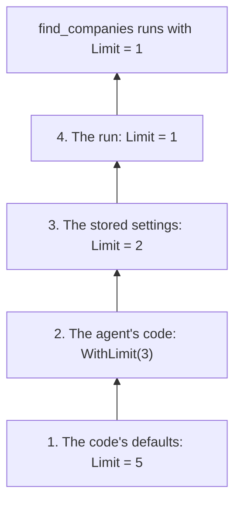

# Settings and stores

Typeshift stores each agent's `Settings` under a settings id, and conversations under a conversation id. Settings go
through an `ISettingsStore` and conversations through an `IConversationStore`, which you
[implement](./implementing-a-store.md) with the id type you already use, in one class or in two.

## Settings layering

A run's settings come from four layers, and each sets values over the one below. Tool settings, chat options and run
options all resolve this way, once, when the run starts.

### One value, four layers

Follow the `find_companies` limit of the [getting started](./getting-started.md) agent up through the layers:



**1. The code's defaults.** `FindCompaniesSettings` initializes `Limit` to 5, so a record made with its parameterless
constructor holds 5. This layer sets every member, so a tool always receives a whole record.

**2. The agent's code.** `ResearchAgent` calls `ConfigureFindCompanies().WithLimit(3)`, so every run of the agent
searches with 3 unless a layer above sets another limit. Its chat and run options, such as `WithTemperature(0.2f)`,
live here too. Because this layer is reviewed, compiled code, it may set any settable member, configurable or not.

**3. The stored settings.** `ConfigureAsync(42, ...)` stores `Limit = 2` and `Temperature = 0.4f`, so every run with
settings id 42 searches with 2, at a temperature of 0.4. `IncludeInactive` cannot be stored, because
`ResearchAgent.Settings` has only the configurable members.

**4. The run.** A run that passes `FindCompanies = new() { Limit = 1 }` in its settings searches with 1, for that run
only. It leaves `Temperature` null, so the stored 0.4 holds.

### Precedence

The highest layer that sets a value wins:

| Layer | Set by | May set | Holds for |
|---|---|---|---|
| 4. The run | The `settings` argument of `RunAsync` and the other runs | Configurable members | That run |
| 3. Stored | `Settings` under the run's settings id: `ConfigureAsync`, `SaveSettingsAsync` | Configurable members | Every run with that settings id |
| 2. The agent's code | `Configure{Tool}()`, `WithChatOptions()`, `WithRunOptions()`, `GetInstructions()` | Every settable member | Every run of the agent |
| 1. The code's defaults | The settings record's parameterless constructor; the run options' defaults | Every member | Every run |

Because the layers resolve when a run starts, settings saved during a run apply from the next run on.

### Null values and nested records

A layer either replaces a value below it or leaves it alone. It never merges, so a configurable member that is itself
a record or a class is replaced as a whole.

::: warning No layer clears a value
Null keeps the layer below, so neither stored settings nor a run can take away a temperature the agent's code set.
:::

### The model and the instructions

The model resolves through the layers like any other value. It stays as the code sets it unless
`Configurable(o => o.ModelId)` lets the layers above choose it, so stored settings can change the model only when the
agent's code allows that. Its provider is a value of its own, so a layer that sets only `Model` keeps the provider of
the layer below.

Stored or run `Instructions` replace the text that `GetInstructions()` returns. Context providers and plan mode then
append to whatever instructions the layers resolved.

### The mode of a conversation

A run with a conversation id continues in the mode (`Default`, `Plan` or `Auto`) that the conversation's last run
ended in. That mode overrides the agent's code and the stored settings, but not the run's own settings. A run whose
own settings name a mode switches the conversation to it, and so does an approved plan
([The three modes](./tool-approval.md#the-three-modes)).

### Sub-agents and handoffs

Sub-agents and handoffs keep the settings id, but not the run's settings. A sub-agent runs with its own settings stored
under the caller's settings id, in the caller's mode. An agent handed off to answers with its own stored settings under
the same id. Run settings apply only to the agent the run started on ([Multiple agents](./multi-agent.md)).

## Registering a store

Register the store in the `AddTypeshift()` chain:

<!-- snippet: quickstart-registration -->
<a id='snippet-quickstart-registration'></a>
```cs
var services = new ServiceCollection();

services.AddTypeshift()
    .WithStore<InMemoryTypeshiftStore>()
    .WithChatClientProvider<KeyedChatClientProvider>();

services.AddKeyedSingleton<IChatClient>("openai", new CannedChatClient());

await using var provider = services.BuildServiceProvider(validateScopes: true);
```
<sup><a href='https://github.com/weboost-at/Typeshift/blob/main/samples/Typeshift.Samples.Docs/Quickstart/Quickstart.cs#L11-L21' title='Snippet source file'>snippet source</a> | <a href='#snippet-quickstart-registration' title='Start of snippet'>anchor</a></sup>
<!-- endSnippet -->

`InMemoryTypeshiftStore` keeps everything in memory and serves tests and samples. For your database, write a store of
your own: [Implementing a store](./implementing-a-store.md) covers its methods, its revisions and the conversation
summaries it reads.

`WithStore<T>()` registers each store interface your class implements, so an `ITypeshiftStore` takes one call. A
store of settings and a store of conversations take one call each.

::: warning The store is a singleton
`WithStore<T>()` registers the store as a singleton, so one instance serves every run at the same time. It cannot
take scoped services, such as a `DbContext`: [the store is a singleton](./implementing-a-store.md#the-store-is-a-singleton)
shows how to build one around that.
:::

Without a store, agents run from their code alone. A run that passes neither a settings id nor a conversation id
works, tools included. Every call that loads or saves, such as a run with either id or `ConfigureAsync`, throws an
`InvalidOperationException` that names `WithStore<T>()` and the interface no registered store implements.

## Agent settings

A settings id stands for whatever you decide: a customer, a team, a user, or a settings profile of your own. Under one
settings id, each agent has its own document, because each agent's `Settings` is its own kind, so a store keys
documents by id and kind together.

`ConfigureAsync` loads an agent's settings, applies your change and saves them. When another save came in between, it
loads them again and reapplies your change until its save wins, up to ten times; then it throws the store's
`StoreConflictException`:

<!-- snippet: configure-settings -->
<a id='snippet-configure-settings'></a>
```cs
await support.ConfigureAsync(settingsId, settings => settings with
{
    Provider = "anthropic",
    Model = "claude-sonnet-5-5",
    Instructions = "Answer in German.",
    SearchTickets = settings.SearchTickets with { Limit = 20 }
});
```
<sup><a href='https://github.com/weboost-at/Typeshift/blob/main/samples/Typeshift.Samples.Docs/Scenarios/AgentSettings.cs#L14-L22' title='Snippet source file'>snippet source</a> | <a href='#snippet-configure-settings' title='Start of snippet'>anchor</a></sup>
<!-- endSnippet -->

A settings form does it in two steps: it loads the settings with their revision and saves them back with it. The
revision tells the store which state the form loaded, so the save throws a `StoreConflictException` when someone saved
in between ([Revisions](./implementing-a-store.md#revisions) explains the number):

<!-- snippet: load-and-save-settings -->
<a id='snippet-load-and-save-settings'></a>
```cs
var stored = await support.LoadSettingsAsync(settingsId);

try
{
    await support.SaveSettingsAsync(settingsId, stored.Data with { Instructions = null }, stored.Revision);
}
catch (StoreConflictException)
{
    stored = await support.LoadSettingsAsync(settingsId);
}
```
<sup><a href='https://github.com/weboost-at/Typeshift/blob/main/samples/Typeshift.Samples.Docs/Scenarios/AgentSettings.cs#L24-L35' title='Snippet source file'>snippet source</a> | <a href='#snippet-load-and-save-settings' title='Start of snippet'>anchor</a></sup>
<!-- endSnippet -->

Saving `Instructions = null` removes the stored instructions, so runs with this settings id use those of
`GetInstructions()` again. After a conflict, the sample loads the settings again, so you can show the user the current
values before they save.

## The stored JSON

What is stored is the record's JSON: camelCase, with the tools nested under `"tools"` by name and nulls left out.

```json
{
  "provider": "anthropic",
  "model": "claude-sonnet-5-5",
  "instructions": "Answer in German.",
  "tools": {
    "search_tickets": {
      "limit": 20
    }
  }
}
```

`System.Text.Json` writes and reads the same JSON, so an endpoint that binds `SupportAgent.Settings` accepts and
returns the JSON the store keeps. A stored member that cannot be read, because its value has the wrong type or its
name is unknown, counts as missing, so the layer below applies. When a configurable member is itself a record or a
class, a stored value replaces the whole object, so members missing from its stored JSON take that type's defaults,
not the values of the layer below.

::: warning A renamed member loses its stored value
A configurable member that is renamed or removed reads as missing, so its stored value no longer applies. When that
matters, raise the agent's settings version with `WithSettingsVersion(2)` and migrate the documents of the older
version in the store ([Settings documents](./implementing-a-store.md#settings-documents)).
:::

## Related

- [Tool settings](./tool-settings.md): declaring a tool's settings and opening members to the layers.
- [Implementing a store](./implementing-a-store.md): the store's methods, its revisions and conversation summaries.
- [Generated members](./generated-members.md#settings): the `Settings` record a store keeps.
- [Running agents](./running-agents.md#run-settings): passing a settings id and run settings.
- [Conversations](./conversations.md): what a run stores in a conversation, and resuming it.
- [Registration](./registration.md#the-id-type): the id type and the other chain calls.
