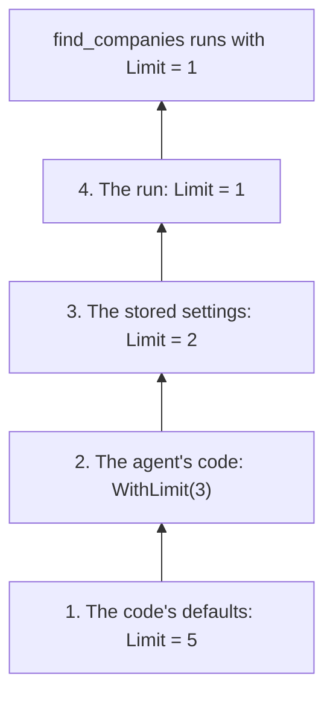

# Settings and stores

Typeshift stores each agent's `Settings` under a settings id, and conversations under a conversation id. Both go through
`ITypeshiftStore`, one interface you implement with the id type you already use.

## Settings layering

A run's settings come from four layers, and each sets values over the one below. Tool settings, chat options and run
options all resolve this way, once, when the run starts.

### One value, four layers

Follow the `find_companies` limit of the [getting started](./getting-started.md) agent up through the layers:



**1. The code's defaults.** `FindCompaniesSettings` sets `Limit = 5` in its parameterless constructor. This layer sets
every member, so a tool always receives a whole record.

**2. The agent's code.** `ResearchAgent` calls `ConfigureFindCompanies().WithLimit(3)`, so every run searches with 3.
Its chat and run options, such as `WithTemperature(0.2f)`, live here too. Because this layer is reviewed, compiled
code, it may set any settable member, configurable or not.

**3. The stored settings.** `ConfigureAsync(42, ...)` stores `Limit = 2` and `Temperature = 0.4f`, so every run with
settings id 42 searches with 2, at 0.4. `IncludeInactive` cannot be stored, because `ResearchAgent.Settings` has only
the configurable members.

**4. The run.** A run that passes `FindCompanies = new() { Limit = 1 }` in its settings searches with 1, for that run
only. It leaves `Temperature` null, so the stored 0.4 holds.

### Precedence

The highest layer that sets a value wins:

| Layer | Set by | May set | Holds for |
|---|---|---|---|
| 4. The run | The `settings` argument of `RunAsync` and the other runs | Configurable members | That run |
| 3. Stored | `Settings` under the run's settings id: `ConfigureAsync`, `SaveSettingsAsync` | Configurable members | Every run with that settings id |
| 2. The agent's code | `Configure{Tool}()`, `WithChatOptions()`, `WithRunOptions()`, `GetInstructions()` | Every settable member | Every run of the agent |
| 1. The code's defaults | The settings record's parameterless constructor; the run options' defaults | Every member | Every run |

Because the layers resolve when a run starts, settings saved during a run apply from the next run on.

### Null keeps, records replace

A layer either replaces a value below it or leaves it alone. It never merges, so a configurable member that is itself
a record or a class is replaced as a whole.

::: warning No layer clears a value
Null keeps the layer below, so neither stored settings nor a run can take away a temperature the agent's code set.
:::

### The model and the instructions

The model is a value like any other. It stays in code unless `Configurable(o => o.ModelId)` lets the layers above
choose it, so stored settings never pick a model the agent does not allow.

Instructions replace, then grow. Stored or run `Instructions` replace those of `GetInstructions()`, and context
providers and plan mode then append to whatever the layers resolved.

### The mode of a conversation

A run with a conversation id continues in the mode the conversation's last run ended in, so that mode sits between the
stored settings and the run. A run whose own settings name a mode switches it, and so does an approved plan
([Plan and auto modes](./tool-approval.md#the-three-modes)).

### Sub-agents and handoffs

Sub-agents and handoffs keep the settings id, but not the run's settings. A sub-agent runs with its own settings stored
under the caller's settings id, in the caller's mode. An agent handed off to answers with its own stored settings under
the same id. Run settings apply only to the agent the run started on ([Multiple agents](./multi-agent.md)).

## Registering a store

Register the store in the `AddTypeshift()` chain:

<!-- snippet: quickstart-registration -->
<a id='snippet-quickstart-registration'></a>
```cs
var services = new ServiceCollection();

services.AddTypeshift()
    .WithStore<InMemoryTypeshiftStore>()
    .WithChatClientProvider<KeyedChatClientProvider>();

services.AddKeyedSingleton<IChatClient>("fast-model", new CannedChatClient());

await using var provider = services.BuildServiceProvider(validateScopes: true);
```
<sup><a href='https://github.com/weboost-at/Typeshift/blob/main/samples/Typeshift.Samples.Docs/Quickstart/Quickstart.cs#L11-L21' title='Snippet source file'>snippet source</a> | <a href='#snippet-quickstart-registration' title='Start of snippet'>anchor</a></sup>
<!-- endSnippet -->

`WithStore<T>()` registers the store as a singleton. `InMemoryTypeshiftStore` is for tests and samples.

Without a store, agents run from their code. A run without a settings id or a conversation id works, tools included,
but every call that loads or saves throws an `InvalidOperationException` that names `WithStore<T>()`.

## The store

`ITypeshiftStore` has four methods. Their ids are of the build's [id type](./registration.md#the-id-type), `Guid`
unless `TypeshiftIdType` names another.

| Method | Does |
|---|---|
| `LoadAsync<TData>(id)` | Returns the document of kind `TData.Kind` under an id, with its revision, or null. |
| `SaveAsync<TData>(id, data, revision)` | Saves the document if the stored revision is still `revision` (0 for none) and returns the new revision. Throws a `StoreConflictException` when another save came first. |
| `LoadConversationAsync(conversation)` | Returns a conversation's entries, oldest first. |
| `AppendConversationAsync(conversation, entry)` | Appends one entry: a run's input, a model response or tool results. |

Runs append as they go, so `AppendConversationAsync` is the hot path, and a row per entry keeps it cheap.

## What a store keeps

Documents serialize themselves, with `Serialize()` and `TData.Deserialize(json, version)`. Next to the JSON, a store
keeps three things:

- **The kind**, `TData.Kind`, a stable name. For an agent's settings it is the class name, so moving the agent to
  another namespace keeps its data. `WithStorageKind("support")` in the agent pins it, so renaming the class keeps the
  data too. Two agents of one kind are [TSH022](./diagnostics.md#tsh022).
- **The version**, `TData.Version`, which the store hands back to `Deserialize`. `Deserialize` refuses a version newer
  than its code's, and a store migrates older documents when it needs to.
- **The revision**, for optimistic concurrency. A save names the revision it loaded, so it fails when another save came
  first.

A settings id stands for whatever you decide: a customer, a team, a user, or a settings profile of your own. Under one
settings id, each agent has its own document, because each agent's `Settings` is its own kind.

## An Entity Framework Core store

The database keeps documents keyed by kind and id, with the revision as a concurrency token, and conversation entries
in order:

<!-- snippet: ef-core-db -->
<a id='snippet-ef-core-db'></a>
```cs
internal sealed class TypeshiftDb(DbContextOptions<TypeshiftDb> options) : DbContext(options)
{
    public DbSet<DocumentRow> Documents => Set<DocumentRow>();

    public DbSet<EntryRow> Entries => Set<EntryRow>();

    protected override void OnModelCreating(ModelBuilder model)
    {
        model.Entity<DocumentRow>().HasKey(document => new { document.Kind, document.Id });
        model.Entity<DocumentRow>().Property(document => document.Revision).IsConcurrencyToken();
        model.Entity<EntryRow>().HasKey(entry => entry.Sequence);
        model.Entity<EntryRow>().HasIndex(entry => entry.Conversation);
    }
}

internal sealed class DocumentRow
{
    public required string Kind { get; init; }

    public required int Id { get; init; }

    public required int Version { get; set; }

    public required long Revision { get; set; }

    public required string Json { get; set; }
}

internal sealed class EntryRow
{
    public long Sequence { get; init; }

    public required int Conversation { get; init; }

    public required int Version { get; init; }

    public required string Json { get; init; }
}
```
<sup><a href='https://github.com/weboost-at/Typeshift/blob/main/samples/Typeshift.Samples.Docs/Stores/EfCore/TypeshiftDb.cs#L5-L44' title='Snippet source file'>snippet source</a> | <a href='#snippet-ef-core-db' title='Start of snippet'>anchor</a></sup>
<!-- endSnippet -->

The store maps the four methods onto it. A save that another save beat becomes a `StoreConflictException`, and any
other database failure surfaces as it is:

<!-- snippet: ef-core-store -->
<a id='snippet-ef-core-store'></a>
```cs
internal sealed class EfTypeshiftStore(IDbContextFactory<TypeshiftDb> contexts) : ITypeshiftStore
{
    public async Task<Stored<TData>?> LoadAsync<TData>(int id, CancellationToken ct)
        where TData : class, IStorable<TData>
    {
        await using var db = await contexts.CreateDbContextAsync(ct);

        return await db.Documents.FindAsync([TData.Kind, id], ct) is { } row
            ? new Stored<TData>(TData.Deserialize(row.Json, row.Version), row.Revision)
            : null;
    }

    public async Task<long> SaveAsync<TData>(int id, TData data, long revision, CancellationToken ct)
        where TData : class, IStorable<TData>
    {
        await using var db = await contexts.CreateDbContextAsync(ct);

        var row = new DocumentRow
        {
            Kind = TData.Kind,
            Id = id,
            Version = TData.Version,
            Revision = revision + 1,
            Json = data.Serialize()
        };

        var entry = db.Entry(row);
        entry.State = revision == 0 ? EntityState.Added : EntityState.Modified;

        // The update only matches the row while it still has the revision the caller loaded
        if (revision > 0)
            entry.Property(document => document.Revision).OriginalValue = revision;

        // A conflict is another save that won; any other failure is the database's and surfaces as it is
        try
        {
            await db.SaveChangesAsync(ct);
            return row.Revision;
        }
        catch (DbUpdateConcurrencyException exception)
        {
            throw new StoreConflictException($"{TData.Kind} {id} changed after revision {revision}.", exception);
        }
        catch (DbUpdateException exception) when (revision == 0)
        {
            if (!await ExistsAsync(TData.Kind, id, ct)) throw;

            throw new StoreConflictException($"{TData.Kind} {id} was saved first by another.", exception);
        }
    }

    private async Task<bool> ExistsAsync(string kind, int id, CancellationToken ct)
    {
        await using var db = await contexts.CreateDbContextAsync(ct);
        return await db.Documents.AnyAsync(row => row.Kind == kind && row.Id == id, ct);
    }

    public async Task<IReadOnlyList<ConversationEntry>> LoadConversationAsync(int conversation, CancellationToken ct)
    {
        await using var db = await contexts.CreateDbContextAsync(ct);

        var rows = await db.Entries
            .Where(entry => entry.Conversation == conversation)
            .OrderBy(entry => entry.Sequence)
            .ToListAsync(ct);

        return [.. rows.Select(row => ConversationEntry.Deserialize(row.Json, row.Version))];
    }

    public async Task AppendConversationAsync(int conversation, ConversationEntry entry, CancellationToken ct)
    {
        await using var db = await contexts.CreateDbContextAsync(ct);

        db.Entries.Add(new EntryRow
        {
            Conversation = conversation,
            Version = ConversationEntry.Version,
            Json = entry.Serialize()
        });

        await db.SaveChangesAsync(ct);
    }
}
```
<sup><a href='https://github.com/weboost-at/Typeshift/blob/main/samples/Typeshift.Samples.Docs/Stores/EfCore/EfTypeshiftStore.cs#L5-L89' title='Snippet source file'>snippet source</a> | <a href='#snippet-ef-core-store' title='Start of snippet'>anchor</a></sup>
<!-- endSnippet -->

Register the context factory the store takes, next to `WithStore<EfTypeshiftStore>()`:

<!-- snippet: ef-core-registration -->
<a id='snippet-ef-core-registration'></a>
```cs
services.AddDbContextFactory<TypeshiftDb>(options => options.UseSqlite("Data Source=typeshift.db"));
```
<sup><a href='https://github.com/weboost-at/Typeshift/blob/main/samples/Typeshift.Samples.Docs/Scenarios/Registration.cs#L42-L44' title='Snippet source file'>snippet source</a> | <a href='#snippet-ef-core-registration' title='Start of snippet'>anchor</a></sup>
<!-- endSnippet -->

## Agent settings

`ConfigureAsync` loads an agent's settings, applies your change and saves them. When another save came in between, it
loads them again and reapplies your change until its save wins:

<!-- snippet: configure-settings -->
<a id='snippet-configure-settings'></a>
```cs
await support.ConfigureAsync(settingsId, settings => settings with
{
    Model = "reasoning-model",
    Instructions = "Answer in German.",
    SearchTickets = settings.SearchTickets with { Limit = 20 }
});
```
<sup><a href='https://github.com/weboost-at/Typeshift/blob/main/samples/Typeshift.Samples.Docs/Scenarios/AgentSettings.cs#L14-L21' title='Snippet source file'>snippet source</a> | <a href='#snippet-configure-settings' title='Start of snippet'>anchor</a></sup>
<!-- endSnippet -->

A settings form does it in two steps: it loads the settings with their revision and saves them back with it. A
`StoreConflictException` means someone saved in between:

<!-- snippet: load-and-save-settings -->
<a id='snippet-load-and-save-settings'></a>
```cs
var stored = await support.LoadSettingsAsync(settingsId);

try
{
    await support.SaveSettingsAsync(settingsId, stored.Data with { Instructions = null }, stored.Revision);
}
catch (StoreConflictException)
{
    stored = await support.LoadSettingsAsync(settingsId);
}
```
<sup><a href='https://github.com/weboost-at/Typeshift/blob/main/samples/Typeshift.Samples.Docs/Scenarios/AgentSettings.cs#L23-L34' title='Snippet source file'>snippet source</a> | <a href='#snippet-load-and-save-settings' title='Start of snippet'>anchor</a></sup>
<!-- endSnippet -->

## The stored JSON

What is stored is the record's JSON: camelCase, with the tools nested under `"tools"` by name and nulls left out.

```json
{
  "model": "reasoning-model",
  "instructions": "Answer in German.",
  "tools": {
    "search_tickets": {
      "limit": 20
    }
  }
}
```

`System.Text.Json` writes and reads the same JSON, so an endpoint that binds `SupportAgent.Settings` speaks the stored
shape. A member that does not read, because it is mistyped or unknown, keeps the layer below. A stored record or class
takes the defaults for the members it lacks.

::: warning A renamed member loses its stored value
A configurable member that is renamed or removed reads as missing, so its stored value no longer applies. When that
matters, raise the agent's settings version with `WithSettingsVersion(2)` and migrate the documents of the older
version in the store.
:::

## Related

- [Tool settings](./tool-settings.md): declaring a tool's settings and opening members to the layers.
- [Generated members](./generated-members.md#settings): the `Settings` record a store keeps.
- [Running agents](./running-agents.md#run-settings): passing a settings id and run settings.
- [Conversations](./conversations.md): what a run stores in a conversation, and resuming it.
- [Registration](./registration.md#the-id-type): the id type and the other chain calls.
