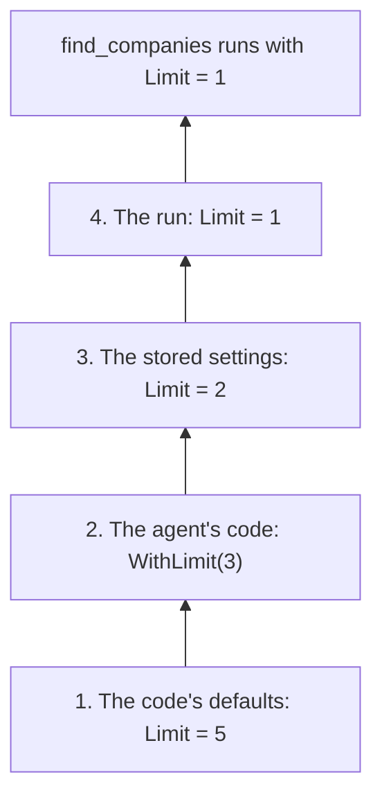

# Settings and stores

Typeshift stores each agent's `Settings`, as the agent's own or under a settings id, and conversations under a
conversation id. An agent's own settings go through an `IAgentSettingsStore`, settings under an id through an
`ISettingsStore<TId>`, and conversations through an `IConversationStore<TId>`, where `TId` is the type of your ids.
Typeshift keeps them in memory until you register stores of your own, which you
[implement](./implementing-a-store.md) over your database, in one class or in several.

## Settings layering

A run's settings come from four layers, and each sets values over the one below. Tool settings, chat options and run
options all resolve this way, once, when the run starts.

### One value, four layers

Follow the `find_companies` limit of the [getting started](./getting-started.md) agent up through the layers:



**1. The code's defaults.** `FindCompaniesSettings` initializes `Limit` to 5, so a record made with its parameterless
constructor holds 5. This layer sets every member, so a tool always receives a whole record.

**2. The agent's code.** `ResearchAgent` calls `ConfigureFindCompanies().WithLimit(3)`, so every run of the agent
searches with 3 unless a layer above sets another limit. Its chat and run options, such as `WithTemperature(0.2f)`,
live here too. Because this layer is reviewed, compiled code, it may set any settable member, configurable or not.

**3. The stored settings.** `WithSettingsId(42).ConfigureAsync(...)` stores `Limit = 2` and `Temperature = 0.4f`, so
every run with settings id 42 searches with 2, at a temperature of 0.4. `IncludeInactive` cannot be stored, because
`ResearchAgent.Settings` has only the configurable members. Below the settings of the id lie the agent's own stored
settings, which every run applies, with a settings id or without one ([Agent settings](#agent-settings)).

**4. The run.** A run that passes `FindCompanies = new() { Limit = 1 }` in its settings searches with 1, for that run
only. It leaves `Temperature` null, so the stored 0.4 holds.

### Precedence

The highest layer that sets a value wins:

| Layer | Set by | May set | Holds for |
|---|---|---|---|
| 4. The run | The `settings` argument of `RunAsync` and the other runs | Configurable members | That run |
| 3. Stored | The agent's own `Settings`, then those under the host's settings id: `ConfigureAsync`, `SaveSettingsAsync` | Configurable members | Every run, or every run with that settings id |
| 2. The agent's code | `Configure{Tool}()`, `WithChatOptions()`, `WithRunOptions()`, `WithInstructions()` or `GetInstructions()` | Every settable member | Every run of the agent |
| 1. The code's defaults | The settings record's parameterless constructor; the run options' defaults | Every member | Every run |

Because the layers resolve when a run starts, settings saved during a run apply from the next run on.

### Null values and nested records

A layer either replaces a value below it or leaves it alone. It never merges, so a configurable member that is itself
a record or a class is replaced as a whole.

::: warning No layer clears a value
Null keeps the layer below, so neither stored settings nor a run can take away a temperature the agent's code set.
:::

### The model and the instructions

The model resolves through the layers like any other value. It stays as the code sets it unless
`Configurable(o => o.ModelId)` lets the layers above choose it, so stored settings can change the model only when the
agent's code allows that. Its provider is a value of its own, so a layer that sets only `Model` keeps the provider of
the layer below.

Stored or run `Instructions` replace the agent's own, from `WithInstructions` or `GetInstructions()`. Context providers and plan mode then
append to whatever instructions the layers resolved.

### The mode of a conversation

A run with a conversation id continues in the mode (`Default`, `Plan` or `Auto`) that the conversation's last run
ended in. That mode overrides the agent's code and the stored settings, but not the run's own settings. A run whose
own settings name a mode switches the conversation to it, and so does an approved plan
([The three modes](./tool-approval.md#the-three-modes)).

### Sub-agents and handoffs

Sub-agents and handoffs keep the settings id, but not the run's settings. A sub-agent runs with the stored settings
of its own kind, those of the agent and those under the caller's settings id, in the caller's mode. An agent handed
off to answers with the stored settings of its kind under the same id. Run settings apply only to the agent the run
started on ([Multiple agents](./multi-agent.md)).

## Ids of your own types

Each store has the id type of its interface, and one app may have several: an `ISettingsStore<int>` keeps settings
under `int` ids while an `IConversationStore<string>` keeps conversations under `string` ids. You give a host its ids
in code, and each id's type picks the store of that type:

- `support.WithSettingsId(42)` applies the settings stored under 42 in the `ISettingsStore<int>`, over the agent's
  own. Its settings members, such as `ConfigureAsync(...)`, load and save those settings.
- `support.WithConversationId(chat)` resumes the conversation in the `IConversationStore` of `chat`'s type, and stores
  what the run adds to it.

Each call returns a copy of the host with the id, in the host's scope, so
`support.WithSettingsId(42).WithConversationId(chat).RunAsync(input)` runs with both, and `support` itself keeps none.
A copy is a small object, so make one wherever your code has the ids, such as in each request. It never disposes
the scope, so it works as long as `support` does. Ids of the same value and different types are different ids: a
conversation under 5 as an `int` is not the one under 5 as a `long`.
[Which store serves a call](./implementing-a-store.md#which-store-serves-a-call) says what happens to an id whose type
none of your stores keeps.

A few things follow the host's ids:

- `ResumeAsync()` resumes the host's conversation, and `ResolveOptionsAsync()` hands it on to the
  [raw path](./running-agents.md#the-raw-path).
- `ConversationTracker<TId>` lists, watches and steers the conversations under ids of `TId`, so a chat under `Guid`
  ids takes `ConversationTracker<Guid>`. The container has the tracker of every id type
  ([Live runs](./conversations.md#live-runs)).

## Agent settings

An app whose agents need one set of settings each stores them as the agent's own, under no id. Every run of the agent
applies them:

<!-- snippet: own-settings -->
<a id='snippet-own-settings'></a>
```cs
await research.ConfigureAsync(settings => settings with { Temperature = 0.3f });

var everyRun = await research.RunAsync("Graz");
```
<sup><a href='https://github.com/weboost-at/Typeshift/blob/main/samples/Typeshift.Samples.Docs/Quickstart/Quickstart.cs#L58-L62' title='Snippet source file'>snippet source</a> | <a href='#snippet-own-settings' title='Start of snippet'>anchor</a></sup>
<!-- endSnippet -->

`LoadSettingsAsync()` and `SaveSettingsAsync(settings, loadedVersion)` load and save them, and
`ConfigureAsync(configure)` retries on a conflict, as the rest of this section shows. On a host from
`WithSettingsId(id)`, the same three members load and save the settings under the id instead.

Kept in memory, they are gone when the app stops. To keep them without a database, for example in a local tool or a
single-agent service, register the file store with `WithFileStore`:

<!-- snippet: file-agent-settings -->
<a id='snippet-file-agent-settings'></a>
```cs
var services = new ServiceCollection();

services.AddTypeshift()
    .WithFileStore(store => store.Folder = folder);
```
<sup><a href='https://github.com/weboost-at/Typeshift/blob/main/samples/Typeshift.Samples.Docs/Quickstart/FileSettings.cs#L29-L34' title='Snippet source file'>snippet source</a> | <a href='#snippet-file-agent-settings' title='Start of snippet'>anchor</a></sup>
<!-- endSnippet -->

The file store keeps agents' settings in its `settings` folder, a file named after each agent's kind:
`settings/ResearchAgent.json` here. You can read, back up and edit the file by hand. Several processes may share the
folder, since a save takes a lock file of its kind first.

- Without a `Folder`, the store lies in a `typeshift` folder under `AppContext.BaseDirectory`, beside your app's
  assemblies, so a service finds it whatever its current directory is. Set one when your app may not write there, as
  is usual for an install folder under Program Files.
- A relative `Folder` resolves against the current directory when you register the store, which for a service may be
  the system's folder.
- Characters other than ASCII letters, digits, `_` and `-` are escaped in the file name, so any kind has a file of its
  own.
- On a file system that ignores case, as on Windows and macOS, two kinds that differ only in case share a file. The
  file names its kind, so a load of the other kind throws; give one of the agents a `WithStorageKind` of its own.
- A save waits up to 30 seconds for the lock file, `settings/ResearchAgent.json.lock` here, and then throws a
  `TimeoutException` that names it, so a program that hangs while it holds the lock cannot hang your saves. The lock
  file stays in the folder between saves.
- A file that is no JSON, or whose JSON has another shape than the store writes, fails the load with an
  `InvalidDataException` that names the file and the shape.
- Registering the file store, as registering any store does, ends the memory: settings under ids and conversations
  then need a store of their own ([Which store serves a call](./implementing-a-store.md#which-store-serves-a-call)).

A settings id stands for whatever you decide: a customer, a team, a user, or a settings profile of your own. Under one
settings id, each agent has its own document, because each agent's `Settings` is its own kind, so a store keys
documents by id and kind together.

`ConfigureAsync` loads an agent's settings, applies your change and saves them. When another save came in between, it
loads them again and reapplies your change, ten tries in all. If the tenth save loses too, it throws the store's
`StoreConflictException`:

<!-- snippet: configure-settings -->
<a id='snippet-configure-settings'></a>
```cs
await support.WithSettingsId(42).ConfigureAsync(settings => settings with
{
    Provider = "anthropic",
    Model = "claude-sonnet-5-5",
    Instructions = "Answer in German.",
    SearchTickets = settings.SearchTickets with { Limit = 20 }
});
```
<sup><a href='https://github.com/weboost-at/Typeshift/blob/main/samples/Typeshift.Samples.Docs/Scenarios/AgentSettings.cs#L13-L21' title='Snippet source file'>snippet source</a> | <a href='#snippet-configure-settings' title='Start of snippet'>anchor</a></sup>
<!-- endSnippet -->

A settings form does it in two steps: it loads the settings with their version and saves them back with it. The
version tells the store which state the form loaded, so the save throws a `StoreConflictException` when someone saved
in between ([Save with a version](./implementing-a-store.md#save-with-a-version) explains the number):

<!-- snippet: load-and-save-settings -->
<a id='snippet-load-and-save-settings'></a>
```cs
var host = support.WithSettingsId(42);
var stored = await host.LoadSettingsAsync();

try
{
    await host.SaveSettingsAsync(stored.Data with { Instructions = null }, stored.Version);
}
catch (StoreConflictException)
{
    stored = await host.LoadSettingsAsync();
}
```
<sup><a href='https://github.com/weboost-at/Typeshift/blob/main/samples/Typeshift.Samples.Docs/Scenarios/AgentSettings.cs#L23-L35' title='Snippet source file'>snippet source</a> | <a href='#snippet-load-and-save-settings' title='Start of snippet'>anchor</a></sup>
<!-- endSnippet -->

Saving `Instructions = null` removes the stored instructions, so runs with this settings id use the agent's own
again. After a conflict, the sample loads the settings again, so you can show the user the current
values before they save.

## The stored JSON

What is stored is the record's JSON: camelCase, with the tools nested under `"tools"` by name and nulls left out.

```json
{
  "provider": "anthropic",
  "model": "claude-sonnet-5-5",
  "instructions": "Answer in German.",
  "tools": {
    "search_tickets": {
      "limit": 20
    }
  }
}
```

An agent whose `WithSchemaVersion(n)` raised its schema version above 1 also writes `"$schemaVersion": n` first.
`System.Text.Json` writes and reads the same JSON, so an endpoint that binds `SupportAgent.Settings` accepts and returns
the JSON the store keeps. A stored member that cannot be read, because its value has the wrong type or its name is
unknown, counts as missing, so the layer below applies. When a configurable member is itself a record or a class, a
stored value replaces the whole object, so members missing from its stored JSON take that type's defaults, not the
values of the layer below.

Text is stored as it is written, letters outside ASCII included, so you can read a row in a database tool and search
it with `LIKE`. That holds for settings and for conversation entries. Quotes and the characters `<`, `>` and `&` are
escaped as `\uXXXX`, because your app may pass the JSON on to a page as it is.

::: warning A renamed member loses its stored value
A configurable member that is renamed or removed reads as missing, so its stored value no longer applies. When that
matters, raise the agent's schema version with `WithSchemaVersion(2)` and migrate the documents of the older
schema version ([Migrate older settings](./implementing-a-store.md#migrate-older-settings)).
:::

## Related

- [Tool settings](./tool-settings.md): declaring a tool's settings and opening members to the layers.
- [Implementing a store](./implementing-a-store.md): registering a store, its methods, its versions and conversation
  summaries.
- [Generated members](./generated-members.md#settings): the `Settings` record a store keeps.
- [Running agents](./running-agents.md#run-settings): running with a settings id and run settings.
- [Conversations](./conversations.md): what a run stores in a conversation, and resuming it.
- [Registration](./registration.md#ids): ids and the other chain calls.
