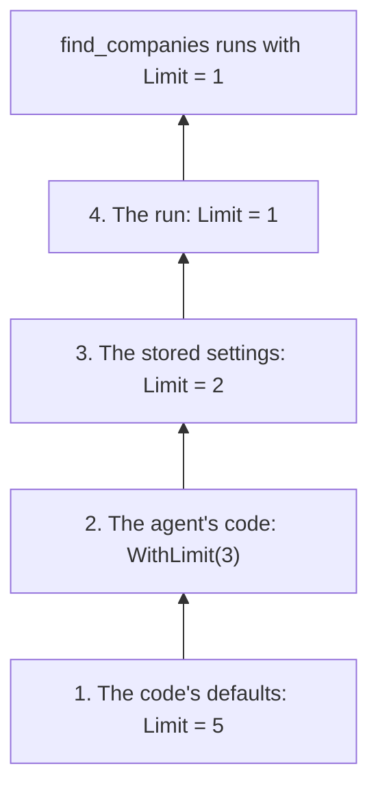

# Settings layering

A run's settings come from four layers: the code's defaults, the agent's code, the settings stored under a settings id
and the run's own settings. Each layer sets values over the one below, and a value it leaves null keeps the one below.
Tool settings, chat options and run options all resolve this way, when a run starts.

::: tip The short version

- Four layers, lowest first: the code's defaults, the agent's code, the stored settings and the run.
- The highest layer that sets a value wins. A layer that leaves a value null keeps the one below.
- The agent's code may set any settable member. Stored settings and runs reach only the configurable ones.
- The layers resolve once, when a run starts. Settings saved during a run apply from the next run on.

:::

## One value, four layers

Follow the `find_companies` limit of the [getting started](./getting-started.md) agent through the layers:

Each layer overrides the one below it. The tool receives the value of the highest layer that sets it.

**1. The code's defaults.** `FindCompaniesSettings` sets `Limit = 5` in its parameterless constructor. This layer sets
every member, so a tool always receives a whole record, whatever the layers above leave out.

**2. The agent's code.** `ResearchAgent` calls `ConfigureFindCompanies().WithLimit(3)`, so every run of the agent
searches with 3. Its chat options, such as `WithTemperature(0.2f)`, and its run options belong to this layer too. The
agent's code may set any settable member, configurable or not. It is code, reviewed and compiled with the rest.

**3. The stored settings.** `ConfigureAsync(42, ...)` stores `Limit = 2` and `Temperature = 0.4f` under settings id
42. Every run with that settings id now searches with 2, at 0.4. Only the configurable members exist in
`ResearchAgent.Settings`. So `IncludeInactive` cannot be stored: there is no member to hold it.

You decide what a settings id stands for: a customer, a team, a user, or a settings profile of your own. Under one
settings id, each agent has its own document.

**4. The run.** A run that passes `FindCompanies = new() { Limit = 1 }` in its settings searches with 1, for that run
only. It leaves `Temperature` null, so the stored 0.4 holds.

## Precedence

The highest layer that sets a value wins.

| Layer | Set by | May set | Holds for |
|---|---|---|---|
| 4. The run | The `settings` argument of `RunAsync` and the other runs | Configurable members | That run |
| 3. Stored | `Settings` under the run's settings id: `ConfigureAsync`, `SaveSettingsAsync` | Configurable members | Every run with that settings id |
| 2. The agent's code | `Configure{Tool}()`, `WithChatOptions()`, `WithRunOptions()`, `GetInstructions()` | Every settable member | Every run of the agent |
| 1. The code's defaults | The settings record's parameterless constructor; the run options' defaults | Every member | Every run |

The layers resolve when a run starts. Settings saved during a run apply from the next run on.

## Null keeps, records replace

A layer replaces a value below it or leaves it alone. It never clears one and never merges one.

::: warning No layer clears a value
Null keeps the layer below. So stored settings or a run cannot take away a temperature the agent's code set.
:::

A configurable member that is itself a record or a class is replaced as a whole, never merged with the one below.

## The model and the instructions

- **The model is a value like any other.** It stays in code unless `Configurable(o => o.ModelId)` lets the layers above
  choose it. So stored settings never pick a model the agent does not allow.
- **Instructions replace, then grow.** Stored or run `Instructions` replace those of `GetInstructions()`. Context
  providers and plan mode then append to whatever the layers resolved.

## The mode of a conversation

A run with a conversation id continues in the mode the conversation's last run ended in. That mode sits between the
stored settings and the run. A run whose own settings name a mode switches it, and so does an approved plan. See [Plan
and auto modes](./modes.md).

## Sub-agents and handoffs

Sub-agents and handoffs keep the settings id.

- A sub-agent runs with its own settings stored under the caller's settings id, in the caller's mode. It does not get
  the caller's run settings.
- An agent handed off to answers with its own stored settings under the same settings id. The run's settings apply only
  to the agent the run started on.

See [Multiple agents](./multi-agent.md).

## Related

- [Tool settings](./tool-settings.md): declaring a tool's settings and opening members to the layers.
- [The `Settings` record](./generated-members.md#settings): what the stored layer holds and how it is serialized.
- [Running agents](./running-agents.md#run-settings): passing a settings id and run settings.
- [How a run works](./running-agents.md#how-a-run-works): where resolving the settings sits in a run.
