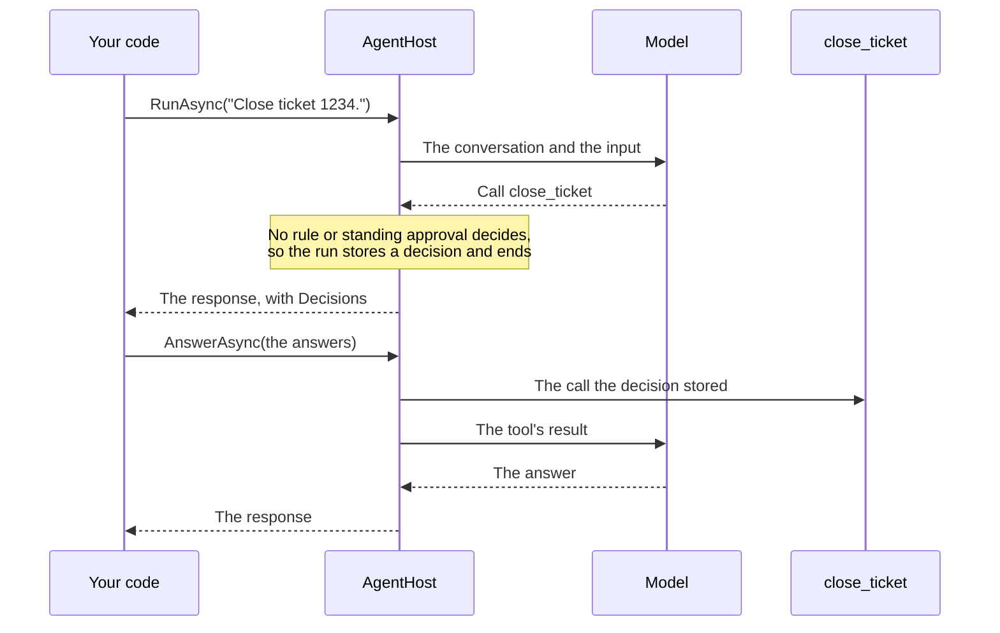

# Approval and modes

Some tools must not run unasked, such as closing a ticket. When the model calls one, the run ends with a decision
for your app, which approves or rejects the call by the decision's id. Approval rules, standing approvals and the
run's mode decide which calls need asking at all. A plan, and a question the model asks the user, reach your app as
decisions too.

## How approval works



Here no [approval rule](#approval-rules) or [standing approval](#approving-for-the-conversation) decides the call to
`close_ticket`, so the run stores a decision with the conversation and ends. Nothing of the model's response has run
yet. Your app answers the decision by its id, and the stored call runs once the answer approves it.

A decision is a record of Typeshift's own: an `ApprovalDecision` for a tool call, a `PlanDecision` for a
[plan](#plan-mode), a `QuestionDecision` for [questions to the user](#asking-the-user). It is stored beside the
conversation and never among its messages, so no provider receives it, and a page can load it again after a reload.

## Requiring approval

`RequiresApproval()` makes every call to a tool wait for approval:

<!-- snippet: approval-tool -->
<a id='snippet-approval-tool'></a>
```cs
AddTool(CloseTicketAsync)
    .RequiresApproval();
```
<sup><a href='https://github.com/weboost-at/Typeshift/blob/main/samples/Typeshift.Samples.Docs/Tickets/TicketToolset.cs#L24-L27' title='Snippet source file'>snippet source</a> | <a href='#snippet-approval-tool' title='Start of snippet'>anchor</a></sup>
<!-- endSnippet -->

`UseMcpServer(...).RequiresApproval()` does the same for every tool of an [MCP server](./mcp.md). A tool that a
[context provider](./middleware.md#context-providers) adds needs approval when you wrap it in
`ApprovalRequiredAIFunction`.

## When a call needs approval

When the model calls such a tool, the run ends without making the call. `Decisions`, which Typeshift adds to
`ChatResponse`, lists what waits for your app. An `ApprovalDecision` has the tool's name and the arguments the model
sent, as JSON:

<!-- snippet: approval-run -->
<a id='snippet-approval-run'></a>
```cs
var chat = support.WithConversationId(8);
var answer = await chat.RunAsync("Close ticket 1234.");

var approvals = answer.Decisions.OfType<ApprovalDecision>().ToList();

foreach (var approval in approvals)
    Console.WriteLine($"Approve {approval.Tool}({approval.Arguments})?");
```
<sup><a href='https://github.com/weboost-at/Typeshift/blob/main/samples/Typeshift.Samples.Docs/Scenarios/Approval.cs#L14-L22' title='Snippet source file'>snippet source</a> | <a href='#snippet-approval-run' title='Start of snippet'>anchor</a></sup>
<!-- endSnippet -->

If the model called other tools in the same response, those calls wait too, even when they need no approval, and run
once your app has answered every decision of that response.

A streaming run carries its decisions in its last update, as `update.Decisions`, after the run has ended. So every
decision your app shows can be answered at once.

A decision is stored with a [conversation](./conversations.md), so the sample runs on a host from
`WithConversationId`. A run without a conversation id throws a `DecisionUnavailableException`, naming the tool, unless
your app [keeps every conversation](./conversations.md#keeping-every-conversation). Run with one, approve the calls
with a rule, or use [auto mode](#auto-mode).

`GetDecisionsAsync()` loads what a conversation waits for without a run, for a page that was reloaded: the decisions
still open in `Open`, and the [standing approvals](#approving-for-the-conversation) in `Standing`.

## Approving or rejecting

Each decision makes its own answer, with `Approve()` or `Reject(reason)`. Pass the answers to `AnswerAsync`, on a
host with the same conversation id:

<!-- snippet: approval-resume -->
<a id='snippet-approval-resume'></a>
```cs
var resumed = await chat.AnswerAsync([.. approvals.Select(approval => approval.Approve())]);
```
<sup><a href='https://github.com/weboost-at/Typeshift/blob/main/samples/Typeshift.Samples.Docs/Scenarios/Approval.cs#L24-L26' title='Snippet source file'>snippet source</a> | <a href='#snippet-approval-resume' title='Start of snippet'>anchor</a></sup>
<!-- endSnippet -->

`AnswerAsync` records the answers. Once no decision of the conversation is left open, it carries them out and
continues the run: approved calls run, a rejected call reaches the model as rejected, with the reason if you gave
one, and the model goes on. `AnswerStreamingAsync` streams that continuation.

You don't have to answer everything at once. While decisions are left open, `AnswerAsync` records what it got, calls
no model, and returns a response whose `Decisions` lists the rest, so a UI can post one answer per button.

An answer is a `DecisionAnswer`, which names its decision by id. A UI posts it as JSON, such as
`{"decisionId":"...","approved":true}`, and sends back nothing of the call
([Answer a decision](./chat-endpoint.md#answer-a-decision)). The call that runs is always the stored one, with the
arguments your app saw.

To record answers without a run, from a webhook for example, call `RecordAnswersAsync(answers)`. `GetDecisionsAsync()`
then has `CanResume` set once every decision is answered, and
[`ResumeAsync()`](./conversations.md#resuming) carries the answers out.

When the run that asked had a settings id, answer on a host with that settings id as well, because the
[conversation doesn't keep it](./conversations.md#tracking-a-conversation). Without it, the approved call runs on the
agent's code instead of your customer's stored settings.

::: details Approvals and the run's limit of tool rounds
`WithMaxToolIterations` limits how many rounds of tool calls one run makes. The calls you approve run in the next run,
which starts its own count, so they run even when the run that asked had used up its rounds. A call that a rule, a
standing approval or auto mode approves is a round like any other and counts toward its run's limit.
:::

## When a decision closes

A decision stays open until your app answers it or the conversation goes on without it. It closes when:

- your app answers it. The same answer again changes nothing, so a retried post is safe; a different answer is
  refused.
- the conversation's next run starts with new input, such as a new message. The decisions that waited expire: none
  of their calls runs, the calls next to them included, and the model reads for each call that it did not run.
- its own run takes [steering input](./conversations.md#steering) after it asked. The decisions expire the same way,
  and the run's response lists none of them. A background agent's answer expires nothing: it is stored, and the model
  reads it once your app has answered.

An answer to a closed decision throws `DecisionClosedException` and records nothing, so your app learns that its
prompt is out of date. Its `Decisions` says why each one is closed:

| `DecisionClosedReason` | Means |
|---|---|
| `Answered` | Another answer stands, or the answers were carried out: a second tab, or a retry after the run continued. |
| `Expired` | The user sent something else first, as a new message or as steering input. |
| `Unknown` | The conversation holds no such decision: an id of another conversation, or of an earlier round of decisions. |

<!-- snippet: approval-closed -->
<a id='snippet-approval-closed'></a>
```cs
try
{
    await chat.AnswerAsync([approvals[0].Approve()]);
}
catch (DecisionClosedException closed)
{
    foreach (var (decision, reason) in closed.Decisions)
        Console.WriteLine($"The decision {decision} is closed: {reason}.");
}
```
<sup><a href='https://github.com/weboost-at/Typeshift/blob/main/samples/Typeshift.Samples.Docs/Scenarios/Approval.cs#L32-L42' title='Snippet source file'>snippet source</a> | <a href='#snippet-approval-closed' title='Start of snippet'>anchor</a></sup>
<!-- endSnippet -->

One closed answer rejects the whole call: the other answers passed with it are not recorded either. Answer again
without the decisions the exception names to keep the rest.

An answer that does not fit its decision, such as a plan's mode for a tool call, throws an `ArgumentException`. So
does a `ChatMessage` passed to `RunAsync` that carries Microsoft.Extensions.AI's approval contents, because answers
go through `AnswerAsync`.

::: warning An approved call never starts twice
Once a run begins to carry out the answers, no later run starts those calls again. If that run is cancelled, or its
process stops, before a call's result is stored, the next run tells the model that it is not known whether the call
took effect, and the model checks before it repeats anything.
:::

## Approving for the conversation

`ApproveForConversation()` approves the call and every later call of the same tool in the conversation. The standing
approval is stored with the conversation's decisions, so it holds across runs, processes and
[compaction](./conversations.md#compaction):

<!-- snippet: approval-for-conversation -->
<a id='snippet-approval-for-conversation'></a>
```cs
var again = await chat.RunAsync("Close ticket 1234 again.");
var asked = again.Decisions.OfType<ApprovalDecision>().Single();

await chat.AnswerAsync([asked.ApproveForConversation()]);
```
<sup><a href='https://github.com/weboost-at/Typeshift/blob/main/samples/Typeshift.Samples.Docs/Scenarios/Approval.cs#L44-L49' title='Snippet source file'>snippet source</a> | <a href='#snippet-approval-for-conversation' title='Start of snippet'>anchor</a></sup>
<!-- endSnippet -->

`GetDecisionsAsync()` lists the conversation's standing approvals, each with its tool and the time it took effect:

<!-- snippet: approval-standing -->
<a id='snippet-approval-standing'></a>
```cs
var decisions = await chat.GetDecisionsAsync();

foreach (var standing in decisions.Standing)
    Console.WriteLine($"{standing.Tool} runs without asking since {standing.GrantedAt:t}.");
```
<sup><a href='https://github.com/weboost-at/Typeshift/blob/main/samples/Typeshift.Samples.Docs/Scenarios/Approval.cs#L54-L59' title='Snippet source file'>snippet source</a> | <a href='#snippet-approval-standing' title='Start of snippet'>anchor</a></sup>
<!-- endSnippet -->

A standing approval:

- matches a tool by its name, whatever arguments the model sends. An [MCP server's](./mcp.md) tool is approved with
  its server, so the approval reaches no tool of the same name elsewhere.
- holds for every agent of the conversation: the agents it is [handed to](./multi-agent.md#handoff) and the
  [sub-agents](./multi-agent.md#sub-agents) they call.
- takes effect when a run begins to carry the answer out. An answer that [expires](#when-a-decision-closes) before
  then grants nothing.
- never overrules a rule. A rule that rejects the call still wins.

::: danger A standing approval covers calls your user never saw
Approving `run_command` for the conversation approves every later command, whatever it runs, for as long as the
conversation lasts. Offer it only for tools whose every call you would approve, and guard the others with
[approval rules](#approval-rules).
:::

## Approval rules

A rule decides a call before your app is asked. It approves what you trust, rejects what you never allow, and
abstains on the rest. Register it with `WithApprovalRule<T>()`, and Typeshift resolves it from the run's services:

<!-- snippet: approval-rule-registration -->
<a id='snippet-approval-rule-registration'></a>
```cs
services.AddTypeshift()
    .WithApprovalRule<ShellGuard>();
```
<sup><a href='https://github.com/weboost-at/Typeshift/blob/main/samples/Typeshift.Samples.Docs/Scenarios/Registration.cs#L64-L67' title='Snippet source file'>snippet source</a> | <a href='#snippet-approval-rule-registration' title='Start of snippet'>anchor</a></sup>
<!-- endSnippet -->

Every rule sees every call that requires approval, with the arguments the model sent, so it decides on exactly the
call that runs. This one rejects the shell commands it never allows:

<!-- snippet: approval-rule -->
<a id='snippet-approval-rule'></a>
```cs
internal sealed class ShellGuard : IToolApprovalRule
{
    private static readonly string[] Never = ["sudo", "rm -rf", "curl", "wget", "ssh"];

    // A provider sends each argument as a JsonElement, whose ToString() is the string itself
    public ValueTask<RuleVerdict> DecideAsync(FunctionCallContent call, AgentRun run, CancellationToken ct) =>
        ValueTask.FromResult(call is { Name: "run_command", Arguments: { } arguments }
            && arguments.TryGetValue("command", out var value)
            && value?.ToString() is { } command
            && Never.Any(command.Contains)
                ? RuleVerdict.Reject("This command is never allowed here.")
                : RuleVerdict.Abstain);
}
```
<sup><a href='https://github.com/weboost-at/Typeshift/blob/main/samples/Typeshift.Samples.Docs/Hosting/ShellGuard.cs#L5-L19' title='Snippet source file'>snippet source</a> | <a href='#snippet-approval-rule' title='Start of snippet'>anchor</a></sup>
<!-- endSnippet -->

A rule answers with a `RuleVerdict`:

| Verdict | Means |
|---|---|
| `RuleVerdict.Reject(reason)` | The call is rejected in every mode, and the model receives the reason. A rejection wins over every approval. The reason is required: a null or blank one throws an `ArgumentException`. |
| `RuleVerdict.Approve` | The call runs, unless another rule rejects it. |
| `RuleVerdict.Abstain` | No opinion. Another rule, a standing approval or the [mode](#the-three-modes) decides: auto mode runs the call, and the default and plan modes ask your app. |

A call a rule approves or rejects never becomes a decision: nothing is stored for it, and the run goes on in the
same round.

::: danger Approve only what you can read in full
A command that looks harmless may run code the model wrote. That is why the rule above only rejects and leaves the
rest to your app.
:::

## The three modes

Every run is in one of three modes. The mode decides which tools the model is offered and what happens to the tools
that require approval:

| Mode | Offers | Tools that require approval |
|---|---|---|
| `Default` | every tool | ask your app, unless a rule or a standing approval decides |
| `Plan` | read-only tools and `exit_plan_mode` | offered only if also marked `ReadOnly()`, and then ask as in `Default` |
| `Auto` | every tool | run without asking, unless a rule rejects the call |

## Setting the mode

The mode is a [run option](./defining-agents.md#run-options). `WithMode(mode)` in the agent's `WithRunOptions()` sets
the mode runs start in, `Default` unless set. Add `Configurable(r => r.Mode)` to the same chain, and the agent's
generated `Settings` gets a `Mode`, so stored settings or a run can change it. `TriageAgent` makes `Mode` configurable,
so this run can pass `Mode = AgentMode.Plan` and start in plan mode:

<!-- snippet: switch-mode -->
<a id='snippet-switch-mode'></a>
```cs
var plan = new TriageAgent.Settings { Mode = AgentMode.Plan };
var chat = triage.WithConversationId(conversationId);

var planned = await chat.RunAsync("Sort out ticket 1234.", settings: plan);
```
<sup><a href='https://github.com/weboost-at/Typeshift/blob/main/samples/Typeshift.Samples.Docs/Scenarios/Modes.cs#L14-L19' title='Snippet source file'>snippet source</a> | <a href='#snippet-switch-mode' title='Start of snippet'>anchor</a></sup>
<!-- endSnippet -->

A conversation keeps its mode. The agent's code and its stored settings decide only the mode of a conversation's first
run. After that, each run continues in the mode the conversation's last run ended in, unless the settings you pass to
the run name a mode, which switches the conversation to it.

::: warning A conversation stays in the mode it ended in
After your app approves a plan with `Approve(AgentMode.Auto)`, later runs of the conversation run in auto mode,
whatever mode the agent's code starts runs in. To switch back, pass a mode in a run's settings. That needs
`Configurable(r => r.Mode)`, so add it to every agent that can enter plan mode.
:::

## Plan mode

Plan mode lets the model research and propose a plan before it changes anything, so your app approves the whole plan
before any step runs. Approve the plan into auto mode, and its steps run without asking, unless a rule rejects them.
The model sees only the tools marked `ReadOnly()`, a toolset's or an [MCP server's](./mcp.md), plus its
[sub-agents](./multi-agent.md#sub-agents) and `exit_plan_mode`, and Typeshift adds a short instruction to research,
then present the plan. A sub-agent called in plan mode sees only its own read-only tools and answers its caller, which
presents the plan.

`exit_plan_mode(plan)` ends the run with a `PlanDecision` that carries the plan:

<!-- snippet: plan-mode -->
<a id='snippet-plan-mode'></a>
```cs
var proposal = planned.Decisions.OfType<PlanDecision>().Single();

Console.WriteLine(proposal.Plan);
```
<sup><a href='https://github.com/weboost-at/Typeshift/blob/main/samples/Typeshift.Samples.Docs/Scenarios/Modes.cs#L21-L25' title='Snippet source file'>snippet source</a> | <a href='#snippet-plan-mode' title='Start of snippet'>anchor</a></sup>
<!-- endSnippet -->

Approve it with `Approve(mode)` to continue in the mode your app picks, `Default` or `Auto`:

<!-- snippet: approve-plan -->
<a id='snippet-approve-plan'></a>
```cs
await chat.AnswerAsync([proposal.Approve(AgentMode.Auto)]);
```
<sup><a href='https://github.com/weboost-at/Typeshift/blob/main/samples/Typeshift.Samples.Docs/Scenarios/Modes.cs#L27-L29' title='Snippet source file'>snippet source</a> | <a href='#snippet-approve-plan' title='Start of snippet'>anchor</a></sup>
<!-- endSnippet -->

To reject the plan, answer with `Reject(reason)`. The model receives the reason as feedback and goes back to planning.

`exit_plan_mode` works only while the conversation plans. In the default and the auto mode the model is not offered
it, and a call of it anyway asks nobody: the model reads that it is not planning and goes on with the task. So
nothing the model read can raise a plan prompt in a conversation that never planned.

::: warning Plan mode hides every tool without the mark
A tool without `ReadOnly()` is hidden in plan mode, whatever it does. Mark every tool that only reads, so the model can
research with it.
:::

## Auto mode

In auto mode, tools that require approval run without asking your app. Rules still see each such call first, and a
rule that rejects it wins.

::: danger In auto mode, only your rules stop a call
Guard auto mode with [approval rules](#approval-rules), for example a guard that never lets `sudo` through, or a
classifier that asks a model.
:::

## Asking the user

`UseQuestions()` lets the model ask the user instead of guessing. The agent then offers the built-in `ask_user` tool.
A call of it ends the run with a `QuestionDecision`, and what your app answers becomes the call's result:

<!-- snippet: use-questions -->
<a id='snippet-use-questions'></a>
```cs
UseQuestions();
```
<sup><a href='https://github.com/weboost-at/Typeshift/blob/main/samples/Typeshift.Samples.Docs/Agents/SupportAgent.cs#L42-L44' title='Snippet source file'>snippet source</a> | <a href='#snippet-use-questions' title='Start of snippet'>anchor</a></sup>
<!-- endSnippet -->

The model asks one to four questions in a call. Each has a short `Header`, the question's `Text` and two to four
`Options` with a `Label` and a `Description`, and `MultiSelect` says whether the user may pick several of them:

<!-- snippet: question-run -->
<a id='snippet-question-run'></a>
```cs
var chat = support.WithConversationId(34);
var response = await chat.RunAsync("Open a ticket for my dishwasher.");

var asked = response.Decisions.OfType<QuestionDecision>().Single();

foreach (var question in asked.Questions)
{
    var options = string.Join(", ", question.Options.Select(option => option.Label));
    Console.WriteLine($"{question.Header}: {question.Text} ({options})");
}
```
<sup><a href='https://github.com/weboost-at/Typeshift/blob/main/samples/Typeshift.Samples.Docs/Scenarios/Questions.cs#L14-L25' title='Snippet source file'>snippet source</a> | <a href='#snippet-question-run' title='Start of snippet'>anchor</a></sup>
<!-- endSnippet -->

Answer with one answer for each question, in the questions' order. The user can always answer in their own words,
whatever the options are:

<!-- snippet: question-answer -->
<a id='snippet-question-answer'></a>
```cs
var resumed = await chat.AnswerAsync([asked.Answer("It leaks", "Since the last service, two weeks ago.")]);
```
<sup><a href='https://github.com/weboost-at/Typeshift/blob/main/samples/Typeshift.Samples.Docs/Scenarios/Questions.cs#L30-L32' title='Snippet source file'>snippet source</a> | <a href='#snippet-question-answer' title='Start of snippet'>anchor</a></sup>
<!-- endSnippet -->

- A string is an answer. It picks the option whose label it equals, and is the user's own words otherwise.
- `new QuestionAnswer(["Today", "This week"], "Mostly in the evening.")` picks several options of a question with
  `MultiSelect`, and adds words to them.
- `Reject(reason)` declines the questions. The model reads that the user declined, with the reason, and goes on.
- The model reads the answers as JSON, each under its question's header, such as
  `{"answers":[{"header":"Problem","selected":["It leaks"]},{"header":"Since","text":"Two weeks ago."}]}`.
- An answer that does not fit its questions throws an `ArgumentException` and records nothing: another number of
  answers than questions, a label the question does not offer, several options for a question that takes one, or an
  answer with neither an option nor words.

A question is a decision like an approval. It is stored with the conversation, `GetDecisionsAsync()` lists it, your
app answers it by its id, it [closes](#when-a-decision-closes) when the user sends a new message instead, and it
waits together with the other calls of its response. Approval rules and standing approvals never apply to it. Whether
the model can ask depends on the run:

| Run | `ask_user` |
|---|---|
| Without a conversation | Not offered, because a decision needs a conversation to wait in. |
| Of a [sub-agent](./multi-agent.md#sub-agents) | Not offered. The agent that calls it asks, if it declares `UseQuestions()` itself, and the analyzer warns where an agent that declares it is used as a sub-agent ([TSH034](./diagnostics.md#tsh034)). |
| In [plan mode](#plan-mode) | Offered beside the read-only tools, so the model can clear up the task before it presents its plan. |
| In [auto mode](#auto-mode) | Asks your app. Auto mode approves tool calls and answers no question. |
| After a [handoff](./multi-agent.md#handoff) | Offered when the agent handed to declares `UseQuestions()`, and that agent receives the answers. |

Arguments that break the tool's shape, such as five questions or a question with one option, ask nobody. The model
reads what is wrong as the call's result and asks again. The tool's description tells the model to ask only what it
can neither find out nor decide itself, and never to ask for approval of a plan or of a tool call, which are
decisions of their own.

## Related

- [Conversations](./conversations.md): where decisions, standing approvals and the mode are stored.
- [Agents](./defining-agents.md#run-options): the run options that set the mode runs start in.
- [MCP servers](./mcp.md): marking a server's tools read-only, so plan mode offers them.
- [How a run works](./how-a-run-works.md): where approval sits among a run's steps.
- [Serving a chat endpoint](./chat-endpoint.md#answer-a-decision): loading and answering decisions over HTTP.
- [Multiple agents](./multi-agent.md#sub-agents): what a sub-agent cannot ask your app.
