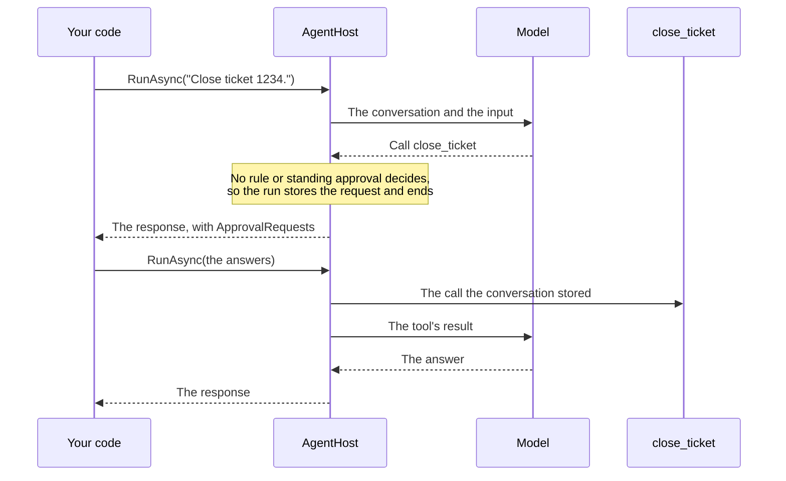

# Tool approval

A tool that must not run unsupervised, such as closing a ticket or refunding an invoice, asks the host first. When the
model calls it, the run ends with an approval request, and the host answers in the conversation's next run. Approval
rules and standing approvals decide the calls you are sure about, so the host is asked only about the rest. Typeshift
uses Microsoft.Extensions.AI's approval contents, `ToolApprovalRequestContent` and `ToolApprovalResponseContent`.

::: tip The short version

- `RequiresApproval()` marks a tool. When the model calls it and nothing else decides, the run ends with the call in
  `ApprovalRequests`.
- Answer each request in the conversation's next run. The call that runs is the one the conversation stored.
- `ApproveForConversation()` approves a tool for the rest of the conversation.
- Approval rules decide before the host is asked. A rejection wins over every approval.
- The [mode](./modes.md) decides the rest: the default mode asks the host, auto mode runs the call.

:::

## The round trip



Your code runs the agent, and the model calls `close_ticket`, which requires approval. No rule or standing approval
decides that call, so the run stores the request in the conversation and ends. Your code answers in the conversation's
next run. The stored call runs, and the model reads its result and answers.

## Requiring approval

`RequiresApproval()` in a tool's declaration makes every call of that tool ask:

<!-- snippet: approval-tool -->
<a id='snippet-approval-tool'></a>
```cs
AddTool(CloseTicketAsync)
    .RequiresApproval();
```
<sup><a href='https://github.com/weboost-at/Typeshift/blob/main/samples/Typeshift.Samples.Docs/Tickets/TicketToolset.cs#L24-L27' title='Snippet source file'>snippet source</a> | <a href='#snippet-approval-tool' title='Start of snippet'>anchor</a></sup>
<!-- endSnippet -->

`UseMcpServer(...).RequiresApproval()` asks before every tool of an MCP server; see [MCP servers](./mcp.md). A tool a
[context provider](./context-providers.md) adds asks when it is wrapped in `ApprovalRequiredAIFunction`.

## A run that asks

When the model calls such a tool, the run ends with the call unmade. `ApprovalRequests` on the response lists what waits
for approval, each with the tool's name and the arguments the model sent:

<!-- snippet: approval-run -->
<a id='snippet-approval-run'></a>
```cs
var answer = await support.RunAsync("Close ticket 1234.", conversationId: conversationId);

foreach (var request in answer.ApprovalRequests)
    if (request.ToolCall is FunctionCallContent call)
        Console.WriteLine($"Approve {call.Name}({string.Join(", ", call.Arguments!.Values)})?");
```
<sup><a href='https://github.com/weboost-at/Typeshift/blob/main/samples/Typeshift.Samples.Docs/Scenarios/Approval.cs#L16-L22' title='Snippet source file'>snippet source</a> | <a href='#snippet-approval-run' title='Start of snippet'>anchor</a></sup>
<!-- endSnippet -->

Calls in the same response that need no approval wait too. They run once the host has answered.

A run that asks needs a [conversation](./conversations.md) to store the request in. A run without a conversation id
throws, naming the tool. Run with a conversation id, approve the calls with a rule, or run in auto mode.

## Approving or rejecting

The next run of the conversation answers each request with `CreateResponse(approved)`:

<!-- snippet: approval-resume -->
<a id='snippet-approval-resume'></a>
```cs
var approvals = answer.ApprovalRequests.Select(request => request.CreateResponse(approved: true));

var approval = new ChatMessage(ChatRole.User, [.. approvals]);

var resumed = await support.RunAsync(approval, conversationId: conversationId);
```
<sup><a href='https://github.com/weboost-at/Typeshift/blob/main/samples/Typeshift.Samples.Docs/Scenarios/Approval.cs#L24-L30' title='Snippet source file'>snippet source</a> | <a href='#snippet-approval-resume' title='Start of snippet'>anchor</a></sup>
<!-- endSnippet -->

Approved calls run. A rejected call reaches the model as rejected, with the reason if the answer gives one. Then the run
goes on.

Typeshift matches each answer to the request the conversation stored. So the call that runs is the one the host saw,
arguments included, whatever call the answer carries. An answer to no stored request is dropped, and a request keeps its
first answer.

::: warning A request left unanswered is dropped
The next run drops every stored request it has no answer for, so the model sees that call as never made. Answer every
request in `ApprovalRequests` in the same run.
:::

## Approving for the conversation

`ApproveForConversation()` approves the call and every later call of the same tool in the conversation. The approval is
stored with the conversation, so it holds across runs and processes:

<!-- snippet: approval-for-conversation -->
<a id='snippet-approval-for-conversation'></a>
```cs
var always = new ChatMessage(ChatRole.User, [again.ApprovalRequests[0].ApproveForConversation()]);

await support.RunAsync(always, conversationId: conversationId);
```
<sup><a href='https://github.com/weboost-at/Typeshift/blob/main/samples/Typeshift.Samples.Docs/Scenarios/Approval.cs#L37-L41' title='Snippet source file'>snippet source</a> | <a href='#snippet-approval-for-conversation' title='Start of snippet'>anchor</a></sup>
<!-- endSnippet -->

## Approval rules

A rule decides calls before the host is asked. It approves what you trust, rejects what you never allow, and abstains on
the rest. Register it with `WithApprovalRule<T>()`. Typeshift resolves it from the run's services:

<!-- snippet: approval-rule-registration -->
<a id='snippet-approval-rule-registration'></a>
```cs
services.AddTypeshift()
    .WithApprovalRule<ShellGuard>();
```
<sup><a href='https://github.com/weboost-at/Typeshift/blob/main/samples/Typeshift.Samples.Docs/Scenarios/Registration.cs#L61-L64' title='Snippet source file'>snippet source</a> | <a href='#snippet-approval-rule-registration' title='Start of snippet'>anchor</a></sup>
<!-- endSnippet -->

Every rule sees every call that requires approval, with the arguments the model sent. So a rule decides on exactly the
call that runs. This one rejects the shell commands it never allows:

<!-- snippet: approval-rule -->
<a id='snippet-approval-rule'></a>
```cs
internal sealed class ShellGuard : IToolApprovalRule
{
    private static readonly string[] Never = ["sudo", "rm -rf", "curl", "wget", "ssh"];

    public ValueTask<ToolDecision> DecideAsync(FunctionCallContent call, AgentRun run, CancellationToken ct) =>
        ValueTask.FromResult(call is { Name: "run_command", Arguments: { } arguments }
            && arguments["command"] is string command
            && Never.Any(command.Contains)
                ? ToolDecision.Reject("This command is never allowed here.")
                : ToolDecision.Abstain);
}
```
<sup><a href='https://github.com/weboost-at/Typeshift/blob/main/samples/Typeshift.Samples.Docs/Hosting/ShellGuard.cs#L5-L17' title='Snippet source file'>snippet source</a> | <a href='#snippet-approval-rule' title='Start of snippet'>anchor</a></sup>
<!-- endSnippet -->

| Decision | Means |
|---|---|
| `ToolDecision.Reject(reason)` | The call is rejected in every mode, and the model receives the reason. A rejection wins over every approval. |
| `ToolDecision.Approve` | The call runs, unless another rule rejects it. |
| `ToolDecision.Abstain` | No opinion. Another rule, a standing approval or the [mode](./modes.md) decides: the host is asked in the default mode, the call runs in auto mode. |

::: danger Approve only what you can read in full
A command that looks harmless may run code the model wrote. So the rule above only rejects, and leaves the rest to the
host. See [the shell](./built-in-toolsets.md#shell).
:::

## Related

- [Plan and auto modes](./modes.md): what a run offers, and what happens when no rule decides.
- [Built-in toolsets](./built-in-toolsets.md#shell): the shell, which asks before every command.
- [Conversations](./conversations.md): where the requests and the standing approvals are stored.
- [Long-running agents](./long-running-agents.md): keeping a long run going without asking for every call.
- [How a run works](./how-a-run-works.md): where approval sits among a run's steps.
