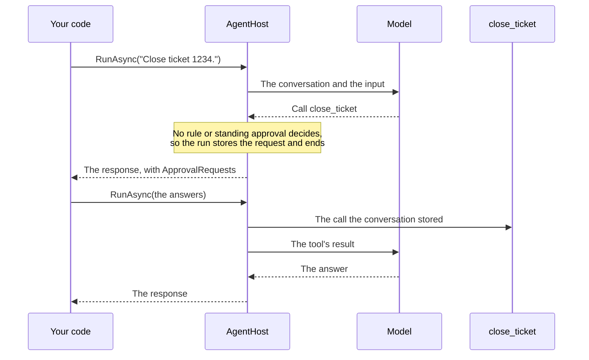

# Approval and modes

Some tools must not run unasked, such as closing a ticket. When the model calls one, the run stops and asks the host.
Rules and the run's mode decide which calls need asking at all.

## The round trip



No rule or standing approval decides the call to `close_ticket`, so the run stores the request and ends, and the
stored call runs once the next run approves it. Requests and answers are Microsoft.Extensions.AI's
`ToolApprovalRequestContent` and `ToolApprovalResponseContent`.

## Requiring approval

`RequiresApproval()` makes every call of a tool ask:

<!-- snippet: approval-tool -->
<a id='snippet-approval-tool'></a>
```cs
AddTool(CloseTicketAsync)
    .RequiresApproval();
```
<sup><a href='https://github.com/weboost-at/Typeshift/blob/main/samples/Typeshift.Samples.Docs/Tickets/TicketToolset.cs#L24-L27' title='Snippet source file'>snippet source</a> | <a href='#snippet-approval-tool' title='Start of snippet'>anchor</a></sup>
<!-- endSnippet -->

`UseMcpServer(...).RequiresApproval()` does the same for every tool of an [MCP server](./mcp.md). A tool that a
[context provider](./middleware.md#context-providers) adds asks when it is wrapped in `ApprovalRequiredAIFunction`.

## A run that asks

When the model calls such a tool, the run ends with the call unmade. `ApprovalRequests` on the response lists each
waiting call, with the tool's name and the arguments the model sent:

<!-- snippet: approval-run -->
<a id='snippet-approval-run'></a>
```cs
var answer = await support.RunAsync("Close ticket 1234.", conversationId: conversationId);

foreach (var request in answer.ApprovalRequests)
    if (request.ToolCall is FunctionCallContent call)
        Console.WriteLine($"Approve {call.Name}({string.Join(", ", call.Arguments!.Values)})?");
```
<sup><a href='https://github.com/weboost-at/Typeshift/blob/main/samples/Typeshift.Samples.Docs/Scenarios/Approval.cs#L16-L22' title='Snippet source file'>snippet source</a> | <a href='#snippet-approval-run' title='Start of snippet'>anchor</a></sup>
<!-- endSnippet -->

Calls of the same response that need no approval wait too, and run once the host has answered.

Asking needs a [conversation](./conversations.md) to store the request in. A run without a conversation id throws,
naming the tool, so run with one, approve the calls with a rule, or use [auto mode](#auto-mode).

## Approving or rejecting

Answer each request in the conversation's next run with `CreateResponse(approved)`:

<!-- snippet: approval-resume -->
<a id='snippet-approval-resume'></a>
```cs
var approvals = answer.ApprovalRequests.Select(request => request.CreateResponse(approved: true));

var approval = new ChatMessage(ChatRole.User, [.. approvals]);

var resumed = await support.RunAsync(approval, conversationId: conversationId);
```
<sup><a href='https://github.com/weboost-at/Typeshift/blob/main/samples/Typeshift.Samples.Docs/Scenarios/Approval.cs#L24-L30' title='Snippet source file'>snippet source</a> | <a href='#snippet-approval-resume' title='Start of snippet'>anchor</a></sup>
<!-- endSnippet -->

Approved calls run. A rejected call reaches the model as rejected, with the reason if the answer gives one, and the
run goes on.

`WithMaxToolIterations` limits the rounds of tool calls of one run. The run that asked has ended, so the calls you
approve run in the next run, which starts its own count: they run even when the run that asked had used up its
rounds. Calls that a rule, a standing approval or auto mode approves go on in the same run and count toward its
limit, and such a run may make one round more than the limit.

Typeshift matches each answer to the request the conversation stored. So the call that runs is the one the host saw,
arguments included, whatever call the answer carries. An answer to no stored request is dropped, and a request keeps
its first answer.

::: warning A request left unanswered is dropped
The next run drops every stored request it has no answer for, and the model sees that call as never made. Answer
every request in `ApprovalRequests` in the same run.
:::

## Approving for the conversation

`ApproveForConversation()` approves the call and every later call of the same tool in the conversation. It is stored
with the conversation, so it holds across runs and processes:

<!-- snippet: approval-for-conversation -->
<a id='snippet-approval-for-conversation'></a>
```cs
var always = new ChatMessage(ChatRole.User, [again.ApprovalRequests[0].ApproveForConversation()]);

await support.RunAsync(always, conversationId: conversationId);
```
<sup><a href='https://github.com/weboost-at/Typeshift/blob/main/samples/Typeshift.Samples.Docs/Scenarios/Approval.cs#L37-L41' title='Snippet source file'>snippet source</a> | <a href='#snippet-approval-for-conversation' title='Start of snippet'>anchor</a></sup>
<!-- endSnippet -->

## Approval rules

A rule decides before the host is asked. It approves what you trust, rejects what you never allow, and abstains on the
rest. Register it with `WithApprovalRule<T>()`, and Typeshift resolves it from the run's services:

<!-- snippet: approval-rule-registration -->
<a id='snippet-approval-rule-registration'></a>
```cs
services.AddTypeshift()
    .WithApprovalRule<ShellGuard>();
```
<sup><a href='https://github.com/weboost-at/Typeshift/blob/main/samples/Typeshift.Samples.Docs/Scenarios/Registration.cs#L62-L65' title='Snippet source file'>snippet source</a> | <a href='#snippet-approval-rule-registration' title='Start of snippet'>anchor</a></sup>
<!-- endSnippet -->

Every rule sees every call that requires approval, with the arguments the model sent, so it decides on exactly the
call that runs. This one rejects the shell commands it never allows:

<!-- snippet: approval-rule -->
<a id='snippet-approval-rule'></a>
```cs
internal sealed class ShellGuard : IToolApprovalRule
{
    private static readonly string[] Never = ["sudo", "rm -rf", "curl", "wget", "ssh"];

    public ValueTask<ToolDecision> DecideAsync(FunctionCallContent call, AgentRun run, CancellationToken ct) =>
        ValueTask.FromResult(call is { Name: "run_command", Arguments: { } arguments }
            && arguments["command"] is string command
            && Never.Any(command.Contains)
                ? ToolDecision.Reject("This command is never allowed here.")
                : ToolDecision.Abstain);
}
```
<sup><a href='https://github.com/weboost-at/Typeshift/blob/main/samples/Typeshift.Samples.Docs/Hosting/ShellGuard.cs#L5-L17' title='Snippet source file'>snippet source</a> | <a href='#snippet-approval-rule' title='Start of snippet'>anchor</a></sup>
<!-- endSnippet -->

| Decision | Means |
|---|---|
| `ToolDecision.Reject(reason)` | The call is rejected in every mode, and the model receives the reason. A rejection wins over every approval. |
| `ToolDecision.Approve` | The call runs, unless another rule rejects it. |
| `ToolDecision.Abstain` | No opinion. Another rule, a standing approval or the [mode](#the-three-modes) decides: the default mode asks the host, auto mode runs the call. |

::: danger Approve only what you can read in full
A command that looks harmless may run code the model wrote. That is why the rule above only rejects and leaves the
rest to the host. [The shell](./built-in-toolsets.md#shell) has the details.
:::

## The three modes

Every run is in one of three modes. The mode decides which tools the model is offered and what happens to the tools
that require approval:

| Mode | Offers | Tools that require approval |
|---|---|---|
| `Default` | every tool | ask the host, unless a rule or a standing approval decides |
| `Plan` | read-only tools and `exit_plan_mode` | offered only if also `ReadOnly()`; they still ask |
| `Auto` | every tool | run without asking, unless a rule rejects the call |

## Setting the mode

The mode is a [run option](./defining-agents.md#run-options). The agent's code sets the mode runs start in, `Default`
unless set, and `Configurable(r => r.Mode)` lets stored settings or a run change it:

<!-- snippet: switch-mode -->
<a id='snippet-switch-mode'></a>
```cs
var plan = new TriageAgent.Settings { Mode = AgentMode.Plan };

var planned = await triage.RunAsync("Sort out ticket 1234.", settingsId, conversationId, plan);
```
<sup><a href='https://github.com/weboost-at/Typeshift/blob/main/samples/Typeshift.Samples.Docs/Scenarios/Modes.cs#L16-L20' title='Snippet source file'>snippet source</a> | <a href='#snippet-switch-mode' title='Start of snippet'>anchor</a></sup>
<!-- endSnippet -->

A conversation keeps its mode. A run that names no mode continues in the mode the conversation's last run ended in,
and a run whose settings name one switches the conversation to it.

::: warning A conversation stays in the mode it ended in
After the host approves a plan with `ApprovePlan(AgentMode.Auto)`, later runs of the conversation run in auto mode,
whatever mode the agent's code starts runs in. Pass a mode in a run's settings to switch back.
:::

## Plan mode

Plan mode lets the model research and propose a plan before it changes anything, so the host approves the whole plan
once instead of each step. The model sees only the tools marked `ReadOnly()`, a toolset's or an
[MCP server's](./mcp.md), plus its [sub-agents](./multi-agent.md#sub-agents) and `exit_plan_mode`, and Typeshift adds
a short instruction to research, then present the plan. A sub-agent called in plan mode sees only its own read-only
tools and answers its caller, which presents the plan.

`exit_plan_mode(plan)` ends the run with an approval request that carries the plan:

<!-- snippet: plan-mode -->
<a id='snippet-plan-mode'></a>
```cs
var proposal = planned.ApprovalRequests.Single();

if (proposal.ToolCall is FunctionCallContent { Arguments: { } arguments })
    Console.WriteLine(arguments["plan"]);
```
<sup><a href='https://github.com/weboost-at/Typeshift/blob/main/samples/Typeshift.Samples.Docs/Scenarios/Modes.cs#L22-L27' title='Snippet source file'>snippet source</a> | <a href='#snippet-plan-mode' title='Start of snippet'>anchor</a></sup>
<!-- endSnippet -->

Approve it with `ApprovePlan(mode)` to continue in the mode the host picks, `Default` or `Auto`. Reject it with a
reason, and the model goes back to planning with that feedback:

<!-- snippet: approve-plan -->
<a id='snippet-approve-plan'></a>
```cs
var approval = new ChatMessage(ChatRole.User, [proposal.ApprovePlan(AgentMode.Auto)]);

await triage.RunAsync(approval, settingsId, conversationId);
```
<sup><a href='https://github.com/weboost-at/Typeshift/blob/main/samples/Typeshift.Samples.Docs/Scenarios/Modes.cs#L29-L33' title='Snippet source file'>snippet source</a> | <a href='#snippet-approve-plan' title='Start of snippet'>anchor</a></sup>
<!-- endSnippet -->

::: warning Plan mode hides every tool without the mark
A tool without `ReadOnly()` is hidden in plan mode, whatever it does. Mark every tool that only reads, so the model can
research with it.
:::

## Auto mode

In auto mode, tools that require approval run without asking. Rules still see each such call first, and a rule that
rejects it wins.

::: danger Auto mode is as safe as your rules
Every call that requires approval runs in auto mode unless a rule rejects it. Guard it with
[approval rules](#approval-rules), for example a guard that never lets `sudo` through, or a classifier that asks a
model.
:::

## Related

- [Built-in toolsets](./built-in-toolsets.md#shell): the shell, which asks before every command.
- [Conversations](./conversations.md): where requests, standing approvals and the mode are stored.
- [Agents](./defining-agents.md#run-options): the run options that set the mode runs start in.
- [MCP servers](./mcp.md): marking a server's tools read-only, so plan mode offers them.
- [How a run works](./running-agents.md#how-a-run-works): where approval sits among a run's steps.
