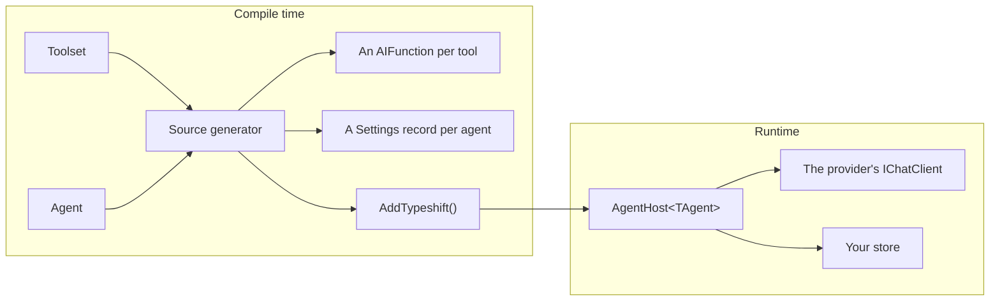

# What is Typeshift?

Typeshift is a .NET library for AI agents that you define in code. You write each tool as a static method with XML
docs and each agent as a small class that names its model, its instructions and its tools. A source generator turns
them into what Microsoft.Extensions.AI runs, so a mistake such as configuring a tool the agent doesn't offer fails
the build, and an analyzer reports others while you type.

::: warning Typeshift is in alpha
The API may change between releases. The [changelog](https://github.com/weboost-at/Typeshift/blob/main/CHANGELOG.md)
lists what changed in each release, and [Known gaps](../contributing/status.md#known-gaps) lists what is open.

These pages describe the `main` branch, so they can be ahead of the package you installed. The version beside the
Typeshift logo is the newest package.
:::

## Why agents in code

An agent is code you review, version and test like the rest of your app. Its tools are methods the compiler checks,
and what may change at runtime is a typed `Settings` record that Typeshift generates from what you mark configurable.
Your customers can store their own instructions or a lower search limit, and the code decides which values they may
touch.

The cost is that an agent cannot be created at runtime, for example from a prompt your users write. Stored settings and
[context providers](./middleware.md#context-providers) cover most of what such agents are used for: instructions per
customer, memory, documents and tools added to a run.

## What it builds on

Typeshift runs on [Microsoft.Extensions.AI](https://learn.microsoft.com/dotnet/ai/microsoft-extensions-ai). A model is
any `IChatClient`, from OpenAI, Anthropic, a local server or your own wrapper. Tools are `AIFunction`s, a run's options
are `ChatOptions`, and the tool loop is `FunctionInvokingChatClient`. What a run returns is a `ChatResponse`. Spans and
metrics follow the OpenTelemetry conventions for generative AI, and an app can publish with Native AOT.

## Compared with writing it by hand

Everything Typeshift does, you could write on Microsoft.Extensions.AI yourself. This is what you would write:

| By hand | With Typeshift |
|---|---|
| An `AIFunctionFactory.Create` call per tool, and its description kept in step with the method | A static method with XML docs; the schema and description are generated |
| Values the model must not choose, such as a search limit, passed around by hand | A settings record the tool receives and the model never sees, layered from code, storage and the run |
| A `ChatOptions` per agent, and code that picks the client for its provider | `WithChatOptions().WithModel(...)` and a registered `IChatClient` |
| Storing the history between requests, and resuming after a crash | A conversation id on the run |
| Asking a person before a call that closes a ticket | `RequiresApproval()`, approval rules, and plan and auto modes |
| Agents that call each other, or hand a conversation on | `UseAgent<T>()` and `UseHandoff<T>()` |
| Registration for each of the above | `services.AddTypeshift()` |

## How the pieces fit

`AddTypeshift()` registers an `AgentHost<TAgent>` per agent. The host resolves the settings, calls the model, runs the
tools and stores the conversation. [How Typeshift reads your code](./how-typeshift-reads-your-code.md) explains the
compile-time half, and [How a run works](./how-a-run-works.md) the steps of a run.

| Piece | What it is | Read |
|---|---|---|
| Toolset | A `partial` class deriving from `Toolset` that declares a group of related tools | [Toolsets](./toolsets.md) |
| Tool settings | A record of values a tool needs that the model must not choose | [Tool settings](./tool-settings.md) |
| Agent | A `partial` class deriving from `Agent`, with chat options, instructions and tools | [Agents](./defining-agents.md) |
| Agent host | `AgentHost<TAgent>`, which runs one agent in a scope: the one it was resolved from, or the one the runtime created for it | [Using an agent](./using-an-agent.md) |
| Store | Your `ITypeshiftStore<TId>`, or an `ISettingsStore<TId>` and an `IConversationStore<TId>`, which keep settings and conversations under ids of your type; an `IAgentSettingsStore` for each agent's own settings | [Settings and stores](./settings-and-stores.md) |

The [glossary](./glossary.md) defines every other term.

## What Typeshift leaves to you

- **The model.** You register the `IChatClient` of your provider; Typeshift ships no provider SDK.
- **Your app.** Typeshift runs inside ASP.NET Core, a worker or a console app, and serves no endpoints of its own.
  [Serving a chat endpoint](./chat-endpoint.md) shows the few a chat UI needs.
- **Your database.** `InMemoryTypeshiftStore<TId>` serves tests and samples. For settings and conversations that must
  survive a restart, you write a [store](./implementing-a-store.md) over your own database.
- **Search over your documents.** A [context provider](./middleware.md#context-providers) adds what your own search
  returns to a run.

## Before you ship

Typeshift's defaults get a first run going, and some of them suit a demo better than an app with customers. Before
you ship, your app has to do these things itself:

- Register a store for everything that must survive a restart
  ([Which store serves a call](./implementing-a-store.md#which-store-serves-a-call)).
- Check the caller before you run, watch or steer a conversation by an id from a request
  ([Conversation ids](./conversations.md#conversation-ids)).
- Filter the tracker's `Runs` and `WatchRunsAsync` by the caller before you return them
  ([Live runs](./conversations.md#live-runs)).
- Mark as configurable only what a customer may change ([Precedence](./settings-and-stores.md#precedence)).
- Decide which tool calls wait for a person, and write your rules before a run goes in auto mode
  ([Approval and modes](./tool-approval.md)).
- Treat the tools of an MCP server you do not control as untrusted, and mark a server `ReadOnly()` only when its
  tools change nothing ([How the agent offers the tools](./mcp.md#how-the-agent-offers-the-tools)).
- Keep secrets out of the messages of the exceptions your tools throw ([Results](./toolsets.md#results)).
- Make tools with side effects safe to repeat ([Resuming](./conversations.md#resuming)).
- Turn compaction on for agents whose conversations grow long ([Compaction](./conversations.md#compaction)).
- With several processes, keep each conversation to one run at a time yourself
  ([One run at a time](./conversations.md#one-run-at-a-time)).
- Read API keys from your app's configuration, never from code ([A real client](./models.md#a-real-client)).
- Watch your logs or spans for saves that failed ([Spans](./observability.md#spans)).
- Capture message content in traces only where your tracing backend may keep it
  ([Message content](./observability.md#message-content)).
- Resolve each host from a scope or take it from the runtime, never from the root provider
  ([Run from a console app](./using-an-agent.md#run-from-a-console-app)).

## Related

- [Getting started](./getting-started.md): a first toolset, agent and run, in four steps.
- [Agents](./defining-agents.md): everything an agent's constructor can declare.
- [How Typeshift reads your code](./how-typeshift-reads-your-code.md): what is read when you build, and what that gives you.
- [Glossary](./glossary.md): the words these docs use.
